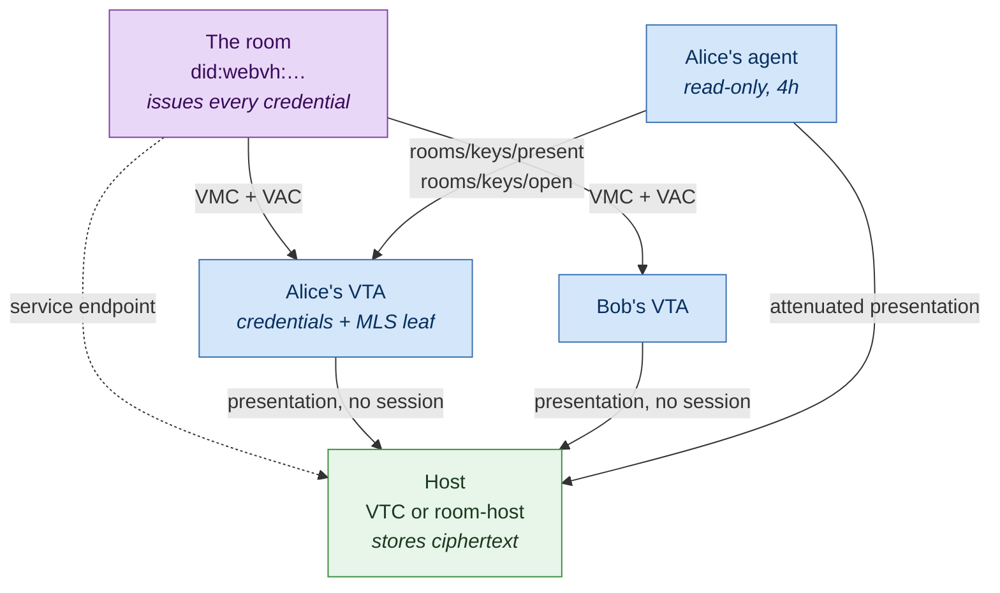
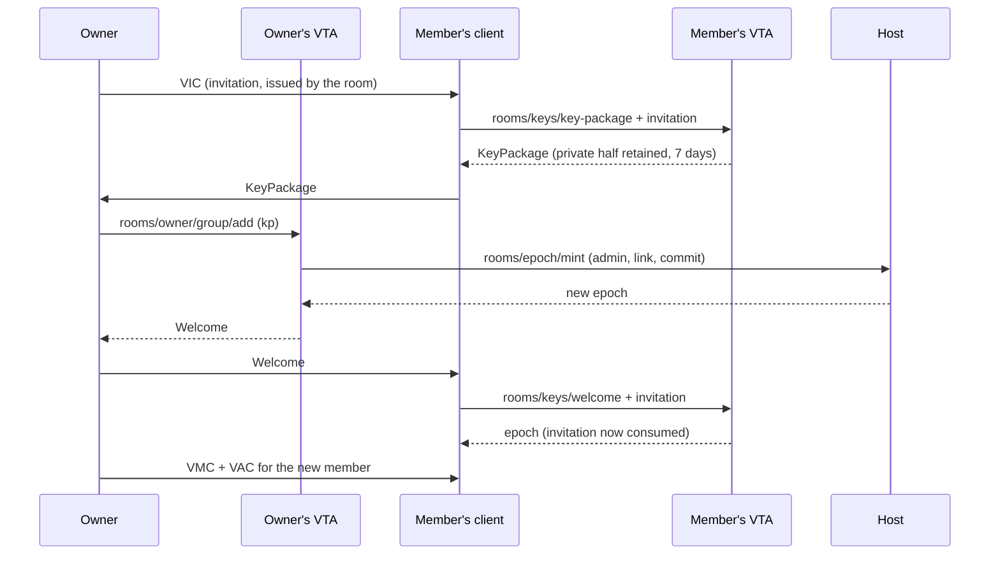

# Data rooms — creating one, and keeping it

A **data room** is a shared space — a set of records — readable and writable by
exactly the parties its credentials admit, for the humans in it and for their AI
agents. It is not a row in some service's table: a room has its own DID, issues
its own credentials, and can move from one host to another without a single
credential being reissued.

This guide is the operator's path through that: what you assemble, which of the
four topologies you are building, and every verb you will use afterwards.

> **Design and rationale** live in
> [`../05-design-notes/data-rooms.md`](../05-design-notes/data-rooms.md) — the
> four topologies, the visibility ladder, why MLS, why the host never decides.
> The security reviews are
> [v2](../05-design-notes/data-rooms-security-review-v2.md) (current) and
> [v1](../05-design-notes/data-rooms-security-review-v1.md). This guide does not
> repeat the arguments; it tells you which commands and calls make them true.
>
> **A running walkthrough** ships as an example:
> `cargo run -p room-host --example data_room`. It starts a real host on a real
> port, signs real credentials, and drives four acts against it. Read it beside
> this guide — every mechanic below appears there, executable.

---

## 1. What a room is made of

Five pieces. Getting them straight up front saves most of the confusion later,
because three of them are commonly assumed to be one thing.

| Piece | What it is | Who holds it |
|---|---|---|
| **The room** | A DID (`did:webvh`, ideally witnessed). Its identifier **is** the `roomId`. It issues every credential in the room. | Controlled by the **owner** |
| **The host** | Stores records and answers `rooms/*` Trust Tasks. Holds no member list and could not consult one. | A VTC, or the `room-host` binary |
| **The member's VTA** | Holds the member's room credentials, their MLS group state, and acts as an oracle for their agents. | Each member, separately |
| **The credentials** | VIC to enter once, VMC to prove membership, VAC for what you may do. All issued **by the room**. | Each member's VTA |
| **The MLS group** | The group-key layer on the sealed tiers. One leaf per member — the member's VTA, not their devices. | Each member's VTA |



**The one rule everything else follows from:** a room operation is authorized by
the credential chain the room issued, verified against the room's own DID. Never
by the host's ACL, never by a session, never by a roster. That is what lets a
room change hosts by re-pointing a service endpoint — and it is why every call
below carries a presentation rather than a bearer token.

---

## 2. What works today

Rooms are implemented across `vti-rooms`, `vti-rooms-dtg`, `room-host`,
`vtc-service` and `vta-service`. Not everything in the design note is built, and
knowing which half you are standing on saves an afternoon.

| | State |
|---|---|
| `open` and `attributed` rooms | **Serve.** Create, records, curate, epoch mint, transfer, claim |
| `private` rooms | **Store but refuse to serve.** The same-subject binding needs a ZK profile the DTG working group has not settled; `vti-rooms-dtg` refuses rather than guessing, so a VTC and a room host cannot disagree about it |
| MLS group layer, record sealing | **Work** (`vti-rooms` `mls` feature) — create, add/remove, commit, exporter-derived storage keys |
| VTA custody: `rooms/keys/{key-package,welcome,commit,open,seal,chain,backfill,list}` | **Work.** A member's VTA holds the group, seals and opens records for their agents, and can fetch a room's epoch chain from the host itself |
| The presentation oracle: `rooms/keys/present` | **Works.** Attenuates the member's own VAC for an agent |
| Succession: nomination, transfer, claim | **Work**, including the "renewing defeats a pending claim" property |
| **A CLI** | **`pnm rooms {list,get,put,curate,renew,prune,file}`** — the member's surface, driven through the oracle so the CLI holds no room credentials and no group key; `put` seals on `attributed` and `private` (§9). **`pnm rooms owner {register,invite,issue-membership,issue-authority,group-create,group-add,group-remove,group-renew,revoke}`** — the owner's, run by the owner's VTA. **`pnm rooms keys {key-package,welcome,commit,list}`** — the joiner's key holder. A sealed room can be run end to end from the CLI (§5, §6) |
| **Credential issuance** | **Works, on the owner's own VTA.** `rooms/owner/{invite,issue-membership,issue-authority}` mint the VIC, VMC and VAC in the *room's* name, signing through the gated key oracle so the room's key never materialises (§5.3). `pnm rooms owner {invite,issue-membership,issue-authority}` drive them, over `VtaClient::room_owner_*` |
| **The owner's MLS half** | **Works, in the owner's VTA.** `rooms/owner/group/create` founds the group with the owner as its only member; `rooms/owner/group/add` admits a member's KeyPackage, advances the room's epoch at its host first, and returns the Welcome to deliver; `rooms/owner/group/remove` (0.3, and 0.2) withdraws the member's credentials at the host and then drops their leaf, host first; `rooms/owner/revoke` withdraws credentials alone, signed as the room; `rooms/owner/group/renew` renews a sealed room with a commit that changes no membership, host first. `pnm rooms owner group-create` / `group-add` / `group-remove` / `group-renew` drive them (§5.4, §6, §10.1) |
| **A browser as a member** | **Works.** `vti-rooms-wasm` compiles the member half — group custody, sealing, opening, the epoch chain — to WebAssembly; `room-host --allow-origin` is what lets a page reach a host at all. No key ever crosses into JavaScript |
| **Governance (`rooms.rego`)** | **On a VTC.** A community decides who may create a room on it, in Rego, with the shipped default hosting `open`/`attributed` for its own members. A standalone `room-host` has no policy engine — T1's governance is its owner (§8.4) |
| **Read mirrors** (T3) | **`room-host --mirror-config`** — a host serves a read-only copy fed by `sinceVersion` pulls and refuses every write, naming the primary. A mirror pulls **as a member**, presenting a room-issued `read` chain |
| **Reading across a membership change** | **Works, including for a member who has just joined.** Records are sealed per epoch, and the *epoch key chain* carries a member back across every advance. The owner hands each rung to the host on `rooms/epoch/mint`; a joiner fetches the chain with `rooms/epoch/chain` and reads everything the room retains. Rungs are ciphertext — the key that opens one is a storage key no host holds |
| **An agent reading history through its VTA** | **Works.** `rooms/keys/open` resolves from the chain the VTA holds, which it accrues from every commit it applies — and a member who *joined* fills the rest with `rooms/keys/chain/0.1`, handing their own VTA the rungs they fetched from the host. The response says how far back it can now read, which is the only number worth having: a rung extends reach only if every rung above it is present too |
| **Cryptographic deletion** | **At the host only.** `rooms/epoch/prune/0.1` (`admin`) erases the epoch key chain below an epoch at a host, so history sealed under those epochs can no longer be derived by anyone who has not already derived it — a member restarting, on a new device, or joining later. Both hosts serve it (audited `room.epoch.prune`, `notAhead` for a floor at the current epoch); `pnm rooms prune` sends it, warns, and asks first (§10.4). **It does not reach members:** a member's VTA that already walked the chain keeps the keys it derived, so today a prune is not a deletion of anything a member already holds. Reaching members' key holders needs a specification change, being drafted separately |
| **Witnessed renewal anchoring** | **Blocked on a decision**, not on effort: §9 says a renewal anchors the epoch authenticator and version watermark in the room's witnessed log, but not *where in the log entry*. See [`epoch anchoring`](../05-design-notes/data-rooms-epoch-anchoring.md) |

---

## 3. Choose a topology

The room protocol is identical in all four. What differs is **where the room
lives and who governs creation** — never what a room is.

| | Room lives on | Members come from | Governed by | You deploy |
|---|---|---|---|---|
| **T1 Personal** | your own `room-host` | anyone you invite | you | the `room-host` binary (§8.1) |
| **T2 Community** | a VTC | that community, typically | the community | nothing — a VTC already serves `rooms/*` (§8.2) |
| **T3 Cross-community** | one home host | any communities' members | the home host | nothing beyond T2 (§8.3) |
| **T4 Peer** | a peer's `room-host` | VRC-connected peers | the owner | the `room-host` binary (§8.4) |

Two of these are nearly free. **T3 is T2 plus nothing** — a VMC binds a member
to *the room*, so members from three communities in one room is the ordinary
case rather than a bridge. **T4 is T1 with the VRC as the door.**

Pick by asking two questions, in this order:

1. **Who must not be able to read it?** If the answer includes the host, you are
   on `attributed` (§4), and the room's DID should be owner-controlled.
2. **Who is accountable for it existing?** That party is the owner. If it is a
   community, use T2. If it is a person, use T1 — a personal host is governed by
   its owner, and that sentence is the whole policy model.

---

## 4. Choose a visibility tier

Fixed at creation, for the life of the room. You cannot un-see cleartext, so a
downgrade is meaningless and an upgrade would protect only what came after while
presenting as though it protected everything.

| | `open` | `attributed` | `private` |
|---|---|---|---|
| Record bodies, titles | cleartext | encrypted | encrypted |
| Which member is acting | visible to the host | visible to the host | unlinkable proof |
| Server-side search | ✅ | ❌ | ❌ |
| Per-member access log at the host | ✅ | ✅ | ❌ |
| Recoverable from the host's backup alone | ✅ | ❌ | ❌ |
| **Serves today** | ✅ | ✅ | ❌ (§2) |

The ladder measures **the host, whoever that is**. On a room you host yourself,
you-as-host see everything and already know the membership — you issued it — so
the ladder largely collapses. Owner-hosting is not automatically the more
private choice; a neutral host that *cannot* read is a real alternative.

On the sealed tiers, **record keys must be opaque**. A key reading
`decision/acquire-northwind` defeats the encryption sitting beside it — use
`SealedRoom::opaque_key()` and put structured naming inside the sealed body.

---

## 5. Create a room

Four steps. Steps 1 and 3 are the owner's own work; only step 2 touches a host.

### Who the member is: a persona, never the client

**In a room, every member — the owner included — is one persona DID**: a DID
your VTA holds for you in one of your trust contexts, typically a `did:webvh` it
minted there (or a `did:key` whose key it derived). That one DID is the
invitation's subject, the identity on your MLS leaf, the subject of your VMC and
VAC, the owner a host records, and the signer of every leaf your VTA narrows
your authority into. One persona per member per room.

**The interface you happen to be using never appears.** A `pnm` session, a
wallet extension or an agent authenticates to your VTA with a `did:key` whose
key lives in that client. Your VTA cannot sign as it, it changes when the client
is reinstalled, and a person with two clients would be two members — so no room
path accepts it as a member. What a client must be able to do is **act in the
context that holds the persona**; that is the whole of the check, and it is
applied the same way everywhere (`vta_service::operations::persona`):

- a `did:webvh` your VTA minted: you act in its context, and its key is the
  first `assertionMethod` key of its own published log held in that context;
- a `did:key`: your VTA holds its key, in a context you act in.

A persona held in a context you cannot act in is refused in exactly the words
used for a DID your VTA does not hold at all, so a refusal never tells you whose
personas live there. The VTA's own DID is **not** a persona: it is shared by
everyone the VTA serves, and a room that named it would link all of their rooms.

**One VTA, several members of one room.** A VTA serving several people — a
family, a team on a company VTA — may hold several personas in the same room.
Each is a different MLS leaf, so the VTA keeps everything it holds for a room
**per member**, keyed by (room, persona): the group state, a pending
KeyPackage, the one pending advance, the epoch chain and the root memory.
Which member a call acts as comes from the call itself — the invitation's
subject for `key-package` and `welcome`, the persona whose credentials are
presented for `read` / `browse` / `backfill` / `anchor` and the owner group
tasks — and otherwise is the **one** persona you may act as that holds the
room (`open`, `seal`, `file-key`, `commit`, `chain`, `list`). If you act in
several contexts each holding the room, act from the context of the one you
mean, or **name it**: `ext["org.openvtc.rooms"].member` on `read`, `browse`,
`backfill`, `open`, `seal` 0.1, `file-key`, `commit` and `chain` names the
persona to act as (it only narrows: a persona you may not act as is the same
"no group state" as one nobody here holds), and `rooms/keys/act` takes it as
the document's `issuer`. `rooms/keys/list` lists a room once per member: at
0.2 each entry names its `member`, and on both versions
`ext["org.openvtc.rooms"].held`, index for index with `rooms`, carries the
`member`, the persona's `context`, and the `actions` its grant confers (0.1's
entry has no member of its own, so 0.1 clients read it there). This is
the ordinary case for an administrator whose VTA is also the community's: it
holds the community's own place in a room the community owns **and** their
own membership in it, so `pnm rooms keys list` shows the room twice, each
with `as <persona>`. A persona in a context you cannot act in is invisible: its group answers
as a room nobody here holds. A store written before this keying moves its rows
under the persona its group's own leaf identifies, the first time that
persona's caller touches the room.

### Your own name for a room (`rooms/keys/label`)

A room's DID says nothing, and the names others give it — the room's own
profile, a community's offer label — are theirs. `rooms/keys/label/0.1` keeps
**your** name for a room, with a description, notes and tags, in your VTA beside
the group state for that room and member:

```bash
pnm rooms keys list                     # each room, the member it is held as, and your label
pnm rooms keys label <room-did> --member <persona-did> \
    --label "Northwind tender" --description "Pricing room for the bid" \
    --tag work --tag bids
pnm rooms keys label <room-did> --member <persona-did> --notes "Final numbers: March folder" \
    --remove-description              # only what you name changes
pnm rooms keys label <room-did> --member <persona-did> \
    --remove-label --remove-notes --remove-tags   # the last detail gone: no label
```

- **Per room and member.** A room held as two personas has two labels; `--member`
  is required and never inferred (`pnm rooms keys list` shows the DID).
- **Patch, not replace.** Each detail given replaces the stored one, `--tag`
  replaces the whole set, absent details stay, and removing the last one removes
  the label. A repeat answers `changed: false` and moves nothing, so the task is
  safe to retry as it is.
- **Who may.** The `roomOpen` capability, and acting as the member. A room you do
  not hold as that member and a member you do not act as are the same
  `rooms/keys/label:notHeld`. A delegate (an AI agent or mediator entry — the kind
  `rooms/keys/present` equips) is `permissionDenied`, and lists no rooms at 0.2.
- **Private.** The VTA sends a label to no room, host, owner or community and puts
  it in nothing it completes, signs or seals (`act`, `seal`, `present`). Its text
  is never logged or audited — the audit row (`rooms.keys.label`) names the room,
  the member and whether it changed — and neither the label response nor a 0.2
  list is kept for replay redelivery. `rooms/keys/list/0.2` returns labels only
  with `includePersonal: true`; a client passing the list on (a wallet answering
  a member portal) asks without it.
- **Kept with the group state.** In the `room_groups` keyspace, backed up with it,
  and discarded only when that member's group state is: not when a commit removes
  the member, not when the room lapses or changes host or owner.

A surface showing rooms prefers your label, then the room's profile name, then
the community's offer label, then the DID — and keeps the room's own name
visible beside yours.

Your own client never reaches a host as itself: it builds each room request
unsigned and your VTA completes it **as the persona** (`rooms/keys/act/0.3`,
§9). The one place a client DID does appear is as a *presenter* (§7): an
agent your VTA equips with a four-hour, one-action leaf narrowed **from** your
persona's grant. That leaf is a delegation, signed by your persona; the agent
is never a member of the room.

### 5.1 Mint the room's identity

The room's DID is its identifier and its credential issuer, so it must be
minted before anything else exists.

**Production shape — `did:webvh` via the `room` DID template, minted in a VTA:**

```bash
pnm did-mgmt dids create \
  --context personal \
  --template room \
  --server <webvh-server-id> \
  --var WEBVH_SERVER=https://dids.example.org \
  --var MEDIATOR_DID=did:web:mediator.example.org \
  --var 'LABEL=Northwind deal room'
```

**Keep both halves of what that prints — `DID:` and `Signing key:`.** Every
`rooms/owner/*` call names the key rather than looking it up, because nothing
maps a room's DID to the key it was minted with and a mapping invented for
convenience is one that goes stale at the first rotation. A DID without its key
id is a room that cannot invite anyone; `pnm keys list --context <id>` is the way
back if you lose it.

The template puts the signing key at `{DID}#key-1` and names it in
`assertionMethod`, which is what the VTA's room signer assumes. A room whose
document says otherwise still mints credentials — they simply verify nowhere, at
first use, loudly.

`did:webvh` rather than `did:peer` on purpose: a `did:peer` encodes its keys in
the identifier, so its controller can never change — and transferring a room is
a controller change. Set `WITNESSES` for any room whose host you do not fully
trust; witnessing is what makes a host serving a stale log *evident* rather than
merely possible.

`pnm bootstrap provision-request --template room` renders the same template and
is the shape to reach for when the room's keys must reach *another* party — it
seals them to a holder DID. It is not the shape for a room you run yourself: no
installer consumes a `room` bundle, and you do not need one, because the VTA that
minted the key can sign as the room without the key ever materialising (§5.3).

**Evaluation shape — a local `did:key`:** mint an Ed25519 key, form
`did:key:z6Mk…`, and use that as both the room's identifier and its issuing key.
`vti_rooms_dtg::test_support::RoomFixture` does exactly this, and it is what the
`data_room` example runs on.

### 5.2 Register the room with its host

```rust
use vtc_client::{VtcClient, rooms::Visibility};

// A room host mounts at the origin; a VTC's base_url includes its mount (…/v1).
let client = VtcClient::anonymous("https://rooms.example.org", host_did);

client.create_room(
    room_did,              // roomId — the room's own DID
    owner_did,             // the accountable party (invariant I1)
    Visibility::Attributed,
    Some(365),             // retentionDays after the room goes dormant
    signer_did,            // signs the Trust Task document
    signer_key_multibase,
).await?;
```

Over the wire that is one `rooms/create/0.1` document
(`vta_sdk::trust_task_sign::build_signed` builds and signs it) posted to
`/trust-tasks`. **The caller brings the `roomId`** — a room identified by
something its host chose could not move to another host without changing
identity.

Two things bite anyone hand-building these documents rather than using the
client. On a VTC the document's **`recipient` must be the VTC's own DID** — that
binding is the framework's replay defence, and a document addressed elsewhere is
rejected before it reaches a room handler. And a VTC's Trust Task endpoint rides
its governed chain, with a **64 KiB body cap**, which is the practical ceiling on
a single record there; the `room-host` binary imposes neither.

The host sets what it is entitled to set and nothing else: `epoch = 1`,
`epochExpiresAt = now + 365 days`, `retentionDays` (default **90**), and the
version counter. **Sign this one as the owner**: creation is the single verb no
chain can authorize, so the request's own proof is the check, and a signer who
is not the `ownerDid` they name is refused (§8.4).

**Through your VTA instead** — `rooms/owner/register/0.2` (0.1 on an older VTA), the way to register
on a community (VTC), and for any surface that can reach its own agent and no
host (a wallet extension, a phone):

```bash
pnm rooms owner register --room <room-did> --host-did <host-did> \
    --owner <your persona DID> --visibility attributed \
    [--retention-days 365] [--retention-policy chained]
```

The VTA sends `rooms/create` for you, and **signs it as the owner**, which is what "the key
holder speaks to the host as its principal" means. The owner (`ownerDid`, or you
when it is absent) must be your **persona** for the room (above): a `did:webvh`
the VTA minted for you or a `did:key` whose key it holds, in a context you act
in. (The VTA's own DID is still accepted here, and only here, for registrations
that predate personas.) Anything else is refused with `permissionDenied` and a
message saying to name an `ownerDid` the VTA holds — a `pnm` session's
`did:key`, whose key lives in your client, is not one. `pnm rooms owner register --owner` has no default.
On a **VTC** the owner must also be a member of the
community: its `rooms` policy decides creation against the party that signed.

**The room's revocation list goes with it.** When the VTA holds a list for the
room — a room moving hosts — it delivers it there once the host has accepted the
registration, and the answer says what became of it (trust-tasks-tf #821):

- `inForce` — the host answered with the list's head. The room is ready there.
- `pending` — the host did not answer, or answered with another head. **The host
  serves the room without its withdrawals**: every credential the room withdrew
  is honoured there until it takes the list. The VTA keeps delivering it on its
  own (one sweeper, capped back-off with jitter, the latest list each time) until
  the host takes it or refuses it; it keeps only the room, the host, the list's
  sequence and the persona that delivers it, and only until then.
- `refused` — the host refused the list, with its code. The VTA never delivers a
  refused list again on its own; a `stale` refusal (the host holds a list this VTA
  did not sign) is logged as the room's key possibly in more than one party's
  hands.

`pnm` says plainly when the list is not in force. **Never register again to fix
it** — the registration is done; deliver the list with `pnm rooms owner revoke
--room <room-did> --signing-key <room's key> --host <host-did>` and no
withdrawal. `hostUnreachable` and `hostRefused` report the registration alone. A
`0.1` request still gets 0.1's answer: a failed delivery is refused, with a
message saying the room **is** registered and naming that command.

`pnm rooms create` is the other path: it signs `rooms/create` with the CLI's own
session key, which makes that client key the owner. It is for a standalone
`room-host` and for testing; a VTC creates rooms only for its members, so use
`owner register` there. Against a VTC, either way, `--host` includes the `/v1`
mount and `--host-did` is needed — a VTC refuses a document not addressed to
its own DID.

### 5.3 Issue the owner's own credentials

The room is now registered and **nobody can do anything in it**, including you.
Authority comes from credentials the room issued, so mint two in the room's name:

- a **VMC** — the room's statement that this DID is a member;
- a **VAC** granting `read`, `write`, `curate`, `admin`.

**The VTA holding the room's key mints both**, over two Trust Tasks — the same
two an owner uses for every later member (§6):

```bash
# rooms/owner/issue-membership/0.1
pnm rooms owner issue-membership --room <room-did> --signing-key <from §5.1> \
    --subject <your persona DID> [--valid-for 365d] --out ./vmc.json --store

# rooms/owner/issue-authority/0.2
pnm rooms owner issue-authority --room <room-did> --signing-key <from §5.1> \
    --subject <your persona DID> --action read,write,curate,admin \
    --valid-for 90d --out ./vac.json --store
```

Each task returns `{ credential, credentialId }` — the signed credential, and
the id bound into its proof, which is what tells a re-send from a renewal. The
CLI writes the credential to `--out` (it never overwrites a file) and, with
`--store`, also puts it in this VTA's credential vault — the right thing when
the subject is your own persona, as here. For another member, leave `--store`
off and deliver the file. The subject is always a **persona DID** — one the
member's VTA holds for them, never a CLI's key — and has no default.

`subject` is the member's **persona** — for the owner, the same DID registered as
`ownerDid` in §5.2. A credential naming a client's `did:key` is one nobody can
present: the member's VTA holds no key to narrow it with.

Three things about that pair are load-bearing:

- **The key never materialises.** `operations::room_issuance` signs through
  `operations::keys::sign_payload`, the same gated oracle `keys/sign` uses, so
  the room's secret is loaded, used and zeroized without any caller seeing it.
- **`validUntil` is required on a VAC, and refused rather than defaulted.** A
  chain root is authority that nothing withdraws by waiting — nothing about a
  subject's standing is consulted when a chain is verified, and this stack has no
  revocation — so expiry is the whole of how a grant ends. Defaulting it would
  put a room's most consequential number somewhere its owner never looks.
- **What authorizes the call is the `credentialWrite` capability plus control of
  the key**, never a check that you are the owner. "Owner" is a fact about the
  room's DID controller and a VTA is not a DID resolver; where key and controller
  have come apart, the credential simply fails to verify. Grant it the way §7
  grants the room capabilities — `pnm acl create --did <did> … --capabilities
  credential-write` — and note what it opens: a DID holding it can admit and
  promote in any room whose signing key it can name. What narrows that is the
  key oracle's own gates — the key's context, the entry's key scope, and the
  context policy's signing limit — not the capability.

From Rust the same calls are `VtaClient::room_owner_issue_membership` and
`room_owner_issue_authority`; a wallet drives the same tasks. The library path
(`DTGCredential::new_vmc` / `new_vac`, signed with a key you hold) still works
and is what `RoomFixture` and the `data_room` example do.

A member who was sent the files stores both in their own VTA's credential vault
(`--store` did this for you above):

```bash
pnm cred-vault receive --credential-file ./vmc.json
pnm cred-vault receive --credential-file ./vac.json
```

This matters for more than tidiness: the presentation oracle (§7) finds a
member's room credentials **by issuer** — `issuer == roomId`, type
`MembershipCredential` / `AuthorityCredential` — and then keeps only those whose
**subject is a persona you may act as**. That second filter is the privilege
boundary: a credential stored without a context is visible from every context,
and its subject being someone else's persona is what keeps it theirs. It refuses
if no persona of yours holds one, if one persona holds two of a kind for one
room, or if you act in several contexts each holding a persona in the room (act
from the one you mean).

The four actions are a ladder with one deliberate break: **`curate` is not
implied by `write`.** Deciding what a room's shared knowledge is worth is a
different grant from being able to add to it. `admin` mints epochs and transfers
ownership.

### 5.4 On a sealed tier, form the MLS group

Your VTA founds the group, with you as its only member
(`rooms/owner/group/create/0.1`):

```bash
pnm rooms owner group-create --room <room-did> --signing-key <key id from §5.1> \
    --member <your persona DID>
```

The entitlement is the same as issuing the room's credentials: control of its
signing key. `pnm` requires `--member`; over the Trust Task it may be omitted.
`member` is the DID your leaf identifies — your **persona**, the
subject of your room credentials — and must be one you may act as. Absent, the
VTA uses the persona its credentials from this room name (§5.3), and if it holds
none it asks you to name `--member` rather than founding the group on the
`did:key` `pnm` authenticates as. A VTA that already holds the room's group
refuses (`alreadyExists`) rather than replacing the key schedule its sealed
records depend on.

Register the room first (§5.2): a refused registration then costs nothing to
retry.

**The room's epoch is the MLS epoch plus one** — MLS counts from 0, a room from
1 — so a group you have just founded is already at the epoch the host recorded
when it registered the room, and nothing needs minting yet. The task answers
`epoch: 1`; an off-by-one here would seal records under an epoch the host
rejects, and the failure would read as a key problem rather than an arithmetic
one.

After that, every membership change moves the group and the number has to follow
(§6, §10.1). The host never learns the key — minting an epoch is an `admin`
chain saying a number, not a key exchange.

---

## 6. Add a member

Joining is a **two-party act**. Without an invitation step the owner could seal a
room key into your VTA and you would simply be *in*, holding keys to material
you never agreed to hold. The VIC is that second party's half, and it is
enforced, not ceremonial.



Step by step:

1. **The owner issues a VIC** naming the joiner's **persona** — the DID the
   joiner's VTA holds for them, never the client they use — from the room's key
   (`rooms/owner/invite/0.1` — `roomId`, `signingKeyId`, `subject`,
   `validUntil`), and delivers it — DIDComm on a sealed room, because a
   server-side invitation store would hand the host the membership at invite
   time:

   ```bash
   pnm rooms owner invite --room <room-did> --signing-key <key id> \
       --subject <joiner's persona DID> --valid-for 7d --out ./invite.json
   ```

2. **The joiner's VTA mints a KeyPackage** (`rooms/keys/key-package/0.1`,
   invitation required) whose leaf identifies the persona the invitation names.
   Whoever delivers the invitation must act in that persona's context; who they
   are does not otherwise matter, and their DID is not the member's. Minting retains a private key against a Welcome that
   may never come, which is why it is not offered unconditionally; unused
   packages expire after 7 days. The joiner sends `kp.b64` to the owner:

   ```bash
   pnm rooms keys key-package --room <room-did> --invitation ./invite.json --out ./kp.b64
   ```
3. **The owner's VTA admits the leaf** (`rooms/owner/group/add/0.3`, falling
   back to `0.2` and then `0.1` against a VTA that predates it):

   ```bash
   pnm rooms owner group-add --room <room-did> --host-did <host-did> \
       --member <joiner-did> --key-package ./kp.b64 --out ./welcome.json
   ```

   `--member` is the joiner's persona — the DID their invitation names. The
   VTA builds the commit and the Welcome, **advances the room's epoch at the
   host first** (`rooms/epoch/mint`, with the epoch link and the commit, under
   your `admin` grant — signed as your owner persona, presenting a leaf your
   persona narrowed to itself, never as the VTA), and only then moves its own
   group. A refusal leaves the
   group where it was (`hostRefused`, `details` `{code, reason}` at 0.3). An
   unanswered advance is kept pending (`hostUnreachable`, `details.stage:
   advance` at 0.3) and settled with the host by the next admission, removal or
   renewal, because the host may have taken it and a key holder cannot process
   its own commit from the wire. An earlier *removal* still pending is settled
   first and in full — its revocation list delivered again — and if the host
   refuses that list, nothing of this admission is done
   (`earlierRemovalRefused`, see *Remove a member* below). Deliver
   `welcome.json` to the joiner directly — **never through the host**, which
   on a `private` room must not learn who joined.

   Lost the answer? Send the identical request again. At `0.2` the VTA keeps
   the last admission it applied for the room — the member, the KeyPackage's
   `KeyPackageRef`, the epoch and the Welcome — until its next advance of the
   room or 24 hours, whichever is first, and answers a repeat (same member,
   same KeyPackage) with that Welcome without touching the host or the group
   (item 8). Another KeyPackage for the same member, or a repeat after the
   Welcome is gone, is `alreadyMember`: remove the member and admit them again
   with a fresh KeyPackage.
4. **The joiner's VTA processes it** (`rooms/keys/welcome/0.1`, same invitation):

   ```bash
   pnm rooms keys welcome --room <room-did> --invitation ./invite.json --welcome ./welcome.json
   ```

   It prints the room epoch joined at. (The task itself answers in MLS epochs,
   one less; the CLI converts, so every number it shows is a room epoch.)
   The invitation is consumed **after** the join succeeds, so a Welcome that
   failed to process does not strand the member with a spent invitation and no
   membership. Single use means single use, and the consumed record outlives
   leaving the room.
5. **The owner issues the member's VMC + VAC** (`pnm rooms owner
   issue-membership` / `issue-authority --subject <their persona DID> --out …`),
   which the member stores in their own VTA with `pnm cred-vault receive`
   (§5.3). The epoch already advanced in step 3. `pnm rooms keys list` shows
   which rooms a VTA holds a group for, at which epoch.

Five checks stand behind the invitation, and none is optional: it parses as a
DTG credential and is an invitation; its proof verifies; the issuer is *this*
room; the subject is *us* — a persona the caller may act as, refused in the same
words whether it is unknown here or held in another context; it is in its window
and unconsumed (keyed on the invitation, not on whoever delivers it).

### Commits are not optional, and their absence is silent

Every membership change after the first produces a Commit, and **every existing
member's VTA must apply it** (`rooms/keys/commit/0.1`). The owner's VTA hands
each one to the host when it advances the epoch, and the host relays them
(`rooms/epoch/commits`, under a `read` grant), so an existing member catches up
with:

```bash
pnm rooms keys commit --room <room-did> --host <host-url> --host-did <host-did>
```

which asks the host for every commit above the epoch this VTA holds and applies
them in order, then says whether the host is still ahead.

**A read catches up by itself.** `rooms/keys/read` — what the wallet and the member
portal use to show a record — repairs before it refuses (trust-tasks-tf #848): a
record sealed under a later epoch makes the VTA fetch and apply the relayed commits
from the host it is reading, and one sealed before the member joined makes it fetch
the epoch links, then it opens the record again. Same host, same persona, same `read`
grant; at most once per read; serialised per member, so a page opening many records
fetches each commit once; never for a removed member. What still will not open is
`rooms/keys/read:cannotOpen`, with `details.reason` (`notDelivered` / `beyondChain` /
`removed`) and the record's `details.epoch` — then the commands here are the
diagnosis, not the routine. (`rooms/keys/open` and `file-key` carry no host, so they
cannot repair; reading the record first does it for them.) A commit delivered
some other way is applied with `--commit <file> --epoch <room epoch it
produces>`. A member who misses one
is stuck at their last epoch and can open nothing sealed after it. The symptom
is "this record does not open", which reads like corruption — so
`rooms/keys/open` reports *which epoch the VTA holds* when a record is sealed
under a later one. If you see that, deliver the missing commit.

Commits are authorized **inside the group** by MLS, not by any ACL of the
receiving VTA. A VTA has no opinion about who a room's owner is, and should not
acquire one.

**Applying a commit is also what keeps the room's past readable.** Each one
carries an *epoch link* — the outgoing epoch's storage key, wrapped under the
incoming one — which the VTA retains alongside the group. That chain is what
lets a member open a record written three memberships ago. A member who skips
commits therefore loses twice: they cannot read forward (they are behind) and
they will not be able to read back across the gap either, because the link that
bridges it only ever arrives once.

**A member who has just joined reads the past by fetching it.** Their group starts
at the epoch they joined, so everything older needs the links the host relays.
Their VTA fetches and keeps them itself (`rooms/keys/backfill`):

```bash
pnm rooms keys backfill --room <room-did> --host-did <host-did>
```

It walks down until it reads the room's whole retained history, or the host has
no more, and says how far back it now reads. Run it once after `keys welcome`.

Three cases, and they mean different things. `rooms/keys/open/0.2` and
`rooms/keys/file-key/0.2` refuse each as `unknownEpoch` with `details.reason`
saying which; a client acts on the reason, never on the message:

| `details.reason` | Message | What happened | What to do |
|---|---|---|---|
| `notDelivered` (`heldEpoch`) | *"a commit has not been delivered"* | the record is **newer** than this VTA's epoch | `pnm rooms keys commit --host …`, then try again |
| `beyondChain` (`earliestEpoch`) | *"cannot reach … the epoch key chain reaches back only to N"* | the record is **older** than any key this VTA can derive | `pnm rooms keys backfill`. If the reach does not move, the links for that stretch never reached the host, or the history was deliberately severed — nothing recovers it |
| `removed` (`removedAtEpoch`) | *"this member was removed from the room's group at epoch N"* | you were removed, and it was sealed at or after that | nothing, and do not retry: what you read before still opens, nothing written after does, and no commit changes that |

A VTA that knows of the removal never answers `notDelivered` for an epoch at or
after it — that reason's remedy, catching up, cannot work. At 0.1, which a VTA
still serves beside 0.2, `open` sends `notDelivered` and `removed` the same
way but an unreachable older epoch as a bare failure, and `file-key` has no
`removed` at all: a removed member's file is `notDelivered`, with the removal in
the message. `pnm` asks at 0.2 and falls back to 0.1 for a VTA that does not
serve it.

### Remove a member

Removal is two acts, and at `rooms/owner/group/remove/0.3` (0.2 on an older
VTA; `pnm` asks at 0.3 and falls back) the owner's VTA does
both, **withdrawing first** (trust-tasks-tf #804):

1. **Withdraw their credentials at the host.** A host authorizes from the
   credentials the room issued and keeps no roster, so without this a removed
   member's membership and authority credentials stay good there until they
   expire. The VTA signs the room's next **revocation list** as the room (one
   `subject` entry for the member, stamped with the time it signs), keeps it,
   and delivers it with `rooms/revocations/put`. From the moment the host
   accepts it, it refuses every credential the room issued the member before
   then — and anything they delegated to an agent — on every task.
2. **Advance the room.** Only then does it drop their leaf and advance the
   epoch, so nothing written from now on is sealed to them either.

```bash
pnm rooms owner group-remove --room <room-did> --host-did <host-did> \
    --member <member's persona DID> --signing-key <room's signing key> \
    [--mirror <mirror host DID>]... [--until <when their credentials expire>] \
    [--reason "left the deal team"]
```

`--member` is the departing member's **persona** — the DID their leaf carries,
which is the DID their invitation named, never a client of theirs. It speaks to
the host as your owner persona:

- **Refused before anything is built** when the VTA holds no group
  (`noGroup`), when `--member` has no leaf in it (`notMember`), when `--member`
  is the VTA's own leaf (`ownLeaf`) — an owner leaving hands the room on with
  `rooms/owner/transfer` — when it will not let you name the room's key
  (`noSigningKey`), and without an `admin` grant naming a persona you act as
  (`noAuthority`).
- **A private room is refused** (`privateRoom`, nothing changed): its host
  verifies membership in zero knowledge and cannot be told whom to refuse
  without being told who was a member. `pnm` then removes them from the group
  alone, at `0.1`; reset every credential with `pnm rooms owner revoke --reset`
  if the room needs that too.
- **Withdrawal before advance.** The commit, the epoch link and the signed list
  are kept as the room's pending advance before anything is sent. If the host
  **refuses the list**, the whole removal is discarded, list included
  (`hostRefused`, `details.stage: revocation`). If it **refuses the advance**,
  the advance is discarded and the withdrawal stays in force — the member is
  refused at the host and holds keys only to the epoch the room was already at
  (`hostRefused`, `stage: advance`). Unanswered at either stage
  (`hostUnreachable` with its `stage`), the removal is kept and the next
  admission, removal or renewal settles it: it delivers the list again first,
  then asks the host's epoch.
- **A redelivery the host refuses** (item 8, trust-tasks-tf #821). The first
  delivery's outcome was never learned, so only a refusal of the list itself
  (`listInvalid`, `entryNotPermitted`, `sequenceConflict` — the last logged as
  the room's key possibly in more than one party's hands) discards the whole
  removal, and the list only while nothing was signed on it. `stale`, when the
  VTA has signed a later list since, delivers that one and confirms the
  withdrawal through it. Anything else keeps the list as the room's and discards
  only the advance. Whatever is discarded, **the request that found it is refused
  and does none of its own work**: `group-remove` answers
  `earlierRemovalRefused` (`details`: the earlier `member`, the host's `code`,
  `listKept`) and `pnm` says which member is still in the group and what to run;
  so do `group-add` at 0.3 and `group-renew` at 0.2, each under its own slug
  (trust-tasks-tf #824), where `hostRefused` means only that the host declined
  that request's own advance (`{code, reason}`), and an unanswered redelivery is
  their `hostUnreachable` at `stage: revocation`. The earlier versions —
  `group-add` 0.1/0.2, `group-renew` 0.1, `group-remove` 0.1 — answer their own
  `hostRefused` with the same three details, and `hostUnreachable` with none;
  `group-remove` 0.2, which has no such code, answers `hostRefused` at
  `stage: revocation` with the member in the message. `pnm` asks the newest
  version and explains every one of these alike. Repeat the request — the
  earlier removal is no longer pending — and remove that member again if that is
  still wanted. A VTC's `members/remove` reports it as `keyHolderRefused`, saying
  the same.
- **Mirrors** are delivered the list once the host has accepted it; one that
  does not answer is named in `mirrorsPending` — deliver it later with
  `pnm rooms owner revoke` and no withdrawal.
- **One pending advance per room** (per owner persona). An admission, a
  removal and a renewal (§10.1) share one slot, so whichever is pending is
  settled before another is built.

Without `--signing-key`, `group-remove` is `0.1`: the group alone, and the
member's credentials are **not** withdrawn at the host — they stay valid until
they expire.

Every remaining member's VTA applies the commit (`rooms/keys/commit/0.1`) as
for any other change; the host relays it (`rooms/epoch/commits`), and
`pnm rooms keys commit --room <room-did> --host <host-url> --host-did <host-did>`
fetches and applies it.

**What removal does not do — say so wherever you offer it.** It recalls nothing
the member already read, and on a `chained` room they keep reading the epochs
they were in. Re-admitting them later works: fresh credentials are issued after
the withdrawal, which does not reach them.

### Withdraw credentials without removing anyone

`rooms/owner/revoke/0.1` is the withdrawal alone — for an `open` room, which
has no group; for an agent's credential, which has no leaf; and for bringing a
host up to date:

```bash
# A party: every credential naming them as subject or issuer, issued until now.
pnm rooms owner revoke --room <room-did> --signing-key <room's key> \
    --host <host-did> [--host <mirror-did>]... --subject <did>
# One credential by its id (a leaked agent credential), or a reset of everything.
pnm rooms owner revoke ... --credential <credential id>
pnm rooms owner revoke ... --reset
# No withdrawal: re-deliver the list the VTA holds (a new host, one that missed it).
pnm rooms owner revoke --room <room-did> --signing-key <room's key> --host <host-did>
```

The list is the **room's**, so it moves with the room: the VTA keeps it with the
room's key (in `room_groups`, backed up), signs one list per sequence, and
delivers the one it holds to a host before answering `rooms/owner/register`
(§5.2). A revoke that reaches a host settles any delivery the VTA was still
carrying on there.
Before signing it asks each host for the list it holds (`rooms/revocations/get`)
and adopts a later one the room signed — a VTA restored from an old backup
recovers instead of signing a list every host refuses as `stale`. A host that
answers `stale` holds a list this VTA did not sign: the room's key may be in more
than one party's hands. The answer reports each host as `accepted` (with the head
it holds and when it began enforcing it), `refused` (with its code) or
`unreachable`; only `accepted` means that host refuses what was withdrawn. On a
`private` room only `--reset` applies (`entryNotPermitted` otherwise).

---

## 7. Give an agent access

**Two different parties reach a host, and they use two different tasks.** Your
own client — `pnm`, the browser extension, your phone — *is* you, and acts as
your persona through `rooms/keys/act/0.3` (§9): the host records the persona.
An **agent** you equip is a different party, rightly recorded as itself: it
asks for a presentation with `rooms/keys/present/0.2`, signs its own requests
and its own record bodies, and is refused `act` and `seal`'s `signAsPrincipal`
with `permissionDenied`. Your VTA tells the two apart by the consumer kind on
the caller's ACL entry: one registered as an AI agent (or a mediator) is a
delegate.

The case rooms were designed for: a member holds `read`/`write`, and their agent
runs on a chain one link longer whose leaf confers only `read`, expires in
hours, and is bound to the agent. The agent never holds the member's
credentials, and never holds a key at all.

The member's VTA does both halves:

| Task | What it does | Gate |
|---|---|---|
| `rooms/keys/present/0.2` | Attenuates the principal persona's VAC into a one-action leaf granted to the caller, signed as the persona, and returns a presentation | `roomPresent` capability + acting in the persona's context |
| `rooms/keys/open/0.2` (and `0.1`) | Takes ciphertext, returns plaintext | `roomOpen` capability |

```jsonc
// rooms/keys/present/0.2 payload — no audience, no nonce: the leaf is bound to
// the caller that asked, and freshness is the carrying request's own `id`/`issuedAt`
{
  "roomId":  "did:webvh:…",
  "action":  "read"               // exactly one; required
}
```

Four things a caller **cannot** obtain by asking, each closing a way this could
have become the credential hand-off it exists to replace:

- **More than the principal holds** — `attenuate` refuses to widen, in the
  credential library, not at a policy check somebody could forget to write.
- **A presentation covering everything** — `action` is required and exactly one
  action is conferred.
- **A presentation made out to somebody else** — the leaf grants to the DID the
  *transport* authenticated, never one named in the payload. Minted for A, it is
  worthless to B.
- **A long-lived leaf** — the lifetime is a constant (4 hours), not a request
  parameter.
- **Somebody else's standing** — the credentials narrowed are those the room
  issued to a persona the caller may act as (§5), and the leaf is signed as that
  persona. A caller acting in one context never presents a credential whose
  subject is a persona in another, wherever the vault stores it.

> **How to grant it.** The role is the ceiling: `application` (what an agent
> integration is normally granted), `initiator` and `admin` carry both room
> capabilities, while `reader` and `monitor` carry neither — minting a
> credential on a principal's behalf is not a read.
>
> Within that ceiling, an entry's own list narrows — at creation
> (`pnm acl create … --capabilities room-present`, which is the form to prefer,
> since it leaves no window where the entry is wider) or after
> (`pnm acl update <did> --capabilities room-present`, undone with
> `--capabilities-all`). Narrowing binds the agent's next call, not its next
> token, and a name the role does not carry is refused rather than dropped — so
> the role always describes the entry.

Withdrawing an agent's access is withdrawing it *at the VTA* — remove the ACL
entry and no further presentations are minted. That is the whole value of an
oracle over handing credentials across: there is a place to say no.

---

## 8. Run the host

### 8.1 T1 — your own room host

```bash
cargo build --release --locked -p room-host

room-host \
  --data-dir /var/lib/room-host \
  --listen 127.0.0.1:8300 \
  --resolve-dids \         # required for did:webvh rooms; see below
  --vta-did <your VTA DID> --vta-context <context>   # serve as that context's DID
```

- **`--listen` is opt-in.** Without it the host opens no socket and is reached
  only through its mediator (`--mediator-did`), which is enough for a VTA: it
  speaks to a host over TSP, DIDComm or HTTPS, whichever the host's DID
  advertises, and the host takes the owner from the request's own proof either
  way. A **browser** is different — the wallet moves room files straight to the
  host over HTTPS — so a host members use from the wallet or the portal needs
  `--listen` behind a TLS reverse proxy, and that `https://` URL published.
- **Give the host an identity a client can find.** Mint its DID from the
  `room-host` template with `URL` set to that public base URL: the document
  then carries a `TrustTaskHTTPS` service, which is what a VTA, `pnm` and the
  wallet's console look for (`<URL>/trust-tasks`). The console will not set a
  room up on a host whose DID publishes no `TrustTaskHTTPS` endpoint, since its
  members could not move files there; it stops at step 2 and says so. Hosts
  minted before the template published `TrustTaskHTTPS` (it said `VTARest`)
  need their DID updated.
- **Enrolment.** With `--vta-did`, the host's first start mints a throwaway
  `did:key` and prints the grant to make: an **`admin` role scoped to the
  context** (`pnm acl create --did <key> --role admin --contexts <context>`).
  Admin because the host fetches its DID's keys at startup, which needs
  `key-export`; scoped, because an admin with no context is a super-admin of
  the whole VTA. Start it again once granted.

- **`--resolve-dids` is off by default and is a real decision.** A room's
  credentials are normally issued by a `did:webvh` room, so a host without it
  serves almost nothing — but turning it on means an *unauthenticated* request
  can make this host fetch. `did:key`-only is the conservative construction and
  is what the example and the tests run on.
- **The binary is deliberately thin.** No TLS, no rate limiter, no admin
  surface, no roster, and no body cap of its own beyond axum's 2 MB default. Put
  it behind a reverse proxy that provides the first two. The absence of the
  roster is the portability guarantee: there is nothing in the binary that could
  consult one.
- **It is not part of the VTA, on purpose.** The process guarding a master seed
  should not also terminate presentations from arbitrary DIDs. The host's own
  identity comes from its VTA context (above), never from the VTA's own DID.
- **Choose `attributed` for a sealed room.** A `private` room is stored but
  every request on it is refused until the zero-knowledge profile is settled
  (§2).
- **Storage** is a plain fjall store under `--data-dir`, unencrypted at rest. On
  `attributed`/`private` the records are already sealed; on `open` they are
  cleartext, so the data directory deserves the same care as any content store.
  Back it up yourself — there is no export task.
- **Audit** goes to `tracing`. Which actor may be recorded is decided in
  `vti_rooms::audit`, shared with the VTC, so a `private` room logs that *a
  member* acted and never who. Do not add the DID back in your own log pipeline;
  that single line reassembles the membership one entry at a time.

### 8.2 T2 — a community (VTC)

Nothing to deploy. A `vtc-service` serves the whole `rooms/*` family in-process
at `POST /v1/trust-tasks`, on the unauthenticated chain — which is correct here,
because on every verb but `create` (§8.4) the caller is authenticated by the
document's own proof and authorized by the room's chain, never by the
community's ACL or a session.

- **Keyspaces**: `rooms` (one row per room), `room_records`, `room_epoch_links`,
  `room_blobs` (the index of room files and their usage) and `storage_configs`
  (where files are stored, below) are in `BACKED_UP`, so a community backup
  captures them. `room_blob_transfers` (uploads and downloads in flight) is
  not; a client resumes from `begin`.
- **Room files are off until you add a `[rooms.files]` section.** A VTC with
  no such section — every configuration written before room files existed —
  starts as it always did: it creates no directory, seeds no storage config,
  accepts no upload, and the console's Data rooms page shows the section to
  add. Writing the section turns files on (`enabled = false` inside it keeps
  the settings and refuses uploads):

  ```toml
  [rooms.files]
  local_storage_bases = ["/var/lib/vtc/room-storage"]  # where an administrator
  #                                        # may place a local config; default
  #                                        # <store.data_dir>/room-storage
  blob_dir = "/var/lib/vtc/room-blobs"     # the seeded `local` config's root;
  #                                        # default <store.data_dir>/room-blobs
  # enabled = true                         # the default once the section exists
  # max_file_bytes = 104857600             # at most 1 GiB
  # storage_capacity_bytes = 107374182400
  # orphan_grace_hours = 168               # a released file is deleted after this
  # sweep_interval_secs = 600
  # direct_transfer = "not_private"        # 0.2 reads straight from storage:
  #                                        # "off" | "not_private" | "all"
  # migration_max_bytes_per_second = 8388608  # the fastest a migration copies;
  #                                        # a request can only lower it
  [rooms.files.room]                       # per room; defaults: 10 000 files,
  # max_files = 10000                      #   100 MiB a file, 5 GiB in all
  # max_bytes = 5368709120
  [rooms.files.member]                     # per member, not on `private` rooms;
  # max_bytes = 1073741824                 #   defaults: 2 000 files, 1 GiB
  ```

  Prefer absolute paths; a relative one is resolved against the directory the
  VTC runs in. With files off, a stored file is still served and records without files are
  unaffected; `begin` answers `filesDisabled`. **A VTC backup carries the index
  and never the bytes**: back up every local config's root beside the data
  directory.
- **Storage configs** (`data-rooms-files.md` §7). Where files go is a set of
  named configs, each a backend; every room is assigned to one, which receives
  its new uploads, and every file remembers the config it was written to, so
  reassigning a room strands nothing. On first start the VTC seeds one, `local`,
  at `blob_dir`, as the default; every room is assigned to the default when it
  is created. A holder of `vtc.rooms.admin` manages them with
  `vtc/storage/configs/{list,get,create,update,retire,probe}/0.1` (list, get,
  create and update also at 0.2), `vtc/storage/credentials/set/0.2`,
  `vtc/rooms/storage/assign/0.1` and `vtc/rooms/storage/migrate/0.1`. Creating,
  changing and retiring a config, setting a sealed credential, and reassigning a
  room or moving its files, are **parked for the other holders' consent** in the
  administrator action list. This build stores to `local` configs, to `s3` configs
  through the community's VTA (below), and to `s3` and `gcs` configs on `ambient`
  or `sealed` authentication where the host's `[rooms.files.auth]` permits them —
  each through a credential the community scopes to one room for at most 15
  minutes (`docs/03-vtc/room-storage.md`); `walrus` follows. A local config's root must lie
  strictly beneath one of `local_storage_bases` once symbolic links are
  resolved, and never overlaps another config's: an administrator cannot point
  the service at the rest of the machine, and one config's collection never
  reaches another's files. Once seeded, the stored `local` config wins over
  `blob_dir`; a VTC whose `blob_dir` changes logs that and keeps the stored
  root. The VTC
  holds ciphertext only. A file's key is derived in the member's VTA, and no
  host ever holds one. Upload chunks are larger than the 64 KiB a document from
  a party with no ACL entry may be, so a chunk is admitted at its declared size
  only from the party holding the open upload it belongs to, and a `begin` only
  when it names a room this VTC hosts. A `begin` is under the same per-address
  budget as any other large document; a chunk arriving at `POST /v1/trust-tasks`
  is under the room budgets below instead (over DIDComm or TSP it still takes the
  large-document budget).
- **Moving a room's files** (`vtc/rooms/storage/migrate/0.1`, §7.3 of the design
  note). Reassigning a room leaves its existing files where they are; a
  migration moves them onto the config the room is assigned to, one at a time:
  each is copied, read back from the new config and checked against every chunk
  digest and the whole-blob digest of its committed manifest, and only then
  switched, in one atomic write with its bookkeeping. No key is involved, and
  readers notice nothing: a file is named by its digest, and every read finds
  its current location. The old copy keeps counting against its config — and
  keeps a `draining` config from retiring — until the collection pass deletes it
  after `orphan_grace_hours`. The bytes to move are reserved on the target when
  the migration starts, so one the target's capacity cannot hold is refused
  (`capacityExceeded`) before anything is copied. One migration runs at a time,
  at most `migration_max_bytes_per_second` (a request's `maxBytesPerSecond` can
  only lower it). A failed copy is retried with capped, jittered backoff and,
  after eight in a row, the migration is `paused`; issuing the task again
  resumes it without asking the approvers again, and a migration `running` or
  `paused` is always the answer to a second request. A copy that does not
  verify stops it `failed`, leaving that file where it was. Progress is
  `vtc/rooms/get`'s `storage.migration`, and each start, resume, completion,
  pause and failure is a `RoomStorageChanged` audit row naming the requester,
  the approvers, the room, the configs and the reason. A restored backup brings
  a running migration back `paused` — the bytes are never in a backup — and the
  file in flight is verified again when it is resumed. Draining a config is
  migrating every room assigned to it.
- **Rate limits** (`[rooms.rate_limits]`). Room traffic is not held to the
  anonymous per-address governor the join and sign-in surface shares (a burst of
  10, then one request every 5 s), which a member reading a room or fetching a
  file of a few chunks used to exhaust, for everyone behind the same address. A
  `rooms/*` document is charged on what it proves:
  1. **Before anything is verified**, to its address's room ceiling
     (limiter `room-address`). A document that then fails to verify, or that its
     room does not authorize, costs that ceiling 25 more, so an address sending
     documents nothing authorizes is held to about four a second once its burst
     is spent.
  2. **Once the room has authorized it**, before the work, to the presenter's
     budget in that room (`room-presenter`) — or, for an upload or download
     chunk, once the presenter is shown to hold that transfer, to its transfer
     budget (`room-transfer`). Two members behind one NAT have a budget each,
     and nobody drains a member's by naming them: it is charged only after that
     member's chain verifies.

  Every refusal is the ecosystem's `429` (`x-rate-limit-source: vtc`,
  `Retry-After`, a JSON body naming the limiter). `vtc-client` (and so `pnm
  rooms`) waits out a `Retry-After` of up to 30 s on a read — `records get` /
  `list`, `info`, `epoch chain` / `commits`, `blobs get` and download chunks —
  and never retries a write. The section is optional; absent, every measure
  keeps its default. A budget is a burst, then one document every
  `*_interval_ms` **milliseconds** — an interval, not a rate, so a larger number
  is a tighter limit. Read when the first room document arrives; change it with
  a restart.

  ```toml
  [rooms.rate_limits]
  # address_burst = 400          # every room document from one address,
  # address_interval_ms = 10     #   before verification (100/s sustained)
  # presenter_burst = 120        # one presenter's operations in one room,
  # presenter_interval_ms = 100  #   after authorization (10/s sustained)
  # transfer_burst = 200         # one presenter's file chunks in one room
  # transfer_interval_ms = 20    #   (50/s: a 100 MB file, 400 chunks of
  #                              #   256 KiB, waits about 4 s past the burst)
  ```
- **S3 through the community's VTA** (`auth: vta-account`). The VTC holds no
  storage credential. For every object operation it asks its VTA, over the
  messaging channel it already keeps, for one presigned request
  (`external/credentials/issue/0.1` on an `s3-static-presign` account): one
  method on one object of one room, valid for five minutes, checked against the
  community's binding and audited at the VTA, and sealed to the community's
  key-agreement key. A download's ranges reuse one read request until shortly
  before it expires. The VTA needs no inbound surface for any of it. To set one
  up:
  1. On the VTA, create the account and set its secret
     (`docs/02-vta/external-accounts.md`).
  2. Give the community's DID an ACL entry holding `external-auth-use` in the
     account's context, and bind it to the account with a ceiling of
     `<prefix>rooms/` and `<prefix>probe/` (`<prefix>` is the config's
     `prefix`, if any), actions `put`, `get` and `delete` — all three: `put`
     writes (a direct upload's multipart steps included), `get` reads and checks
     what was written (`head`), `delete` removes files and aborts an abandoned
     upload — `maxTtlSeconds` of at least 300, and a rate per minute that covers
     a few issuances per file. A direct upload is about four (create, one per 64
     parts, the checks and completion together), whatever its size: one
     `external/credentials/issue/0.2` batch counts once.
     The access key at the store must also allow `ListMultipartUploadParts` and
     `AbortMultipartUpload` on those prefixes; `pnm external setup` prints the
     policy.
  3. Create the config, with `auth` naming the account by its context and
     identifier, and `settings` naming the same bucket (and `endpoint`
     for R2, B2 or MinIO) as the account. Creating it asks the VTA once: an
     account the community is not bound to use is `unknownAccount`, a ceiling
     that does not cover the prefix is `invalidSettings` on `settings.prefix`. A
     presigned request for a different bucket or endpoint than the config's is
     refused before it is sent. Through a VTA account, `prefix` is lowercase
     segments only, as the VTA's scope accepts.
  4. *Recommended:* set the bucket's lifecycle rule
     `AbortIncompleteMultipartUpload` (`bucket-lifecycle.json` from `pnm external
     setup`, two days), so a direct upload nobody completes or aborts — the VTC
     crashed, or lost its record — is reclaimed by the store. The VTC's own sweep
     aborts every upload it knows of when it lapses.
  5. *Optional, for browsers:* set the bucket's CORS so a browser may move files
     straight to and from it (direct transfer, below). `pnm external setup` prints
     the rule as `bucket-cors.json`: `GET` and `PUT`, the `Range`,
     `Content-Length` and `x-amz-checksum-sha256` request headers allowed,
     `Content-Length`, `Content-Range` and `ETag` exposed, and `AllowedOrigins`
     for you to set to the origins your members' browsers load the portal from.
     Non-browser clients (`pnm`, `vtc-client`) need nothing.
- **Direct transfer** (`rooms/blobs/*` 0.2, served beside 0.1). A member may
  ask for a file's bytes to move straight between them and the room's storage,
  rather than through the VTC as chunk documents. The VTC still authorizes
  every object against the room's chain and limits, and counts it.
  - **Reads** (`rooms/blobs/get/0.2` with `direct: true`): on an `s3` config
    through the community's VTA, the answer is `mode: direct` with a target — a
    presigned `GET` of that one object, ranged requests allowed, expiring within
    five minutes, asked of the VTA afresh for this reader and never logged. A
    target that is not an HTTPS `GET` within five minutes, or a VTA that cannot
    issue one, is answered `mode: proxied` instead. A direct read is counted when
    the target is issued — a download, and the blob's whole size served — since
    its bytes never pass through the VTC. `local` storage always answers
    proxied.
  - **`private` rooms stay proxied** unless `[rooms.files] direct_transfer =
    "all"`. Direct transfer shows the storage provider which network address
    reads which object: on a `private` room that is the link between a member
    and their activity the tier exists to deny anyone. The default,
    `"not_private"`, allows it for `open` and `attributed` rooms; `"off"` keeps
    every transfer through the VTC.
  - **Uploads** (`rooms/blobs/upload/begin/0.2` with `directParts`): on an
    `s3` config through the community's VTA, the answer is `mode: direct`. The
    VTC chooses the object (the room's prefix, the BlobRef and the upload's id),
    starts a multipart upload for a plan of several parts, and answers with a
    presigned `PUT` per part — at most 64 per answer, each bound by its signature
    to the part's exact `Content-Length` and `x-amz-checksum-sha256`, expiring
    within five minutes, never logged. The member writes each part to its target
    and begins again, with the same manifest and plan, for the rest or for any
    that lapsed. Every request is presigned by the VTA in
    `external/credentials/issue/0.2` batches; the VTC holds no storage
    credential. A plan of one part is one `PUT`; several parts must be at least
    5 MiB but the last (storage's floor), or the begin is answered proxied (with
    an upload key) or `noTransferMode`.
  - **Commit verifies at storage before recording anything**
    (`rooms/blobs/upload/commit/0.2` item 3): every part's length and checksum
    from storage's own listing, the completion bound to the planned total size,
    and the assembled object's length and composite checksum from storage. Any
    difference — a store that accepted bytes other than the signed checksum
    included — deletes what storage holds for the upload, releases its
    reservation and answers `digestMismatch`. A direct commit and abort are the
    member's own, signed like the begin; usage is charged at begin (the
    reservation) and at the verified commit.
  - **The upload key.** A `0.2` proxied upload's chunk, commit and abort are
    signed by the `uploadKey` the begin named — a `did:key` generated for that
    one upload — so the member's VTA signs the begin and never sees a byte. The
    VTC records, charges and rate-limits the member, never the key: a chunk from
    the key is admitted at its size because an open upload names it, and charged
    to the member's transfer budget in the room, so a key minted per file buys no
    second budget. The member signing a chunk as themselves is `notFound`; a
    begin resumed with a new key rebinds the upload and the old key is refused.
- **Usage and limits** (`data-rooms-files.md` §6.3). The VTC keeps one row per
  room per UTC day (and one per member per room, on rooms that are not
  `private`) for 400 days: space held at the day's close, uploads, downloads
  begun and bytes served. A holder of `vtc.rooms.admin` reads them with
  `vtc/rooms/usage/0.1` and one room in full with `vtc/rooms/get/0.1`, and
  overrides a room's limits, its members' default or one member's with
  `vtc/rooms/limits/set/0.1` (a reason is required and audited; it is not
  parked, since an allowance can be reversed and loses nothing, and a lower
  limit deletes nothing). A room's owner reads their room's figures per member
  with `rooms/usage/0.1`. In the console, all of it is one **Data rooms** page
  with three tabs:
  - **Rooms** (`/admin/rooms`) lists the rooms; each opens its own page
    (`/admin/rooms/r/<roomId>`) with its storage, its limits and where each
    came from, per-member usage (not on `private` rooms; members who added
    nothing are not listed, since the host never saw them), and daily activity
    over 30, 90 or 365 days. Limits are changed and uploads paused from there.
    The tab also shows the defaults the `[rooms.files]` section sets — each
    room's and each member's limits, the largest file, capacity and how long a
    deleted file is kept — read from `vtc/rooms/list`'s
    `ext["org.openvtc"].roomFiles` and changed only in the configuration file.
  - **Usage** (`/admin/rooms/usage`) groups the same figures by room, member,
    storage config or day, lists rooms and configs past 80 %, 95 % or 100 % of
    a limit or of capacity, and exports what it shows as CSV.
  - **Storage** (`/admin/rooms/storage`) lists the storage configs with what
    each holds, its credential state (never a credential) and its last probe;
    configs that need a credential are listed first. Each config's page
    (`/admin/rooms/storage/<configId>`) probes it, changes its label, capacity
    or default, and retires it; **New storage** creates a `local` or an `s3`
    (VTA account) config. A room's page sends its new uploads to another
    config and moves the files it still holds on earlier storage (**Move existing
    files**, with its progress, and **Resume** when paused). Every one of those changes takes the requester's passkey and is
    parked for another holder of `vtc.rooms.admin`, as above.

  The pages that were separate before — `/admin/storage`, `/admin/storage/<id>`
  and `/admin/room-usage`, and a room at `/admin/rooms/<roomId>` — redirect to
  these. A room's page is under `r/` because a room's identifier is whatever
  its owner minted, so a bare segment could be `usage` or `storage`.

  Every tab needs `vtc.rooms.admin`. None shows a record title, a file name or
  a file's contents: the host has none of them.
- **Audit**: room operations land in the VTC's hash-chained audit keyspace, with
  the same tier rule as above.
- **Governance**: the `rooms` policy purpose (`vtc.rooms` package) decides who
  may create a room here. The shipped default hosts `open` and `attributed`
  rooms for the community's own members and refuses `private` until an operator
  activates a policy permitting it — §7.4's posture, on the grounds that a
  community which has not decided should not discover it is hosting rooms whose
  membership it cannot see. Replace it like any other policy:
  `POST /v1/policies` then activate. A VTC with **no** active `rooms` policy
  refuses creation rather than answering 500 — a missing decision is a closed
  door, not a server fault.
- **What a policy can see**: the creator (their DID, whether they hold a member
  row, and their role) and the room's identifier, visibility and owner. It
  deliberately does *not* carry the design's `didControlledBy` /
  `contentStoredAt` hosting axes — the published `rooms/create/0.1` schema has
  no member for either, so no host can know them.

Members of a T2 room do not need to be members of the community. Community
membership governs *who may create a room here*; room membership is, and stays,
the room's own statement — nothing in the family consults the roster once a room
exists.

### 8.3 T3 — cross-community

T3 is T2 with members from anywhere: a VMC binds a member to **the room**, so a
room whose members come from three communities needs no bridging and no special
configuration. Register the room on whichever host is the home, and every
member's VTA presents to that one.

**Read mirrors** are the optional half, and they exist. Another `room-host` can
hold a read-only copy of a room primaried elsewhere:

```jsonc
// mirrors.json — hardened to owner-only on load, because it holds a key
{ "rooms": [{
    "roomId": "did:webvh:room.example",
    "primaryUrl": "https://primary.example.org",
    "primaryDid": "did:web:primary.example.org",
    "membership": "<the VMC the room issued this mirror>",
    "authority": ["<a chain conferring read>"],
    "signerDid": "did:key:zMirror",
    "signerKeyMultibase": "z…"
}] }
```

```bash
room-host --mirror-config mirrors.json --mirror-interval-secs 300
```

**A mirror pulls as a member.** It presents a room-issued chain conferring
`read`, exactly as any other reader does — there is no mirror-shaped exemption
at the primary and no new verb, so the room admits a mirror the way it admits a
person and can stop admitting it the same way. Two consequences, neither hidden:
on `attributed`/`private` the mirror only ever holds ciphertext, so mirroring
gives its operator nothing the primary's operator lacks; on `open` it reads
cleartext, because everything on that tier is cleartext to whoever holds it.

What a mirror **cannot** do is tamper — records are signed and AEAD-bound to
`roomId | key | version | epoch`, so an altered or renumbered copy does not
verify and does not open. Its only failure modes are **stale** and **silent**,
and both are visible to a client watching the version watermark. Writes are
refused naming the primary; even `admin` is refused, because a mirror that
accepted an epoch mint would fork the lifecycle clock its primary owns.

Multi-primary replication remains a non-goal, not a gap: replicated
multi-writer room state needs state-resolution machinery whose failure modes
took Matrix years to shake out.

### 8.4 T4 — peers, and what still governs creation

T4 runs the same binary as T1; what differs is the door — a VRC-linked peer
rather than an invitation you originated — and that nobody governs creation but
the owner.

**What creation checks, stated once for all four.** `rooms/create/0.1` is the
one verb no chain can authorize: at the moment it runs the room has issued
nothing. So the check is the request's own proof — **the signer must be the
party they name as owner** — and the room is written from that, not from the
payload. Without it `ownerDid` is a field anyone can fill with anyone.

What that does *not* establish is control of the identifier. Someone can still
register a `roomId` they do not control while naming themselves owner, and so
deny that id to its real owner on that host. The row confers nothing — every
later verb needs credentials the real room issued — so it is a nuisance rather
than a takeover, and bounding it is quota and access control.

**On a VTC, creation is also governed** by the `rooms` policy (§8.2), which is
how a community says whose rooms it will host. **A standalone `room-host` has no
policy engine and no roster**, by design — T1's governance is its owner, and
that sentence is the whole model — so creation there is open to anyone who can
sign as themselves: put it behind a proxy you control.

---

## 9. Use the room

### From the CLI

```bash
# Every command needs both parties: your VTA (which completes each request as your
# persona) and the room's host (which stores the bytes). --host-did names the
# host the request is addressed to; the proof covers it.
pnm rooms list  --room <room-did> --host https://rooms.example.org --host-did <host-did>
pnm rooms get   decision/pricing-2026 --room <room-did> --host https://rooms.example.org
pnm rooms put   decision/pricing-2026 "Agreed not to reprice." --room <room-did> \
                --host https://rooms.example.org --title "Pricing holds" --expected-version 0
pnm rooms curate decision/pricing-2026 --status deprecated --room <room-did> --host …
pnm rooms renew 3 --room <room-did> --host …          # mint the next epoch (needs `admin`; open rooms only, §10.1)
pnm rooms prune --room <room-did> --host … --before-epoch 3 --reason "…"   # IRREVERSIBLE (needs `admin`, §10.4)

# Files, on `attributed` and `private` rooms.
pnm rooms file put ./term-sheet.pdf --room <room-did> --host … --title "Term sheet v3"
pnm rooms file get <record-key> --room <room-did> --host … [--out ./term-sheet.pdf]
```

The CLI **never holds a room credential, a group key or a key of your
persona's**. For `list`, `get`, `put`, `curate`, the `rooms/info` lookup and
`keys commit --host`, it builds the room request **unsigned** — no
presentation, no proof — and hands it to your VTA with `rooms/keys/act/0.3`
(falling back to `0.1` for a VTA that does not serve it).
The VTA completes it **as your persona**: it inserts the persona's own
authority narrowed to exactly the action the request's type needs (`read`,
`write`, `curate`, `admin`, from the specification's closed table) and granted
to the persona, sets the persona as `issuer`, and signs for `authentication`
with the persona's key. The CLI sends that document to the host unchanged. The
host sees the persona — as presenter, signer and, on `attributed`, author —
and nothing of the CLI or of the VTA. On a sealed record the ciphertext goes
back to the VTA to open. A member who holds less than the action needs is
refused by their own VTA (`actionNotHeld`) rather than by the host; one who
may act as several members of the room names the one they mean (`issuer`), or
is asked to (`principalAmbiguous`).

**A request that names no room names its member.** A download chunk
(`rooms/blobs/chunk/0.1`) and a direct upload's commit or abort
(`rooms/blobs/upload/{commit,abort}/0.2`) carry no `roomId`, so the client sets
`issuer` to the member whose request opened the transfer — the one whose
`rooms/blobs/get` or `rooms/blobs/upload/begin` it was. The VTA completes such
a document only as that `issuer`, if it holds the member's keys and the caller
may act as it (`issuerNotPrincipal` otherwise), and refuses one without
`issuer` (`principalAmbiguous`) even when it holds keys for only one member: it
never picks the member itself (act 0.2 recipient item 2a).

**The member is `act`'s subject.** At 0.2 the task's `subjectPath` is
`/document/issuer`, not the room. A policy over `rooms/keys/act/0.2` sees the
member as `input.request.subject` — where `issuer` is absent, the one member of
the room the caller may act as — and the audit row (`rooms.keys.act`) names the
member as its target, the type and room in its detail. A 0.1 row still names
the room.

**A community's offer (0.3).** `rooms/keys/act/0.3` also completes a member's
reply to a community's offer of a room — `vtc/rooms/offers/list/0.1` and
`vtc/rooms/offers/accept/0.1` — addressed to the community. The member is not in
the room yet, so no presentation is inserted and no room credential is asked
for: `issuer` is required (the DID the offer names), and the VTA acts as it only
where it holds a key that DID lists for `authentication` and the caller may act
as it (`issuerNotPrincipal` otherwise; recipient item 2b). An acceptance's
`keyPackage` is completed only when this VTA minted it with
`rooms/keys/key-package` for that room and member and still holds its private
half — unused and unexpired, compared by `KeyPackageRef`, never by what its leaf
credential names — and is refused `keyPackageNotHeld` otherwise (item 10): a
KeyPackage minted anywhere else would become the member's leaf with keys
somebody else holds. 0.1 and 0.2 refuse the offer types. `pnm rooms offers
{list,accept}` drives them (see `docs/03-vtc/community-rooms.md`).

**The listing with descriptions (0.4).** `rooms/keys/act/0.4` adds
`vtc/rooms/offers/list/0.2` — which shows each offered room's description — to
the same row as `0.1`, on the same terms. Nothing else changes, but 0.3's table
is closed, so a 0.3 request wrapping a `0.2` listing is still refused
`typeNotActable`. The SDK's `room_act` asks 0.4 first; it falls back to 0.3 for
the 0.3 offer types and further for room requests, never for a `0.2` listing,
and `pnm` lists at 0.1 when either the VTA or the community does not serve the
newer version.

**The community's record and the renewals (0.5, 0.6).** `rooms/keys/act/0.5` adds
`vtc/rooms/memberships/list/0.1`, the community's record of where each admission
stands, and `0.6` adds `vtc/rooms/offers/list/0.3`, which also carries the
renewals of the admissions a member holds — fresh membership and authority
credentials the community issues before the ones held expire. Each is in the
offer row, on the same terms; each earlier table is closed, so a `0.5` request
wrapping a `0.3` listing is refused `typeNotActable`. The SDK's
`room_act_community` asks 0.6 first and falls back version by version, never
below 0.6 for a `0.3` listing.

`act` is not a signing oracle: only the table's host-bound room requests are
completed, never `rooms/epoch/prune`, ownership changes, `rooms/create` or a
chunk upload, and a delegate (§7) is refused. A `rooms/epoch/mint` for a room
your VTA holds group state for is refused (`sealedRoomMint`): a sealed room's
epoch advances only with a group commit, which only the owner's key holder
makes (`rooms/owner/group/renew`). An `open` room still mints through `act`. `renew` and the file transfers
still present for the CLI itself (`rooms/keys/present`) for now, and so does `prune`
— permanently, not for now: every version of `act` leaves `rooms/epoch/prune` out on
purpose, because ending a span of the room's readable history "warrants a task of its
own that states its consequences" (§10.4).

**On a sealed room, every record is signed by your persona.** `pnm rooms put`
reads the room's tier (`rooms/info`) and, on `attributed` or `private`, builds
a `SealedRecordBody` (`rooms/_shared/0.1/room.schema.json`): the title, body
and any file manifest, the room, key and version it is for, and your persona
as `author` — without a proof. Your VTA signs it **as the persona**, for
`assertionMethod`, and seals it (`rooms/keys/seal/0.2` with
`signAsPrincipal`), after checking the author is a member you may act as
(`authorNotPrincipal`) and the location matches the seal's
(`locationMismatch`). `pnm rooms get` refuses a sealed record whose signature
does not hold, which was signed for another key or version, or, on
`attributed`, whose signer is not the author the host recorded. It never shows
such a record with a warning.

**Your VTA's own reads go out as your persona too.** `rooms/keys/read`,
`browse`, `backfill` and `rooms/owner/anchor` present your persona's own grant
narrowed to `read` and sign as the persona; the VTA's own DID never reaches a
host. Any client allowed to act in the persona's context can run them — they
no longer need a super-admin.

**The version is predicted, and corrected if it is wrong.** The seal binds the
version, and the host assigns versions from a room-wide counter. The CLI seals
for the room's head plus one. If another write took that version, the record
landed at a version it was not sealed for, and does not open. The CLI then
re-seals at the next version and rewrites over exactly what landed, a few
times. If the room keeps moving it says so, and names the key and the
`--expected-version` to retry with.

**Files** (`pnm rooms file put/get`) are sealed and opened on your machine
with one file's key from your VTA (`rooms/keys/file-key`). Their bytes never
pass through the VTA, and the host holds only ciphertext. `get` writes nothing
unless every check holds: the record's signed body, the blob being the one its
author named, each chunk against the manifest, and the plaintext against the
author's digest. A file's name comes from another member, so `get` writes it
in the current directory under its last path component, never over an
existing file. Files need a host that serves `rooms/records/put` 0.2:
`room-host` does, and so does a VTC with a `[rooms.files]` section (§8.2).

**The owner's and the key holder's verbs are here too.** `pnm rooms owner
{register,invite,issue-membership,issue-authority,group-create,group-add,group-remove,group-renew,revoke}`
(§5, §6, §10.1) and `pnm rooms keys {key-package,welcome,commit,list}` (§6) are calls
to your own VTA, which holds the room's signing key and the group; the CLI never
holds either. Every party they name — owner, subject, member — is a persona
DID.

### The room's own name: its profile

A room's DID says nothing about it. Its **profile** — a name, and optionally a
description, a few tags and one emoji (`RoomProfile`, `rooms/_shared/0.1`) — is
what the room calls itself, and it lives **inside the room**: one record per
epoch, sealed like every other on `attributed` and `private`, at a key derived
from that epoch's storage key (`profile_key(E)`, `vti_rooms::profile`). To the
host it is one more opaque record; it cannot tell which record names the room.
On an `open` room it is the record at `room-profile`, in the clear.

```bash
pnm rooms profile show  --room <room-did> --host-did <host-did>
pnm rooms profile set   --room <room-did> --host-did <host-did> \
                        --name "Board pack — 2027" --description "Papers for the board" \
                        --tag board --emoji 📋
pnm rooms profile clear --room <room-did> --host-did <host-did>
pnm rooms keys list --host-did <host-did>      # each room's name beside its DID
```

Your VTA does all of it (`rooms/keys/profile/{read,write}/0.1`), because only a
key holder can compute where the profile is and open it. It reads and writes as
your persona, under your own `read` and `write` (or `curate`, to clear) grants.

**Who may name a room is decided by readers.** The host stores the profile
under `write` like any record, so any member who can write can overwrite it.
What they cannot do is rename the room: the statement carries its author's
authority chain, and every reader accepts it only if that chain confers
`curate` or `admin` on the author, valid at the statement's own `issuedAt`,
with `issuedAt` no earlier than an hour before and no later than five minutes
after the host's `updatedAt`. A profile that fails is ignored — the room keeps
the one before it — and **reported** (`rejected`, with its author and the
reason). `pnm rooms profile show` says in words when somebody wrote a newer
profile without the standing to. Your own VTA refuses such a write before it
reaches the host (`noAuthority`). Setting takes `write` and `curate` or
`admin`; clearing takes `curate`.

**The newest accepted profile wins.** The read walks down from the current
epoch and takes the first profile it accepts, or stops at a retracted one
(`cleared`). A profile found below the current epoch is `stale`.

**Every advance re-writes it.** On a `fromJoin` room a member cannot read below
the epoch they joined at. So your VTA, as a sealed room's owner, reads the
profile before each `group-add`, `group-remove` or `group-renew` and writes it
again under the new epoch, as you, once the host accepts the advance. A
re-write that fails never fails, delays or undoes the advance; it is retried a
few times and logged. A room with no profile, or a cleared one, gets none.

`rooms/keys/read` of the profile's key does not open it (its answer says
`ext["org.openvtc.rooms"].roomProfile`), and `rooms/keys/browse` leaves it out of
the records. Show `name`, `description` and `tags` as **text**: they are free
text another member wrote.

### From Rust

All record verbs carry a presentation and no token. `RoomSession` holds the
credentials — build one per room per identity; a member's and their agent's are
different sessions against the same room, differing only in the chain.

```rust
use vtc_client::rooms::{RoomSession, CleartextContent, SealedContent};

let alice = RoomSession::new(room_did, membership_vmc, chain_leaf_first)?;
```

The chain travels **leaf first**, whole, on every call. A host never fetches a
link it was not given: resolving one over the network would make verification
depend on availability, turn an identifier into a request the host can be
induced to make against an address the *caller* chooses, and signal credential
use to whoever hosts it. Depth is capped at `MAX_CHAIN_DEPTH` (8).

| Verb | Task URI | Needs |
|---|---|---|
| Write | `rooms/records/put/0.1` | `write` |
| Read | `rooms/records/get/0.1` | `read` |
| List | `rooms/records/list/0.1` | `read` |
| Curate | `rooms/records/curate/0.1` | `curate` |
| Mint an epoch | `rooms/epoch/mint/0.1` | `admin` |
| Transfer ownership | `rooms/owner/transfer/0.1` | `admin` |
| Claim ownership | `rooms/owner/claim/0.1` | a nomination (§10) |

**Writing on an `open` room** carries `cleartext` (`title`, `description`,
`body`, `tags`); on a sealed room it carries `sealed` (`ciphertext`, `nonce`,
`epoch`). Exactly one — the host refuses the wrong shape for the tier.

**`expectedVersion` is the concurrency control.** `Some(0)` is create-only;
`Some(n)` requires the stored record to be at version `n`, and a mismatch comes
back carrying the current version so you do not have to re-read to learn what
you lost to. Versions are assigned by the host, monotonic per **room**, which is
what `sinceVersion` watermarks compare.

**Sealing binds a record to its location.** The AEAD associated data commits to
`roomId | key | version | epoch`, so a host that relocates a record — to another
key, version, epoch, or room — produces an authentication failure rather than a
readable record. It holds every byte and cannot move one.

That binding has a consequence worth planning for: **the version is committed
before the host assigns it.** `seal_record` takes the version you *intend*, so
the shapes that work are create-only writes (`expectedVersion: 0`) or a read of
the current version before a rewrite.

**Listing returns metadata, never bodies.** On sealed tiers clients fetch and
decrypt to rank, which is affordable because rooms are small — and is one
concrete reason `open` continues to exist.

**Curation** (`status` → `active` / `deprecated` / `retracted`, plus `pinned`) is
separate from writing because a record's *standing* is not its content: on a
sealed tier "same body, marked deprecated" would otherwise make a member re-seal
and re-upload bytes the host already holds. A curation assigns a new version —
a change others must converge on is a change like any other. `retracted` is a
tombstone: the body goes, the key/version/epoch stay, so incremental sync
converges instead of resurrecting deletions.

**Bodies are human-readable markdown**, written for the human and recalled by
the agent — and treated as **untrusted input in both directions**. A room is a
writable channel into every member's agent context, and a phishing channel into
every member's eyes. Render inert; fence recalled content as data, never
instructions.

---

## 10. Keep it alive, and hand it on

### 10.1 The lifecycle clock

```text
  Live  ──epoch expires──▶  Lapsed  ──30 days──▶  Dormant  ──retention──▶  Reclaimable
   ▲                          │                      │                        │
   └──────────────────────────┴──────────────────────┴─── a single renewal ───┘
```

- **Live** — normal. A new room is live for one epoch lifetime: **365 days**.
- **Lapsed** — read-only. Nothing destroyed, nothing hidden.
- **Dormant** — 30 days past lapse. The owner should have been told, and this is
  the state a successor can claim in (§10.2).
- **Reclaimable** — the `retentionDays` you stated at creation has run out,
  counted from the lapse and never sooner than the dormancy window, so a short
  retention cannot reclaim a room before its owner has had the notice. Even
  here the code only reports; deleting is a separate deliberate act.

The state is **computed, never stored** — a stored state is a decision somebody
made and can get wrong. Renewal is minting an epoch, and it undoes every earlier
state up to the last. **Reads do not extend anything**, deliberately: a host
counting reads would make a sealed room's lifecycle depend on the one signal the
host can see, which is exactly the correlation the tiers exist to deny.

**How a room renews depends on its tier.**

- **An `open` room** has no group: renewal is a bare `rooms/epoch/mint`, by any
  holder of `admin`.

  ```bash
  pnm rooms renew <next-epoch> --room <room-did> --host <host-url> --host-did <host-did>
  ```

  ```rust
  client.mint_epoch(&alice, next_epoch, Some("quarterly renewal"), signer, key).await?;
  ```

- **A sealed room** (`attributed`, `private`) renews from the **owner's VTA**
  (`rooms/owner/group/renew/0.2`, or 0.1 against an older VTA; the two differ only
  in how an earlier removal settled first is reported, as for `group-add` 0.3).
  Its epoch is the MLS group's epoch plus one,
  so the host's epoch may only advance together with the group — carried to the
  host as the mint's commit. The VTA builds a commit that adds and removes
  nobody (an update of its own leaf) and the epoch link that keeps the past
  readable, keeps it as the room's pending advance, advances the host first and
  only then its own group — the same remote-first machinery, the same one
  pending-advance slot and the same refusals as `group-add` / `group-remove`
  (§6).

  ```bash
  pnm rooms owner group-renew --room <room-did> --host-did <host-did> [--reason "quarterly renewal"]
  ```

  Every remaining member's VTA then applies the commit, as for any advance:
  `pnm rooms keys commit --room <room-did> --host <host-url> --host-did <host-did>`.
  Until it does, it reads everything sealed before the renewal and the host
  refuses what it seals at the superseded epoch. Nobody's access changes.

  **Never mint a sealed room's epoch directly.** A mint without a commit moves
  the host and no member: the host is at N+1, every member's VTA is still at N,
  every write is refused as sealed under a superseded epoch, and the owner's
  next `group-add` / `group-remove` fails `epochConflict`. It looks like
  success. `pnm rooms renew` reads the tier first and refuses a sealed room,
  naming `group-renew`.

The design also wants each renewal **anchored in the room's witnessed DID log**
(the MLS epoch authenticator plus the version watermark), which is what makes a
host claiming a live room lapsed, a forked group, and a rolled-back mirror all
detectable. That is the owner's job, not the host's, and it is not implemented —
`RoomGroup::epoch_authenticator()` gives you the value if you want to anchor it
yourself.

### 10.2 Ownership: transfer and claim

Two verbs, the same storage effect, entirely different routes.

**Transfer** is the owner acting while present, gated on `admin` — the same
grant that mints epochs, because handing over the room is the more consequential
of the two.

```rust
client.transfer_owner(&alice, new_owner_did, Some("stepping back"), signer, key).await?;
```

The host does **not** check that the incoming owner is a member of the group. It
cannot — it holds no roster and no group state. Refusing what it cannot verify
would fail every correct transfer, and treating its own ignorance as evidence
would convert "I don't know" into "no". That obligation is the outgoing owner's,
who can see the group.

**Claim** is what happens when the owner is not there, and it needs three things
at once:

1. a **nomination** the room issued, naming this claimant, in its window;
2. the room **dormant** — not merely lapsed;
3. the claimant's **own membership**, presented as every other room task does.

A nomination is a VAC granting `succeed` — a word no room task accepts, so it
confers nothing at all while the owner is present, and is redeemable through
exactly one path. Issue it like any other room credential, from the room's key:

```rust
let mut nomination = DTGCredential::new_vac(
    room_did.to_string(),        // issuer: the room
    successor_did.to_string(),   // subject: who may claim
    room_did.to_string(),
    vec![vti_rooms::authz::ACTION_SUCCEED.into()],
    now - Duration::minutes(1),
    Some(now + Duration::days(365)),   // give it a real window
)?;
nomination.sign(&room_secret, None).await?;
```

Give it to the nominee and to nobody else; a claim presents it alongside their
own membership.

**Renewing is the whole defence, and it is the same act as ordinary use.** An
owner who was merely away defeats every pending claim by minting an epoch —
which is what they would have done anyway. Nothing has to be revoked and no
dispute has to be raised. That is why the gate is dormancy rather than lapse: a
window that opened the moment an epoch expired would make every holiday one.

**A claim does not renew the room.** It hands over a dormant room and leaves it
dormant; the new owner's first act should be the epoch mint that proves they can
perform it. If they cannot, the next nominee can claim in turn — the succession
chain working rather than failing.

### 10.3 Losing a member, and losing everyone

A member who loses their VTA lost their MLS leaf. Their persona is what the room
knows them by, so a re-admission is of that **same persona** — restored with the
VTA's backup, or re-minted and re-credentialed — never of whatever client they
reconnect from. The design's answer is
**k-of-n re-admission** — some members attest the returning party and the owner
commits an add for their new leaf; not secret sharing, because what needs
distributing is the *authority to re-admit*, not shards of a key. No quorum
machinery is implemented, so today this is the owner adding a fresh leaf on
whatever assurance they are willing to act on, which is the same human judgement
the quorum would formalise.

If every member's VTA is gone, **the room is gone.** The host holds ciphertext
and cannot help. Say this at creation, not in a footnote.

Which is why `room_groups` and `room_invitations` are in the VTA's `BACKED_UP`
set — that is a decision, not a default. A member who restores a VTA without
their room groups has lost every sealed room they belong to, with no way to
recover but a fresh invitation from every owner.

### 10.4 Pruning the epoch key chain

A room that keeps its history (`chained`) can later decide that part of it
should stop being readable. That is `rooms/epoch/prune/0.1`: the host erases the
epoch key chain's rungs **below** an epoch, `admin` only — not `curate`, which
every writer holds.

```sh
pnm rooms prune --room <room-did> --host <host-url> --host-did <host-did> \
                --before-epoch 5 --reason "retention: past the agreed window"
```

What it does, and what it does not:

- **The rungs go, not the records.** The host still holds and serves every
  record. What is gone is the ability to *derive* the keys they were sealed
  under — for a member who restarts, moves device or joins later, whatever
  authority they hold.
- **It does not reach members.** A member's VTA that already walked the chain
  keeps the keys it derived, and anything already read stays read. Today a
  prune erases the host's copy only; it is closer to losing a key than to
  shredding a document. Making it reach members' key holders needs a
  specification change, which is being drafted separately.
- **It cannot be undone.** No party keeps a copy that brings the rungs back.

`pnm rooms prune` reads the room first (its epoch and retention policy), prints
what becomes unreadable, and asks before sending; without a terminal it refuses
unless `--yes` is given. `--reason` is required — it is the only record of
intent a prune leaves, and it goes to the host's audit log, so keep member
identifiers and record content out of it. A floor at or above the current epoch
is refused (`notAhead`) before anything is sent. The answer's `earliestRung` is
how far back the chain now reaches, which is not necessarily the floor you asked
for (a chain can already have a gap), and `pruned: 0` is a success.

It goes the way `renew` does: your VTA presents for the CLI
(`rooms/keys/present`) and the CLI signs, so the host records the CLI's DID
rather than your persona. It cannot go through `rooms/keys/act`, whose every
version leaves `rooms/epoch/prune` out on purpose. Both hosts audit it as
`room.epoch.prune`.

Mind the timing: a prune straight after a membership change tells the host why
the change happened.

---

## 11. When something is refused

| Refusal | What it usually means |
|---|---|
| `a private room must not be served without a ZK profile` | The tier is not servable yet (§2). Use `attributed` |
| the chain "does not confer this on room …" | Wrong action for the chain (agent with `read` writing), or a chain rooted somewhere other than this room |
| a valid-looking presentation refused on a *different* signer | Presentations are bound to the presenter. A captured one is worthless — this is working as intended |
| `this VTA holds N AuthorityCredentials issued by room …` | Two credentials of one kind for one room; the oracle will not guess which to attenuate |
| record "does not open", VTA reports an older epoch | A missed commit (§6). A read fetches it from the host itself; still refused (`cannotOpen`, `notDelivered`) means the host does not have it — the owner re-delivers it |
| `rooms/keys/read:cannotOpen`, `beyondChain` | Written before the member joined, and the host keeps no epoch link that far back (§6). Nothing on the member's side recovers it |
| `an authority credential must name \`validUntil\`` | `rooms/owner/issue-authority` with no expiry. There is no default and no revocation — pick a window (§5.3) |
| `no invitation presented for room …` | `key-package`/`welcome` without the VIC |
| `the invitation names …, which is not a persona you may act as here` | The VIC names a DID this VTA does not hold for you — another context's persona, a DID it holds nothing for (the two read alike), or your client's own `did:key`. Invite the persona, and call from its context |
| `this VTA holds no … issued by room … to a persona you may act as` | The member's VMC/VAC are not in the vault, or they name a persona you cannot act as (§5.3) |
| `you may act as N personas holding a … issued by room …` | You act in several contexts, each with a persona in this room. Act from the context of the one you mean |
| `you may act as N personas holding group state for room …` | The same, for the keys: several of your personas hold the room's group. Act from the context of the one you mean (§5) |
| `rooms/keys/welcome:alreadyJoined` | The persona the invitation names already holds the room's group on this VTA. Another persona on the same VTA is no obstacle — each member keeps their own (§5) |
| `… is not a persona you may act as, so it cannot be the owner's leaf` | `group/create --member` named a DID that is not your persona (§5.4) |
| `name the owner's persona as \`member\`` | `group/create` with no `--member`, and no credential from the room names a persona of yours (§5.4) |
| `invitation … has already been used` | Single use. Issue a fresh one |
| a room "is live" / "not claimable" | The owner renewed. The claim is correctly dead |
| `pnm rooms renew`: *"room … is `attributed`/`private`: its epoch advances only with a commit of its group"* | A sealed room renews from the owner's VTA: `pnm rooms owner group-renew --room … --host-did …` (§10.1) |
| `rooms/epoch/prune:notAhead` (`details.epoch`) | `--before-epoch` is at or above the room's current epoch, which would drop the whole chain. Use a floor below it; `pnm rooms prune` prints the highest that works (§10.4) |
| `pnm rooms prune`: *"refusing to prune without confirmation"* | No terminal to ask. Read the warning, then run the printed command with `--yes` (§10.4) |
| `rooms/owner/group/renew:noGroup` | This VTA holds no group for the room — an `open` room renews with `pnm rooms renew`; a sealed one from the VTA holding its owner's group |
| `rooms/owner/group/renew:noAuthority` | No `admin` grant in the vault naming a persona you act as (§5.3) |
| `rooms/owner/group/{add,remove,renew}:epochConflict` (`hostEpoch`) | Another admin advanced the room. Catch up (`pnm rooms keys commit --host …`) and retry |
| `rooms/owner/group/{add,remove,renew}:hostUnreachable` | The outcome is unknown and the advance is kept. Run any owner group verb for the room again: it settles the pending advance with the host first |
| `rooms/owner/group/{add,remove,renew}:hostRefused` | The host declined; `details` carries its code and reason. Nothing changed |
| `429`, limiter `room-presenter` / `room-transfer` | One presenter is sending more to one room than its budget (§8.2). Wait out `Retry-After`; reads are retried for you |
| `429`, limiter `room-address` | Everything from your address together, or documents the room did not authorize costing extra (§8.2) |
| `unsupportedType` | The host does not implement that task — check you are talking to a room host and not something else on the same port |
| `this registration was signed by …, which is not the owner it names` | `rooms/create` signed by anyone but the `ownerDid` in the payload. Sign as the owner (§5.2) |
| Every call fails on `missing field 'id'` | You are posting a bare JSON body. Room calls are Trust Task **documents** — build them with `vta_sdk::trust_task_sign::build_signed` |

---

## 12. Reference

**Host tasks** (`https://trusttasks.org/spec/rooms/…`), served by `room-host`
and `vtc-service`:

| URI | Action required |
|---|---|
| `rooms/create/0.1` | no chain — the signer must be the `ownerDid` (§8.4) |
| `rooms/records/put/0.1` | `write` |
| `rooms/records/get/0.1` | `read` |
| `rooms/records/list/0.1` | `read` |
| `rooms/records/curate/0.1` | `curate` |
| `rooms/epoch/mint/0.1` | `admin` |
| `rooms/epoch/chain/0.1` | `read` — reading the room and reading what was written before you joined are the same act |
| `rooms/owner/transfer/0.1` | `admin` |
| `rooms/owner/claim/0.1` | nomination + membership + dormancy |

**Member-VTA tasks** (`https://trusttasks.org/spec/rooms/keys/…`), served by
`vta-service`:

| URI | Authorized by |
|---|---|
| `rooms/keys/key-package/0.1` | an invitation naming a persona the caller may act as |
| `rooms/keys/welcome/0.1` | that invitation, consumed |
| `rooms/keys/commit/0.1` | the MLS group itself |
| `rooms/keys/open/0.1`, `0.2` | `roomOpen` capability |
| `rooms/keys/file-key/0.1`, `0.2` | `roomOpen` capability |
| `rooms/keys/seal/0.1` | `roomOpen` capability |
| `rooms/keys/seal/0.2` | `roomOpen` capability; `signAsPrincipal` refused to a delegate |
| `rooms/keys/act/0.1` – `0.6` | `roomPresent` capability; refused to a delegate |
| `rooms/keys/list/0.1`, `0.2` | `roomOpen` capability; at 0.2 a delegate is listed nothing, and `personal` only with `includePersonal` |
| `rooms/keys/label/0.1` | `roomOpen` capability + acting as `member`; refused to a delegate |
| `rooms/keys/chain/0.1` | `roomOpen` capability |
| `rooms/keys/backfill/0.1` | `roomOpen` capability |
| `rooms/keys/present/0.2` | `roomPresent` capability + acting in the persona's context |

**Owner tasks** (`https://trusttasks.org/spec/rooms/owner/…`), served by
`vta-service` — the room's own key, used without it leaving the VTA. The family
name is shared with `rooms/owner/{transfer,claim}` above and the server is not:
those two change a row on a **host**, these four mint credentials on the VTA that
holds the room's key:

| URI | What it mints | Authorized by |
|---|---|---|
| `rooms/owner/invite/0.1` | a VIC — single-use consent to join | `credentialWrite` + control of the room's key |
| `rooms/owner/issue-membership/0.1` | a VMC — the room's statement that a DID is a member | same |
| `rooms/owner/issue-authority/0.2` | a VAC chain root; `validUntil` required | same |
| `rooms/owner/register/0.2` (and 0.1) | nothing — asks this VTA to call `rooms/create` on a host, signing **as the owner** (your persona: a DID it holds the key for, in a context you act in), not as the room or the agent; 0.2 reports the room's revocation list there (`inForce` / `pending` / `refused`) | same, plus a resolver |

**Constants**

| | Value | Where |
|---|---|---|
| Epoch lifetime | 365 days | `vti_rooms::lifecycle::DEFAULT_EPOCH_LIFETIME_DAYS` |
| Lapsed → dormant | 30 days | `DORMANT_AFTER_LAPSE_DAYS` |
| Default retention | 90 days | host-side default for `retentionDays` |
| Max chain depth | 8 | `vti_rooms::authz::MAX_CHAIN_DEPTH` |
| Minted presentation lifetime | 4 hours | `room_oracle::PRESENTATION_LIFETIME` |
| Unused KeyPackage lifetime | 7 days | `room_group::KEY_PACKAGE_LIFETIME_SECS` |

**Crates**

| | |
|---|---|
| `vti-rooms` | Storage, wire types, authorization, lifecycle, audit-actor rule; `mls` + sealing behind the `mls` feature |
| `vti-rooms-dtg` | The credential half — chain verification, invitation and nomination checking, `RoomFixture` test support |
| `room-host` | The standalone host binary (T1/T4) and the `data_room` example |
| `vtc-service` | The same family in-process (T2/T3) |
| `vta-service` | Member-side custody and the oracle (`operations::{room_oracle,room_groups,room_invitation}`) |
| `vtc-client` | `RoomSession` and the client methods, with `mls` for the group layer |
