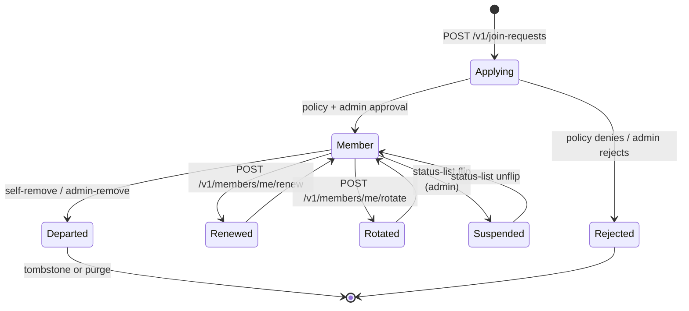
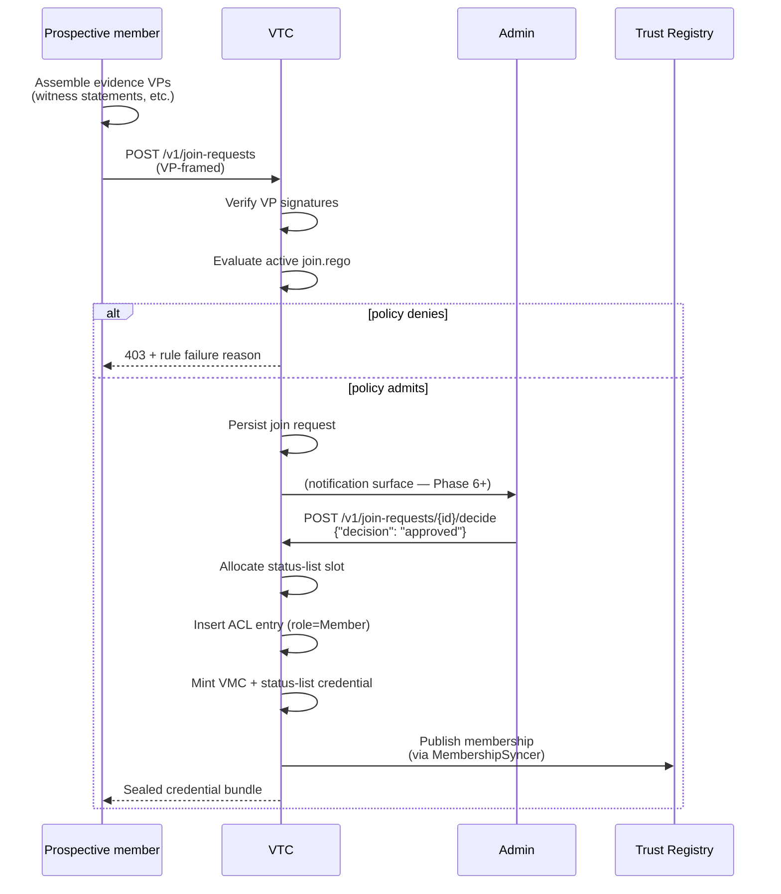
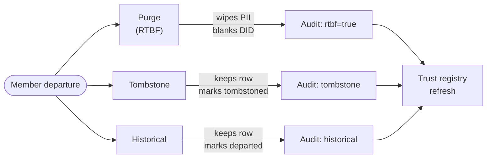
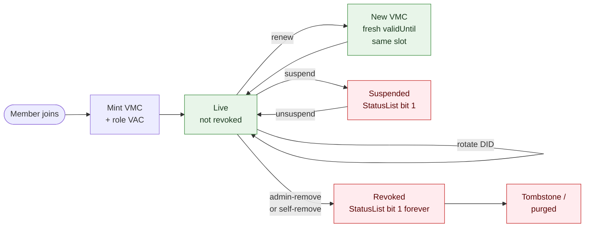
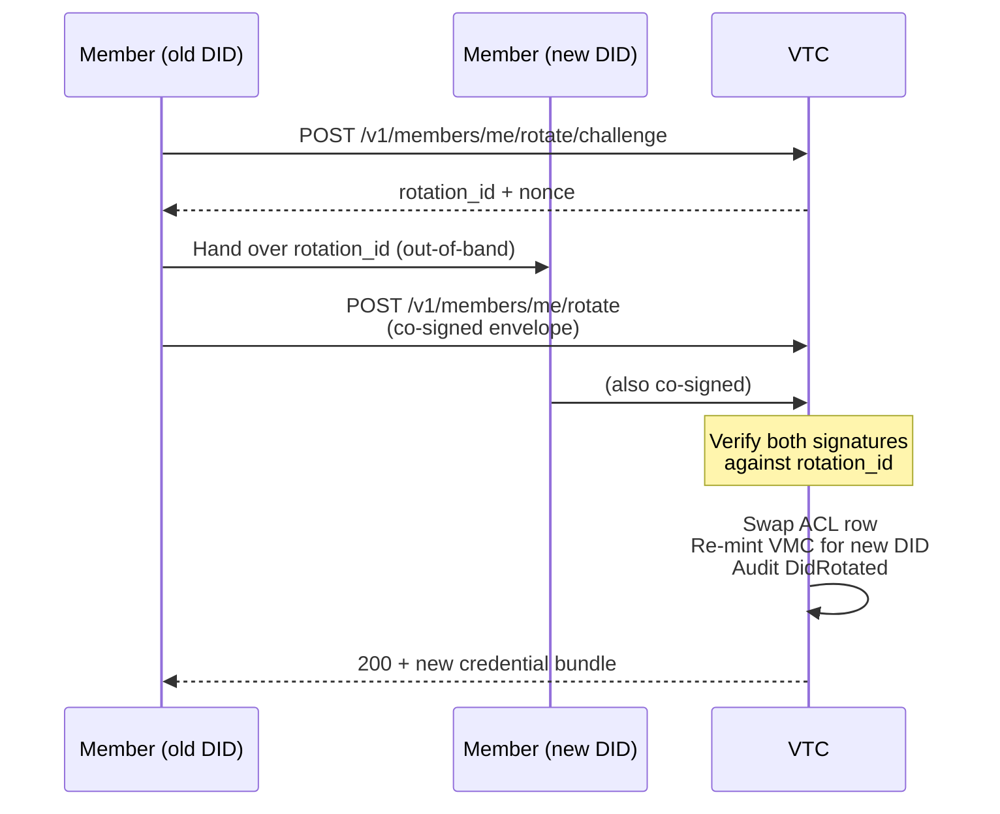

# Community lifecycle

How a member joins, what credentials they receive, how they
maintain membership, and how they leave. The lifecycle is driven
by **Rego policies**: the VTC ships defaults that default-deny, and
operators upload site-specific policies to actually admit anyone.

## Lifecycle states



The VTC tracks every state transition in the audit log
(`AuditEvent::MemberAdded` / `MemberUpdated` / `MemberRemoved` /
`StatusListFlipped` / `MembershipRenewed` / `DidRotated` / …).

## Policies that gate the lifecycle

| Policy | Trigger | Default | Purpose |
|---|---|---|---|
| `join.rego` | `POST /v1/join-requests` | deny-all | `join` |
| `removal.rego` | `DELETE /v1/members/{did}` | deny-all | `removal` |
| `personhood.rego` | `POST /v1/members/{did}/personhood/assert` | allow if VP carries a `witnessed/1` statement (VWC) whose digest binds to an edge this community holds, or a `vetted/1` statement this community issued about the member, for this community | `personhood` |
| `relationships.rego` | `POST /v1/relationships` | allow if both parties are current members | `relationships` |
| `registry.rego` | `MembershipSyncer` reconciliation | `publish_on_join: true; default_departure: tombstone` — publishes only members whose `publishConsent` is true; the rule can narrow that, never override it ([trust-registry.md](trust-registry.md#who-is-published-member-consent)) | `registry` |
| `cross_community_roles.rego` | `POST /v1/auth/recognise` | deny-all (no peer recognition) | `crossCommunityRoles` |
| `admission.rego` | `vtc/members/admit/0.1`, `vtc/members/make-membership/0.1` (an administrator admitting directly) | allow — admitted at once | `admission` |

Policies are authored over the admin REST API: upload a revision with
`POST /v1/policies`, dry-run it with `POST /v1/policies/{id}/test`, and put it
in force with `POST /v1/policies/{id}/activate`. There is no `cnm` command for
policies.

Each policy gets a canonical input shape supplied by the VTC. See
the VTC spec [§8](../05-design-notes/vtc-mvp.md) for the full input
schemas.

## Join flow (happy path)



Both ends use VP/VC envelopes throughout — there is no
bespoke-JSON authorisation format. The credential bundle the member
receives is HPKE-sealed to their `did:key` (the same sealed-transfer
envelope every VTI bootstrap uses).

## Admitting a member directly

An administrator can admit someone without a join request, from the
**Members** page of the console:

- **Add a member** (`vtc/members/admit/0.1`) — a DID, a role (default
  `member`) and an optional label. The result is what a completed join
  leaves: an ACL entry, a member record, the VMC and role VAC, a
  revocation slot. A former member (a removed record and no ACL entry)
  is re-admitted, as a rejoin would be, and recorded as returning.
- **Make this a membership** (`vtc/members/make-membership/0.1`) — for
  an ACL entry with no member record, typically the bootstrap
  administrator, who otherwise cannot sign in to the member portal. It
  writes the member record and issues the credentials at the role the
  entry already holds, and changes nothing on the entry. The action is
  on each such row of **Access control**, and under *Access without a
  membership* on **Members** (the ACL listing marks these entries
  `ext["org.openvtc"].membership: "none"`).

Both skip the join criteria and vetting, so both are **governed**:

- **Who may.** The requester holds `vtc.members.manage`. A role other
  than `member` is assigning a role: it takes `vtc.roles.assign` too, and
  the entry it seats is bounded by the requester's own authority
  (`vtc-admin-roles.md` §6.3), the rule an invitation's role is held to.
  `admin` is never seated this way — add the member, then promote them
  with `acl/change-role`, which takes its own step-up and consent. A role
  carrying administrative authority (`moderator`, `issuer`) asks for the
  requester's passkey gesture bound to the one admission.
- **Whether now.** The community's `admission` policy decides
  (*Policies* → *Other policies* → `admission`; package
  `vtc.admission`). `allow` admits at once; `deny` refuses with the
  policy's code; `refer` parks the admission on the **Actions** page
  after the requester's passkey gesture, for another holder of
  `vtc.members.manage` (never the requester, never the subject) to
  approve, and it then runs itself with every check repeated. The
  shipped default admits at once. To require a second administrator for
  every direct admission, activate

  ```rego
  package vtc.admission
  import rego.v1
  default decision := {"effect": "refer", "with": {"queue": "second-admin"}}
  ```

  The policy reads `input.evidence.request.action` (`add` /
  `make-membership`), `.role`, `.administrative` and `.returning`, and
  may admit, refer or refuse — not choose the role. Changing it is an
  authority change, so it takes another administrator's approval
  itself. In single-administrator mode a referral is waived on the
  requester's gesture and recorded so.
- **Refused before the policy:** an entry that already exists (*Add* —
  the refusal names *Make this a membership*), a live membership, an
  `application` entry (git rights for a non-member, which joins through
  the join flow), an expired or suspended entry, and — for *Make this a
  membership* — a removed member's record: re-admitting a former member
  is a rejoin, through the join flow or *Add a member* once the entry is
  gone.

Each is audited as `MemberAdmittedDirectly` (the action, role, label,
whether the subject was returning, how it was allowed —
`policyAllowed`, `approved` or `waived` — and the action id when it was
approved), beside the `MemberAdded` / `VmcIssued` / `VecIssued` rows
every admission writes. The credentials are pushed to the member's
wallet as on a join approval, best-effort, and returned in the
response.

Both tasks are specified in dtgwg-trust-tasks-tf (#784) and served on
the types `trust-tasks-rs` generates from them. A payload is read
against its schema first: a `subject` that is not a DID or is over 2048
characters, a `role` over 128, a blank `label` or a `reason` over 1024
is `malformedRequest`, before any role is considered.

From the command line, as an administrator's `cnm` profile:

```bash
cnm members admit did:key:z6Mk… --role member --label "Ada" --reason "…"
cnm members make-membership did:key:z6Mk… --reason "the founder is a member too"
```

A refusal that means the other command — `hasEntry` from `admit`,
`noEntry` or `applicationEntry` from `make-membership` — prints the
command to run instead; a referral prints the action to follow with
`cnm actions show`.

## Removal dispositions

When a member leaves (self-remove or admin-remove), the operator
chooses one of three dispositions. The choice surfaces in the
trust-registry record so peer communities see the same intent:



- **Purge** — RTBF (right-to-be-forgotten). The member row's PII
  is wiped; the row becomes a tombstone with `purged: true`. The
  trust-registry record is removed (batched per
  `registry.rtbf_batch_window_hours` to break timing correlation).
- **Tombstone** — the member row stays but is marked
  `tombstoned: true`. PII fields stay; further authentication
  fails.
- **Historical** — the member row stays editable for audit /
  historical research. The status-list slot still flips (revoked).

The active `registry.rego` determines which dispositions are
permitted (`removal_options` field) and the default
(`default_departure`). A self-initiated `Purge` always overrides
`min_disposition` (RTBF cannot be downgraded by community policy).

## VMC / role VAC lifecycle



- **VMC** = Verifiable Membership Credential. Mandatory for every
  member; `validUntil` is bounded (default 30 days, configurable).
  Inside the community the ACL is authoritative — an expired VMC
  doesn't lock the member out, they just renew via
  `POST /v1/members/me/renew`.
- **Role VAC** = Verifiable Authority Credential conferring the member's
  role as the action `role:<role>` at the community's DID, re-minted on
  every role change. Community statements (VSCs under a registered
  predicate, `vtc/endorsements/issue/0.1`) are issued separately.
- **VRC** = Verifiable Relationship Credential. Self-issued by
  members to declare trust edges to other members (see
  [`personhood-and-graph.md`](personhood-and-graph.md)).

Each credential has its own slot on the shared BitstringStatusList.
Revocation flips the bit; the public list is served at
`GET /v1/status-lists/{purpose}` so external verifiers can check
without authenticating.

## Renewal failure modes

`POST /v1/members/me/renew` re-evaluates `personhood.rego` against
the member's current evidence. The operator-configured
`renewal.on_personhood_fail` (Phase 4 D5) decides what happens when
the policy returns `false` for a member whose previous
`personhood` flag was `true`:

| Mode | Behaviour |
|---|---|
| `downgrade` (default) | Flip `personhood = false`, re-mint VMC without the flag, audit `PersonhoodRevoked { reason: "renewal-policy" }`, return success. |
| `refuse` | Reject renewal with 403. The member keeps the *old* VMC until they re-present evidence sufficient to pass `personhood.rego`. |

## DID rotation

Members can rotate the DID they authenticate with via a
two-step ceremony:



Both the old and new DID sign the rotation request. The VTC
preserves the member's status-list slot — the same audit identity
moves to the new DID. `did:key` and `did:webvh` are both supported;
for `did:webvh` rotations the VTC resolves the new DID document
and verifies the signing key against it.

## Changing the community's transports after mint

The community's DID document says how anyone reaches it: `#tsp`
(`TSPTransport`) and `#didcomm` (`DIDCommMessaging`), each naming the
mediator by DID, alongside `#vtc-rest`. `vtc setup` renders the ones you
chose, but they are not fixed there. To add a transport later — `#tsp`
on a community minted with DIDComm only, say — or to change or drop one,
edit the document at the VTA and publish the new log entry.

The VTA holds the keys that extend the community's DID log, so the edit
always happens there. What happens next depends on who serves the log.
Check first:

```sh
pnm did-mgmt dids get <community-did>
#   Server:          serverless     ← the VTC serves its own log: steps 1–3
#   Server:          <server-id>    ← a DID host serves it: step 1 only
```

**A VTC on a DID host** (`[webvh] server_id` in the setup TOML, a DID
of the form `did:webvh:<scid>:<host>:<path>`) needs only step 1: the
VTA pushes the new entry to the host as part of the edit, and there is
nothing to deliver.

**A serverless VTC** (`did:webvh:<scid>:<host>`, served by the VTC
itself at `/.well-known/did.jsonl`) needs all three: the VTA cannot
reach the copy the VTC serves, so you carry the log across.

1. **Edit the document** at the VTA, with a `pnm` profile that manages
   the community's DID:

   ```sh
   pnm did-mgmt dids edit --did <community-did>
   ```

   This opens the current document in `$EDITOR`. Add the entry to
   `service`, then save and confirm:

   ```json
   {
     "id": "<community-did>#tsp",
     "type": "TSPTransport",
     "serviceEndpoint": "<mediator-did>"
   }
   ```

   `serviceEndpoint` is the mediator's **DID**, not a URL; the URL lives
   in the mediator's own document. Name the same mediator as the
   `#didcomm` entry. For a scripted run, pass the edited document with
   `--document <file> --no-confirm`
   ([edit walkthrough](../02-vta/runtime-service-management.md#walkthrough-edit-an-existing-did-document)).
   For a serverless DID the command ends by printing the two commands
   below.

2. **Fetch the complete log** from the VTA:

   ```sh
   pnm did-mgmt dids get-log <community-did> --out did.jsonl
   ```

3. **Install it at the community**:

   ```sh
   cnm did-log install --file did.jsonl
   ```

   `cnm` authenticates to the VTC as the community profile's DID, which
   needs an administrator entry in the VTC's ACL
   ([bootstrap runbook](bootstrap-runbook.md#cnm-needs-its-own-administrator-entry)).
   It reads the VTC's URL from the DID (`https://<host>/v1`); pass
   `cnm --url <base> did-log install …` to override it, and `-c <slug>`
   to pick a community profile other than the active one.

   The VTC verifies the log before serving it. It refuses one that does
   not verify, is for a different DID, or drops or rewrites an entry it
   already serves, so only a log the key holder signed can be installed,
   whoever delivers it. The new log is served at once, with no restart.
   Resolvers see the new version as their caches expire.

Then confirm the VTC can actually serve what the document now
advertises. Clients prefer TSP over DIDComm over REST, so an advertised
transport that nothing answers on strands every client that picks it:

```sh
vtc status        # on the VTC host: "Transports" compares document and build
```

- The VTC has to be connected to the mediator the entry names:
  `[messaging]` in its `config.toml`. A VTC minted with no messaging
  needs `[messaging]` added and a restart. One that is already connected
  needs neither: `#tsp` and `#didcomm` share one mediator, and the
  shipped build serves both.
- The mediator must itself route the protocol. Nothing on the VTC side
  can check that. Confirm the mediator's own DID document advertises
  the matching service before you add the entry.
- Keep `#didcomm` when you add `#tsp`. A document that offers TSP alone
  leaves every peer that does not speak TSP with no messaging route.

The same three steps publish any other change to the community's
document after mint, such as a `TrustRegistry` referral added or
changed, or a key rotated. For the referral the entry is:

```json
{
  "id": "<community-did>#trust-registry",
  "type": "TrustRegistry",
  "serviceEndpoint": {
    "uri": "<registry-did>",
    "profile": "https://trustoverip.org/profiles/trqp/v2"
  }
}
```

`serviceEndpoint.uri` is the registry's DID. The referral is what other
parties use to find the registry; the VTC's own connection to it is the
separate `[registry] did` setting in its `config.toml`
([trust registry](trust-registry.md)), which the edit does not touch.

Make the edit with `pnm` against the running VTA. The offline
`vta did-mgmt dids edit` on the VTA host builds the same entry, but it
holds no mediator session, so it can publish only to a DID host whose
document advertises `TrustTaskHTTPS` or `WebVHHosting` at an `https://`
origin. Against a host that advertises TSP or DIDComm alone it stops
with `no transport in common`, and the entry stays pending in the VTA's
store until the running VTA's next edit of that DID publishes it.

Two more entries go the same way, the ones wallet sign-in
needs, `TrustTaskHTTPS` (`<public_url>/v1`) and `SignInPortal`
(`<public_url>/members/`): a running VTC that finds either missing from its
published document logs a warning with the exact entries to add, and its
sign-in pages say wallet sign-in is unavailable until they are published
([member portal](website-and-admin.md)).

## Quick reference

Member, join-queue, policy and credential administration happens in the admin
console or over the admin REST API. `cnm` has no commands for these. Every
route needs a `Trust-Task` header and an admin bearer token
([bootstrap runbook](bootstrap-runbook.md#authenticating-a-script)).

| Task | Admin console | REST (under `/v1`) |
|---|---|---|
| List members, show one | **Members** | `GET /members`, `GET /members/{did}` |
| Remove a member | **Members** | `DELETE /members/{did}`, body `{"disposition": "tombstone"}` |
| List join requests | **Join requests** | `GET /join-requests` |
| Approve or reject a request | **Join requests** | `POST /join-requests/{id}/decide`, body `{"decision": "approved"}` or `"rejected"` |
| Upload, test, activate a policy | — | `POST /policies`, `POST /policies/{id}/test`, `POST /policies/{id}/activate` |
| Issue a community statement (VSC) or IDVC | — | signed `vtc/endorsements/issue/0.1` |
| Revoke a statement, vetter grant or IDVC | **Members** | signed `vtc/endorsements/revoke/0.1` |

`cnm` covers the rest of community administration. It needs the community
profile to name the VTC (`cnm community set-vtc <vtc-did>`) and the profile's
DID to hold an administrator entry in the VTC's ACL
([bootstrap runbook](bootstrap-runbook.md#cnm-needs-its-own-administrator-entry)):

```sh
cnm vetting vetters {list,grant,revoke,resend}   # vetter grants
cnm vetting auto-grant {show,set}                # automatic vetter grants
cnm vetting ask {show,set}                       # what applicants are asked
cnm vetting branding {show,set}                  # how the community presents itself
cnm vetting revocations                          # vetting statement withdrawals
cnm vetting bootstrap-pgp …                      # first vetters from a PGP web of trust
cnm audit verify                                 # the community's audit chain
cnm backup {export,import}                       # encrypted full-state backup
cnm did-log install --file did.jsonl             # a self-hosted community's DID log
```

See [`../04-reference/cli-style.md`](../04-reference/cli-style.md)
for the conventions every CLI verb follows.

## See also

- [Credentials](credentials.md) — VMC / role VAC details + status-list
  mechanics.
- [Credential delivery](credential-delivery.md) — how the admitted
  member receives its credentials.
- [Bootstrap runbook](bootstrap-runbook.md) — the first admin and
  the first vetter of a new community.
- [Trust-registry integration](trust-registry.md) — publication
  + cross-community recognition.
- [Personhood + relationships](personhood-and-graph.md) — VRC
  graph + personhood ceremony.
- [VTC MVP spec §5-6](../05-design-notes/vtc-mvp.md) — full
  reference.
