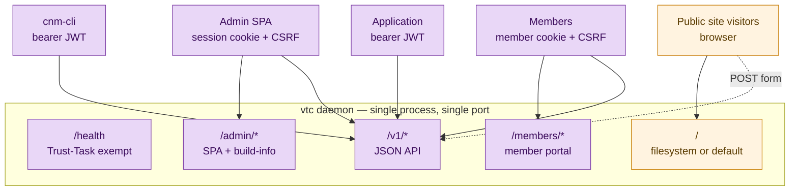
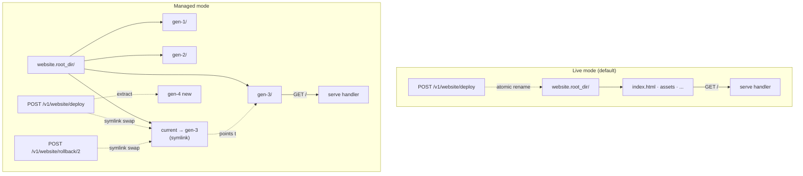
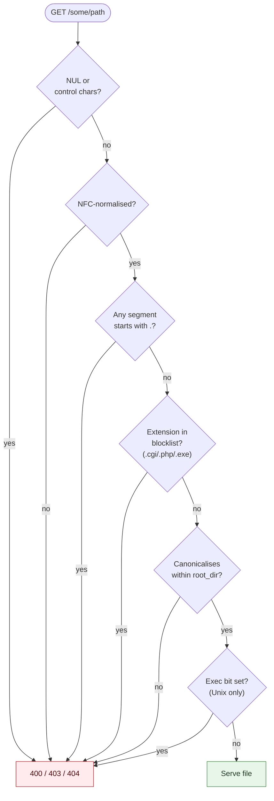
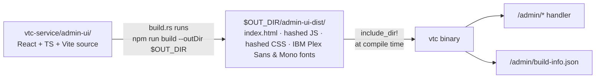
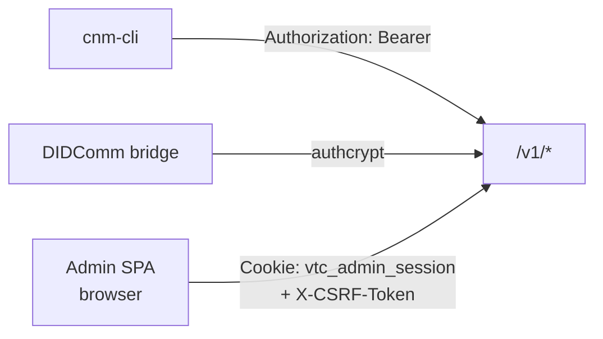
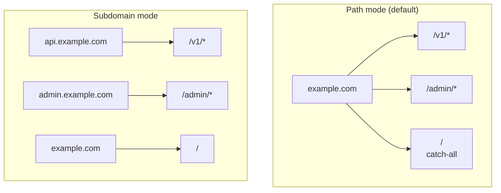

# Website + admin UX

Phase 5 ships three operator-facing surfaces on the same VTC
process: the **JSON API** at `/v1/*`, the **admin SPA** at
`/admin/*`, and the **public community website** at `/`. Each has
its own cookie scope, body cap, and CSP. This page covers the
public-website and admin-UX surfaces; the routing infrastructure
that makes them coexist safely is shared.

## Surface map



The default routing assignment:

| Mount | Purpose | Body cap | CSP |
|---|---|---|---|
| `/health` | Health probe (Trust-Task exempt) | 1 MiB | — |
| `/v1/*` | JSON API | 1 MiB global, per-route override on website mgmt | — (JSON wire) |
| `/admin/*` | Admin SPA + `/admin/build-info.json` | 1 MiB | default-src 'self' |
| `/members/*` | Member portal (fixed mount; see [Member portal](#member-portal)) | 1 MiB | default-src 'self' |
| `/` (catch-all) | Public website | 1 MiB | default-src 'self' (overridable per site) |

Operators can rewrite these mounts via `routing.api.mount`,
`routing.admin_ui.mount`, `routing.website.mount`, or switch to
subdomain mode by setting per-surface `host = "..."`. Phase 5 path-
prefix mode is the default.

## Public website

### Deploy modes



| Mode | Where served from | Bundle deploy | Operator workflow |
|---|---|---|---|
| **`live`** (default) | `website.root_dir/` directly | Extract to `<root>.staging.<ts>/` + atomic rename | `scp` / `rsync` / `git pull` directly into `root_dir`, OR `POST /v1/website/deploy` |
| **`managed`** | `website.root_dir/current/` via symlink to `gen-N/` | Extract to `gen-N+1/` + symlink swap + prune | `POST /v1/website/deploy` for new gen; `POST /v1/website/rollback/{gen}` for rollback |

In managed mode the `current` symlink swap is atomic via the
`symlink + rename` idiom — concurrent readers never see a broken
link. `managed_generations_keep` (default 5) prunes oldest gens.

### Which of these are Trust Tasks

Most of the `/v1/*` API requires a `Trust-Task` header naming the operation.
The website management surface is the exception, and deliberately so: a Trust
Task's payload is a JSON document, and three of these endpoints move **raw
file bytes**.

| Endpoint | `Trust-Task` header |
|---|---|
| `GET /v1/website/files` | `spec/vtc/website/files/list/0.1` |
| `GET /v1/website/files/{path}` | **none** — file bytes out |
| `PUT /v1/website/files/{path}` | **none** — file bytes in |
| `DELETE /v1/website/files/{path}` | `spec/vtc/website/files/delete/0.1` |
| `POST /v1/website/deploy` | **none** — bundle bytes in |
| `GET /v1/website/generations` | `spec/vtc/website/generations/list/0.1` |
| `POST /v1/website/rollback/{gen}` | `spec/vtc/website/rollback/0.1` |

`DELETE` carries a path rather than a payload, so it is a Trust Task like any
other. The three byte-moving endpoints are not, and no canonical spec will ever
supersede them — there is no document shape to write.

Sending no header on the three exempt endpoints is correct. Sending a stale one
is harmless there (nothing checks it) but **fails on `DELETE`** with
`TrustTaskMismatch` (415): it previously accepted
`openvtc/vtc/website/files/show/1.0`, which labelled a delete as a read.

Losing the header requirement is **not** losing an authorization gate — every
endpoint above still requires an admin bearer token or admin session cookie.

### Path safety

Every request walks through the same safety chain before hitting
the filesystem:



Bundle uploads run the same chain on every entry **before**
extraction. A bundle containing a single forbidden entry is rejected
in toto.

### CSP override

Default CSP: `default-src 'self'; script-src 'self'; object-src
'none'; base-uri 'self'`.

Operators relax it by dropping a `.vtc-website.toml` at the root:

```toml
# vtc-service/website.example.com/.vtc-website.toml
csp = "default-src 'self'; script-src 'self' 'unsafe-inline'; img-src 'self' data:"
```

The file is read on every request (no daemon restart needed). Empty
or missing file → default CSP applies.

### Default landing page

When `website.root_dir` is **unset**, the daemon serves a small
in-tree landing page (HTML/CSS/JS at `vtc-service/website-default/`)
that fetches `/v1/community/public-profile` + `/health` and renders them.
The moment an operator sets `root_dir`, the filesystem handler
takes over and the default is unreachable.

It is written for a visitor who has never heard of a VTC: the main
call to action is **Get started** at [openvtc.net](https://openvtc.net),
which explains what a community is and how to get a wallet and join.
Beside it is **Member sign-in** (`/members/`). The page then outlines
what the community runs on — git repositories governed across GitHub,
Forgejo/Codeberg and Gitea, verifiable data rooms, access management,
membership credentials, cross-community recognition — and ends with
the service status. The operator console is linked, deliberately
quietly. An operator site replacing the default should keep a link to
`/members/`.

### Colour theme

The default landing page, the member portal and the operator console
each have a **Match system / Light / Dark** switcher — in the landing
page's top bar (`website-default/theme.js`), at the end of the portal's
and the console sign-in page's top bar, and in the console's account
menu. All three store the choice in `localStorage` under one key,
`vtc-admin-theme`, so on one origin a choice made on any of them holds
on the others, and open tabs follow it. *Match system* stores nothing
and follows `prefers-color-scheme`. The landing page applies a stored
choice from `<head>`, before first paint; without JavaScript its
switcher stays hidden and the page follows the system. An operator site
under `website.root_dir` can do the same by setting `data-theme="light"`
or `"dark"` on `<html>` over the shared `tokens.css`.

### Community theme, and the theme preview

The console's **Community profile** page has a **Theme** card: the
colours, fonts and corners the console and the member portal are drawn
with. Start from a built-in theme (Default, Forest, Ocean, Slate,
Sunset, High contrast) or **Upload .css**, edit it in place, and
**Download** it to keep or share. A theme is one stylesheet in the
*theme profile* of `vtc/community/theme/update/0.1`
([dtgwg-trust-tasks-tf#811](https://github.com/trustoverip/dtgwg-trust-tasks-tf/pull/811)):

- design tokens (`--brand`, `--bg`, `--radius-md`, …, see
  `admin-ui/src/styles/tokens.css`) on `:root`, `:root[data-theme=…]`
  or inside `@media (prefers-color-scheme: light|dark)`;
- on elements, only colours, gradients, borders (at most 4px wide,
  32px round), font family / weight / style, letter-spacing (±0.2em),
  text decoration and case;
- nothing that loads a file (`url()`, `@import`, `@font-face`), no
  `!important`, no escapes or `<`, and nothing that moves, sizes, hides,
  overlays or adds content.

The card checks the draft as you type and names the line, column and
profile item of the first thing outside it
(`admin-ui/src/lib/theme-profile.ts`; the cases it must agree on with
the community's own check are `theme-profile.vectors.json`).

**Preview console** and **Preview member portal** open that surface in
a new tab drawn with the draft, under a bar that says nothing there is
saved. The preview follows the draft live as you edit. In a preview
tab:

- the console sends **reads only** — a Trust Task document goes only
  when its task is a read (`show`, `list`, `get`, …), a plain request
  only when it is a `GET`; every other action is refused in the
  browser before it is sent, and the bar says *Nothing was changed*
  (`admin-ui/src/lib/theme-preview.ts`, default-deny);
- the console loads no third-party plugin, since a plugin could send a
  write past that guard;
- the member portal answers its own routes from a sample member, so an
  administrator who is not a member can preview it; the bar switches
  between the signed-in home and the sign-in page. Public reads (the
  community's name and logo) are real. Rooms never reach the member's
  wallet.

Leave the preview with **Exit preview**; the flag lives in that tab
only. Preview first asks the community to check the draft without
storing it (`dryRun`), so the preview draws exactly what **Save theme**
would store.

**Save theme** stores it for everyone (`vtc/community/theme/update/0.1`,
`vtc.surface.admin`, audited as `CommunityThemeUpdated` with the
stylesheet's SHA-256, never its text); **Remove theme** goes back to the
standard look. The theme lives in the `community` keyspace beside the
profile and branding, so it is backed up with them. Every page — the
console, the portal and its sign-in page — reads it with
`vtc/community/theme/show/0.1`, which answers an unidentified caller,
checks it again, and draws it; a stored theme the daemon's check now
refuses is answered as none.

**What a theme never reaches.** Approvals, confirmations, step-ups and
warnings are drawn in a shadow tree with the standard tokens and their
own ground (`admin-ui/src/components/Protected.tsx`), so no theme can
recolour, hide or restyle them: the confirm dialogs, the action-list and
break-glass banners, the attention strip, the step-up page, the whole
Actions, Join requests, Members and Repos pages, and in the portal the
wallet sign-in number and identity choice. While a theme is drawn, the
console's top bar says **Custom theme**, out of the theme's reach too.

### Community DID as a QR code

The default landing page shows the community DID as a QR code beside
the community name, so a wallet (Keyring first) can add the community
by scanning it instead of retyping the DID. The daemon renders it:

```console
$ curl -s https://community.example/v1/community/did-qr.svg -o did-qr.svg
```

`GET /v1/community/did-qr.svg` is public and unauthenticated, like
`public-profile`, and it encodes the **bare DID** and nothing else: the
same string the page's Copy button copies, and the profile's
`communityDid`. A DID is already a URI (scheme `did`), so no `did://`
or app-specific wrapper is added; a phone's camera hands the scan to
whichever app registers the `did` scheme. It returns 404 until the
community profile is initialised. An operator site under
`website.root_dir` can show the same code with
``.

### Transport connectivity

`GET /v1/community/public-profile` (public, unauthenticated) carries a
`transports` array, and the default landing page renders it as a
**Transports** row. Anyone can use it to check how to reach the
community and whether each route currently answers:

```console
$ curl -s https://community.example/v1/community/public-profile | jq .transports
[
  { "protocol": "tsp",     "advertised": true,  "serviceable": true,
    "endpoint": "did:webvh:QmTS3…:mediator" },
  { "protocol": "didcomm", "advertised": false, "serviceable": true },
  { "protocol": "rest",    "advertised": true,  "serviceable": true,
    "endpoint": "https://community.example" }
]
```

Each transport carries **two** facts, and they mean different things:

| Field | Question it answers |
|---|---|
| `advertised` | Does the community's DID document offer this transport, so a resolving client will find it? |
| `serviceable` | Can this VTC answer on it *right now* — protocol compiled in, and the mediator connection live? |

A transport is genuinely reachable only when **both** are true. The
interesting combinations:

- `advertised: true, serviceable: false` — clients will choose this
  transport and get nothing. This is the state that silently broke a
  live deployment; the daemon also refuses to start if *no* advertised
  transport is serviceable (see `vtc status`).
- `advertised: false, serviceable: true` — the binary supports it but
  the DID document has not caught up. Normal mid-rollout; nothing
  routes to it yet.
- An **empty** array means the community's own DID could not be
  resolved, so the answer is *unknown* — not "offers nothing".

Because it is a plain unauthenticated GET, it works from a browser,
from `curl`, and from a monitoring check. Note the endpoint — not the
page — is the durable surface: an operator who replaces the website
with their own keeps the endpoint and can render it however they like.

> **The DID document stays authoritative.** This field is a *view* of
> it, resolved at request time, published so connectivity can be
> validated without resolving the DID by hand. A client selecting a
> transport must still match on the document's service `type`. If the
> two ever disagree, the document wins.

Deliberately **not** published here: build feature flags, version
strings, and the operator-facing remediation text. Those stay in
`vtc status` and the daemon log. Everything in `transports` is either
already public in the DID document or discoverable by attempting the
transport.

## Admin UX



The admin SPA source is **in-tree** (Phase 5 D1, refined after the
initial Phase-5 deviation note in `docs/05-design-notes/vtc-mvp.md`
§12.2): React + TypeScript + Vite source under
`vtc-service/admin-ui/`, with `build.rs` invoking
`npm install && npm run build` to produce a bundle which
`include_dir!` bakes into the binary. The end-to-end source-to-
binary path stays a single `cargo build`; operators on air-gapped
hosts opt out of the npm step with `VTC_SKIP_ADMIN_UI_BUILD=1` and
ship a pre-built `admin-ui/dist/` instead, which `build.rs` reads
and bakes.

The bundle lands under `$OUT_DIR`, **not** `admin-ui/dist`, and the
build script writes nothing into the source tree. That is load-
bearing rather than tidiness: `include_dir!` expands to one
`include_bytes!` per file, so all 312 baked files are compile
inputs of the lib. While the script regenerated them in-tree — and
`npm install` refreshed `package-lock.json`, one of the script's own
`rerun-if-changed` inputs — `cargo build -p vtc-service` was never a
no-op, and every local build, test, clippy run and rust-analyzer
check-on-save recompiled the crate from scratch (#1243). CI guards
it with a "vtc-service rebuild is a no-op" step, since a cold-cache
CI run cannot notice the problem on its own.

Why in-tree React rather than the original "plain HTML/CSS/JS
placeholder":

- **Plugin API** (in-tree React + framework-agnostic custom
  elements for third-party plugins, see
  `docs/03-vtc/admin-ui-plugins.md`) outgrew the placeholder.
- **Design language**
  (`docs/05-design-notes/admin-ui-design-language.md`) needed a
  component model the placeholder couldn't carry — toasts,
  modals, sortable tables, a session-expiry redirect.

### What the console shows at a glance

The console is framed by a top bar and a grouped sidebar. The top bar carries
the community's mark and name (from its public profile), an "Operator console"
pill, **Jump to… ⌘K** (below), the live indicator and an account menu holding
**My passkeys**, **Signing keys**, the colour theme and **Sign out**. The
sidebar groups the screens under **Overview** (Dashboard, Actions, Audit
trail), **Membership** (Join requests, Members, Invitations, Vetting,
Relationships), **Governance** (Policies, Roles, Access control, Sessions) and
**Community** (Profile, Recognition, Data rooms, Repos), with third-party
plugins that name no group under **More**
([`admin-ui-plugins.md`](admin-ui-plugins.md)). **Policies** is the screen
once labelled Ceremonies, and **Profile** the one labelled Community profile;
their routes, `/admin/ceremonies` and `/admin/profile`, are unchanged. The
look itself — tokens, type, components — is described in
[`admin-ui-design-language.md`](../05-design-notes/admin-ui-design-language.md).

Navigation follows the viewer's capabilities: a screen the viewer cannot use is
not listed, and nor is a group with nothing in it. Two entries carry a count
bubble while something waits:

- **Actions** — actions waiting for your decision (`vtc/admin/actions/list`
  `counts.waitingForMe`), with a notice in the attention strip after sign-in
  (dismissible for the session) and the count in the tab title. This includes the **queues** (`admin-access.md` §3.2a): break-glass
  ratifications (Ratify / Revoke), join requests referred for review (Approve
  / Reject) and withdrawn vetting statements a membership rests on (Keep
  member / Start removal). A queue item has no threshold and no expiry, and
  closes however its record is decided.
- **Join requests** — join requests awaiting an administrator's decision,
  for a viewer holding `vtc.join.decide`. Hidden at zero. Each is also a queue
  item in **Actions**; deciding it in either place closes it in both.

Both are fetched at sign-in, whenever the tab regains focus or becomes
visible, whenever the live channel says they moved (below), and on a poll —
every 60 s while the console is offline, every 5 minutes while it is live.

The dashboard reads "what needs me", then health. Under a greeting, with
**Invite a member** for a viewer holding `vtc.invitations.manage`, a row of
tiles counts **Members** (current members, for `vtc.members.manage`), **Join
requests** (the badge's pending count, for `vtc.join.decide`), **Awaiting a
vetting decision**, actions **Waiting for you** and **Withdrawn statements**,
each linking to its screen; a tile whose screen the viewer cannot use is hidden
and its count never read. Below them, **Waiting for you** lists the first five
actions from the same signed read as the Actions screen — each summary shown
only once the console has re-derived and checked it, a refused one saying so —
and **Service health** gives one row each to the daemon, the VTA, the mediator,
the trust registry, this browser's signing key, the build and hidden-vetting
support. The transport advertisement and the community's identifiers follow.

Each count is **one read**. `vtc/members/list/0.1` and
`vtc/join-requests/list/0.1` apply their filter (role, status) before paging,
so the cursor walks only matching rows and a page is never empty while a match
lies further on, and they fill `totalEstimate` with the exact number of
matches. Exact is cheap at a community's size: the page is already cut from
the whole keyspace held in memory. So the console asks for `limit: 1` and reads
the total. The **Join requests** page shows the same total for its status
filter, and the dashboard's **Awaiting a vetting decision** tile reads the
total pending from it and checks the first 50.

Every page size the console sends a signed listing is held to that listing's
specification maximum: `admin-ui/src/lib/list-limits.json` pins the maxima,
`vtc-service`'s `console_list_limits` test compares them to the generated
schemas, the console's `list-limits.test.ts` census checks every call site,
and the signer refuses an over-limit page before signing. A page size over
the maximum is refused by the VTC as `malformedRequest`; that is how the
admission-criteria page read nothing until #1921.

### Jump to anything: the command palette

**⌘K** (Ctrl+K off Apple platforms), or **Jump to…** in the top bar, opens
a palette. Type to filter every screen the viewer can see — the built-in
ones and any plugin registered with `registerPlugin`, whether or not it
names a nav `group` — and a short list of actions: review the actions
waiting for you, add or invite a member, decide join requests, add an
access-control entry, invite an administrator, renew this browser's
signing key, switch the theme, reload plugins and sign out. An action is
offered only when the screen it needs is visible, as in the nav; the VTC
still decides every operation. Whatever is typed is also offered as a
member search, and a DID opens that member.

Up and Down move, Enter opens, Escape (or a click outside) closes and
returns focus to where it was. It is a modal dialog with focus held on
its search field, announced as a combobox over a grouped list of
results. Actions that navigate use query strings the screens accept on
their existing routes — `/members?q=…`, `/members?add=1`,
`/acl?add=1`, `/acl?invite=1`, `/actions?tab=waitingForMe` — each applied
once and then dropped from the URL.

### Live updates, and polling as the fallback

A signed-in console holds **one live channel** per session:
`vtc/admin/events/subscribe` — at **0.2** when the VTC lists it in
`trust-task-discovery`, else 0.1 — sent as a signed document to the ordinary
`POST /v1/trust-tasks` with `Accept: text/event-stream, application/json;q=0.5`
and answered as a **streamed response** (HTTPS binding 0.3 §2.1): `200
text/event-stream`, whose first event is the signed `#response` and whose later
events are `vtc/admin/events/event` **hints** of the same version. There is no
other route — no `GET`, no WebSocket — and nothing about the door changes for
any other task. The VTC serves both versions; 0.2 adds the `rooms` topic and
nothing else, so a 0.1 console (or `cnm actions watch`) is unchanged.

**A hint is never data.** It names a topic, when it changed, and for the three
badge topics the viewer's count:

| Topic | Re-reads | `count` | Who hears it |
|---|---|---|---|
| `actions` | the Actions page and its badge | `waitingForMe` | every administrator |
| `acknowledgements` | the operator-write banner (the badge read) | open acknowledge items owed | every administrator |
| `joinRequests` | the Join requests page, badge and tile | pending requests — the list's own `totalEstimate` | every administrator |
| `members` | the Members page and tile | — | every administrator |
| `singleAdminMode` | the single-administrator banner | — | every administrator |
| `config` | the configuration and profile screens | — | holders of `vtc.config.admin` |
| `rooms` (0.2) | the Data rooms page (its Rooms, Usage, Storage and Community rooms tabs) and a room's page | — | holders of `vtc.rooms.admin` |

`rooms` is hinted when a room is registered (or removed), when a room's
lifecycle state changes — which happens with the clock, so the VTC wakes the
stream at the moment a room is due to lapse, go dormant or become reclaimable —
when a room's usage or a storage config's held bytes crosses 80, 95 or 100 % of
its limit or capacity in either direction, and when a storage config is
created, changed or changes state. Holdings moving inside a band, or a live
room renewing, send nothing: the VTC digests exactly those facts, as the rooms
reads report them, and hints only when the digest moves. The pages also poll
(60 s, 5 min while the stream carries `rooms`), so a 0.1 VTC or an
administrator without the topic still sees changes. The Community rooms tab
(rooms the community owns, [`community-rooms.md`](community-rooms.md)) polls at
60 s regardless: the topic hints when a community room is created, but not when
one is offered to, accepted by or removed from a member, nor when its label,
description or tags change (`vtc/rooms/community/update` — the owner's record,
not the host's view the topic covers), and it goes only to holders of
`vtc.rooms.admin`, not of `vtc.rooms.manage`.

The console reacts to a hint only by invalidating the react-query keys of that
topic's own signed read, so authorization stays on every read: a hint can
neither leak a record nor grant one, and a forged hint costs one unnecessary
request. A hint never carries a record, a record id or a DID — the community's
integration tests assert the shape of every one it sends. Within a count topic,
a change the viewer's read would not show them sends no hint (the VTC compares
a digest of what that read shows). Who hears a topic is decided by exactly the
check its read makes — one table in the VTC (`admin_events::read_capability`)
that the read handlers gate on too — so whoever the community would answer on
the read gets its hints, and nobody else.

**Live or offline.** The top bar shows **Live** only while bytes are arriving —
an event, or the heartbeat comment the VTC sends at least every
`heartbeatSeconds` (25 by default). Silence for twice that, an ended stream or
any failure shows **Polling** at once, re-reads every topic, and the badge and
tile polls go back to 60 s. The console re-subscribes with a **freshly signed**
document carrying `since` (the last resume token it saw), backing off
exponentially with jitter (1 s doubling to 60 s, any `retry:` the stream sent
as the floor). `resumed: true` means the VTC replayed a hint for every topic
that changed while it was away; `resumed: false` — an unknown, expired or
another caller's token, or a VTC that restarted — means the console re-reads
everything, and is never an error. A refusal that will not change this session
(`streamUnavailable`, `notAdministrator`, `permissionDenied`, `unsupportedType`)
leaves it polling; `tooManyStreams` backs off and tries again.

**What the VTC holds to.** A refusal is the ordinary JSON `trust-task-error`
and never opens a stream; once the `#response` is written nothing but hints
and heartbeats follow, and the stream simply ends (no reason, no error) when:
the client goes; the service stops; the authority it was opened on lapses — the
signer's ACL entry, the console key's delegation, or the document's own
`expiresAt`; an hour passes; a write stalls for twice the heartbeat; or the
viewer's readable topics shrink (re-checked on every ACL change, before every
hint, and at least once a heartbeat). Each end costs one freshly signed
subscribe, which re-authorizes everything. A subscribe is accepted only inside
a five-minute `issuedAt` window, and a replayed one opens nothing (`204`).
`Last-Event-ID` is only a cross-check: one that disagrees with `since` is
`malformedRequest`. Hints are coalesced to at most one per topic per second.

Limits: **5** concurrent streams per administrator (each console key counts
against the administrator it acts for — several tabs or devices) and **256**
in all; past either, `tooManyStreams` (retryable). Resumption history is kept
in memory for 10 minutes or 4096 changes, whichever is shorter.

Proxies in front of the VTC must not buffer `text/event-stream` responses (the
VTC sends `X-Accel-Buffering: no` for nginx) and must allow an idle read of at
least twice the heartbeat. `cnm actions watch` prints the same hints on a
terminal.

Operators wanting a different UX serve their own console from a
directory (below). The console cannot be hosted on another origin: it
reads the `csrf` cookie, calls the API by relative URL, and passkeys
are bound to the VTC's own origin. The former `admin_ui.mode =
"external"` and `external_origin`, which never served anything, are
refused at config load.

### Customising the console (`admin_ui.mode = "directory"`)

To change the console's look and feel without rebuilding the daemon,
serve it from a directory instead of from the binary:

```sh
vtc admin-ui export /var/lib/community/console   # the built-in console, as a starting point
# edit it there, then in config.toml:
#   [admin_ui]
#   mode = "directory"
#   dir  = "/var/lib/community/console"
# and restart the daemon
```

The daemon serves that directory at `/admin/*` exactly as it serves the
built-in console: `index.html` is the shell, extensionless paths fall
back to it (client-side routing), and `/assets/*` is cached for five
minutes. Files are read on every request, so an edit shows on the next
page load with no restart. Every path goes through the website's
[path-safety chain](#path-safety): hidden files, symlinks out of the
directory and files with the executable bit are never served.

Two ways to customise:

- **Restyle.** Add a stylesheet to the directory and link it from
  `index.html` (`<link rel="stylesheet" href="/admin/theme.css">`)
  after the bundled one. The bundled CSS is minified; override it
  rather than editing it.
- **Rebuild.** Change the source under `vtc-service/admin-ui/`, run
  `npm run build`, and point `admin_ui.dir` at the output. The build
  emits asset URLs under `/admin/`, so keep the default
  `routing.admin_ui.mount`.

The directory is a snapshot of the console it was exported from. Upgrading
the daemon does not touch it, so a console exported before an upgrade keeps
its old look and screens (for example, the layout before the top bar, grouped
sidebar and IBM Plex type) until you export again and re-apply your changes.
The same holds for a member portal served from `admin_ui.members_dir`.

The console's [security headers](#path-safety) still apply: the CSP
allows scripts only from the console's own origin, so a customised
console cannot load scripts from a CDN or run inline ones. Styles,
fonts and images may be inline or local.

**Whoever can write this directory can act as every administrator.**
The console's scripts run in the administrator's session and sign with
their console key, so treat the directory like the binary: owned by
the operator, not writable by the daemon's user if that can be
avoided. The daemon refuses to start if the directory has no
`index.html`, or if it or `index.html` is world-writable; it never
falls back to the built-in console. `admin_ui.dir` is host
configuration only — `config/patch` cannot set it.

The `AdminUiServed` audit row records `mode = "directory"` and the
SHA-256 of `index.html` **as it was at start-up**;
`/admin/build-info.json` reports the directory as it is now. If the two
differ, the console was edited after the daemon started.

The member portal (`/members/*`) is customised the same way, independently
of the console: `vtc admin-ui export --members <dir>`, then
`admin_ui.members_dir = "<dir>"`. It gets the same serving rules and the same
start-up checks, for the same reason: the portal's scripts run in members'
sessions. Its build emits asset URLs under `/members/`.

### `/admin/build-info.json`

Unauthenticated. Returns:

```json
{
  "version": "0.6.0",
  "indexSha256": "<sha256 of index.html>",
  "fileCount": 4,
  "mode": "embedded"
}
```

The `indexSha256` matches the `AdminUiServed` audit envelope emitted
exactly once at boot — operators who suspect compromise can pin the
running build against the audit record.

### Cookie session vs bearer



Three concurrent auth paths:

- **Bearer JWT** — `Authorization: Bearer <jwt>`. Used by
  `cnm-cli`, DIDComm bridges, programmatic clients.
- **Cookie session** — `Cookie: vtc_admin_session=<jwt>`. Used by
  the admin SPA. Scoped `Path=/` (the API lives at `/v1`, not under
  `/admin`, so the SPA→API call needs the cookie there — an earlier
  `Path=/admin` design was reverted). HttpOnly keeps JS from reading
  it on any path; Secure + SameSite=Strict prevent cross-site sends.
  **Path mode does not isolate a deployed website on `/` from this
  cookie** — same-origin website JS can still `fetch('/v1/...',
  {credentials})` and ride it. The posture that *does* isolate is a
  dedicated website host (see [Routing modes](#routing-modes)); a
  filesystem website now requires one.
- **CSRF double-submit** — `csrf=<random>` cookie (JS-readable) +
  `X-CSRF-Token` header. Required on every mutating call from the
  cookie session. Bearer-only callers don't carry CSRF.

Both flow through the same `AuthClaims` extractor in `vti-common`,
which tries bearer first then falls back to cookie. Bearer wins
when both are present.

### Admin login

The console's login page (`/admin/`) wears the community's sign-in look —
the member portal's top bar, card and footer, with "Not an operator? Go to
the member portal" and a "Back to <community>" link home — and offers, in
order:

1. **Sign in with your wallet** — the trigger-link key grant described under
   *Member portal* below, asking for the console's session (see *Wallet
   sign-in to the console*).
2. **Passkey.**
3. **Using an older wallet?** (deprecated) — the two SIOPv2 buttons, "Sign in
   with this browser's wallet" and "Sign in as a VTA identity", unchanged.

Every one of them ends in the same console session: audience `VTC`, the
`sessions` keyspace, the `vtc_admin_session` + `csrf` + refresh cookies, and
the same lifetimes and CSRF, for a DID whose ACL entry holds an
administrative role.

#### Wallet sign-in to the console

The page sends the same `auth/oob/request` the portal does, with one
VTC-namespaced extension:

```json
{ "purpose": "login", "mode": "scan",
  "ext": { "org.openvtc.session": { "audience": "admin" } } }
```

`purpose` stays `login` — `auth/oob/0.1`'s purpose is a closed enum and both
are logins. The VTC fixes the audience on the request when it is opened,
echoes it in the request's response (the page refuses to show a code if a VTC
ignored it), and repeats it under the same `ext` member in the signed step 1
and step 2 responses, so a wallet can say "operator console" and the grant's
`contextDigest` — the digest of the signed step 2 — covers it. An approval
given for the portal cannot be redeemed as a console session, or the other
way round: the grant names one request, its digest covers that request's
audience, and `redeem` issues only the session the record says, after
checking it is the one signed into step 1.

The console's gate is the ACL role, read now, by the same check passkey login
makes. A DID that is a member but not an administrator can still prove it
holds its DID, and is then told **"This identity isn't an administrator of
this community."**: `prove` (or `respond`, or `redeem` if the entry changed
in between) declines the request, and `redeem` answers `declined` with
`details.reason: "notAnAdmin"`. No session of either kind is issued, and the
request is spent. A DID the community does not know at all is refused before
anything is resolved, as on the portal. Each step is audited as
`AdminWalletSignIn`.

A request without the extension, or with `"audience": "member"`, is a portal
sign-in exactly as before, and its responses carry no extension. The console
is served from the portal's origin (`/admin/` beside `/members/`), which is
what the wallet compares with the `SignInPortal` service; its HTML is served
with the same `no-referrer`, `no-store` and CSP as the portal's.

The SIOPv2 path is two calls, both on canonical Trust Tasks:

1. `POST /v1/auth/` (`spec/auth/authenticate/0.1`) — the DIDComm-packed or
   SIOP challenge response, returning `{ session, tokens }` with a bearer
   access token.
2. `spec/vtc/auth/admin-session/0.1`, a signed document on
   `POST /v1/trust-tasks` — post that access token back; the daemon validates
   it (signature, VTC audience, expiry), checks the document is **signed by
   the token's subject** (or by a console key that subject enrolled), and
   answers with `Set-Cookie` headers carrying the session JWT + CSRF token. The
   console has the wallet sign it as the identity that just signed in, or
   signs with this browser's console key when the wallet cannot. No privilege
   escalation: the caller already held a token it could have used as a bearer,
   so this only mirrors it into the cookie the browser SPA expects — and a
   token alone, without the subject's key, no longer does even that. The
   document also names a fresh browser key (`ext["org.openvtc"].sessionKey`)
   that the daemon binds to the session; the console signs `auth/whoami/0.1`
   with it, as it does with the key every other console sign-in binds. The
   bearer route `POST /v1/auth/admin-session` was removed (#1641): the task
   declares a proof REQUIRED. A wallet that cannot sign Trust Tasks, in a
   browser holding no signing key for that identity, cannot finish this
   sign-in; use the wallet sign-in above or a passkey.

Passkey login is a single call — `POST /v1/auth/passkey-login/finish` mints
the same cookie pair directly.

There was a one-shot `POST /v1/auth/admin-login` that fused step 1 and step 2;
it was removed in #710. It ran exactly the same mint as `POST /v1/auth/` and
differed only by appending the cookies, so it was a second way to
authenticate for no wire-visible gain.

### Signing keys — what the console signs with

Every admin verb is served as a **signed Trust Task document** at
`POST /v1/trust-tasks`; the bearer twins are gone (#1641, #1808). A document
carries its own authentication: the daemon verifies its `eddsa-jcs-2022`
proof, binds the proof to the document's `issuer`, requires the community as
`recipient`, bounds its age and records its `id` against replay — none of
which a cookie can supply. The console therefore needs a key before it can do
anything for an administrator.

**First sign-in on a browser.** After sign-in (passkey or VTA wallet), the console checks
whether this browser holds a key the community accepts (one signed
`auth/signing-key/list/0.1`). If it does not — a new browser, a first install,
a key that expired or was revoked, or a community restored from backup, which
drops every delegation by design — the operator sees **Set up signing**
instead of the dashboard: name the browser, approve in your wallet or confirm
with your passkey, done.
Nothing in the console signs until that has happened, so an unenrolled key
never spends the anonymous rate-limit budget that its enrolment needs. If a
signed document is later refused outright, the console checks again and
returns to that page when the key has stopped being accepted.

- **What it is.** A non-extractable WebCrypto Ed25519 key, generated in the
  browser and kept in that profile's IndexedDB as a `CryptoKey` — never as
  bytes, and not readable by script in the origin. Its public half becomes a
  `did:key:z6Mk…`.
- **What it authorises.** Nothing on its own. The daemon records a
  *delegation* — "this key may act as that admin DID" — and authority stays
  the admin's ACL row, read afresh each time a document executes. Revoking
  the row, or the key, stops it.
- **Enrolling one** needs proof that you control your identity, so a stolen
  session cannot leave a signing key behind (the key signs with no gesture
  at use time). Either:
  - **your VTA wallet** — signed in with the VTA browser wallet, you approve
    once in the wallet and your VTA signs the enrolment's terms as your
    identity (`auth/signing-key/authorize/0.1`, carried in
    `auth/signing-key/enroll/0.2`). No passkey is needed, and this is the
    default for a wallet sign-in; or
  - **a passkey** — a live gesture bound to this one enrolment (the same
    step-up `acl/grant` uses). The default for a passkey sign-in.
- **Per browser, not per operator.** Each profile, machine and private
  window enrols its own, listed and individually revocable, exactly as
  passkeys are. The key is per **origin**: `https://vtc.example` and
  `https://vtc.example:8443` — or `localhost` and `127.0.0.1` — hold
  different keys, so reach the console at one address.
- **Always a fresh key.** The daemon never enrols a key twice: a revoked
  key is tombstoned, and an *expired* delegation still answers
  `alreadyEnrolled`. So every enrolment — first setup, re-setup and renewal —
  generates a new key, stores it only once the daemon has accepted it, and
  then revokes the key it replaced.
- **Lifetime.** A delegation lasts at most 30 days. Five days before it ends
  the console puts a renewal reminder in the attention strip; renewing is one
  passkey confirmation on the Signing keys screen.
- **Durability.** The key survives signing out and restarting the browser,
  the OS or the VTC. It ends when the browser deletes the origin's storage:
  clearing site data, a private window closing, eviction under disk pressure
  (the console asks for persistent storage to avoid this), or Safari's
  seven-day limit on storage for sites not visited. Losing it costs one
  re-setup, not access.
- **Required.** A browser without WebCrypto Ed25519 (below Chrome 137 /
  Firefox 130 / Safari 17) cannot administer the community; the console
  says so at sign-in.
- **At most five active per administrator.** Each lost browser leaves its
  delegation live until it expires, so an operator who loses browser storage
  repeatedly can reach the cap. Setup then lists your active keys (only after
  your wallet or passkey has been accepted), least recently used first; pick
  one to **replace** and confirm once more — it is revoked in the same step
  the new key is enrolled (`replaces`). No working browser is needed.

Design note: `docs/05-design-notes/vtc-console-signing.md`.

### The attention strip, and what it never hides

What the operator must know sits in one **attention strip** above every console
page, most severe first, with the rest folded behind **Show N more**. Three
conditions put an item there that is always shown, has no dismiss button and
goes away only when the condition does. All three are read from the same signed
`vtc/admin/actions/list` the Actions badge makes (`ext["org.openvtc"]`), so
they cost no request of their own:

- **An offline change waits for your acknowledgement** (`Critical`) — the
  operator wrote the ACL with the daemon stopped; it clears when you
  acknowledge the item in **Actions** (VTI-VTC-023).
- **A reduction of your authority is cooling off** (`Critical`) — another
  administrator asked to remove or narrow you with nobody else to approve; it
  names who and when it lands, and clears when it lands or is cancelled
  (VTI-APV-019).
- **SINGLE ADMIN MODE** — the host runs the community in
  single-administrator mode; shown to every administrator for as long as it is
  on, with a dashboard tile (VTI-APV-022).

A self-granted break-glass right awaiting ratification is pinned in the same
way. What each means, and what to do, is in
[`admin-access.md`](admin-access.md) §2.1a, §3.4 and §3.5.

## Member portal

`/members/` is where a community's **members** sign in. It is a
separate application from the operator console, not the console with
fewer menus, and the separation is enforced by the daemon rather than
by what the page chooses to show:

| | Console (`/admin/`) | Member portal (`/members/`) |
|---|---|---|
| Who may sign in | An administrator (any administrative role) | An **active member** |
| Sign-in methods | Passkey, wallet (SIOPv2), VTA identity | Wallet sign-in by trigger link (`auth/oob/*`, the default), a portal passkey, or — deprecated — SIOPv2 issued by the member's VTA |
| Token audience | `VTC` | `VTC-member` |
| Session store | `sessions` | `member_sessions` |
| Passkey store | `passkey` | `member_passkeys` |
| Cookies | `vtc_admin_session`, `vtc_admin_refresh` (`Path=/`), `csrf` | `vtc_member_session`, `vtc_member_refresh` (`Path=/v1/member`), `vtc_member_csrf` |
| Bundle | console shell + plugins | its own; loads no console code |

The portal's top bar carries the same colour-theme switcher as the
console and the landing page, sharing their stored choice (*Colour
theme*, above); it is a small dependency-free component, not console
code.

**Active member** means a live ACL entry — not expired, not suspended,
not an `application` entry — and a member record that has not been
removed. It is checked at the challenge (a non-member gets an unusable
challenge that looks like any other, VTI-SES-006/007), at
authentication, at every refresh and on **every request**: a member
removed or suspended mid-session is refused on their next call
(VTI-SES-020–022). An administrator with no member record cannot sign
in here — the bootstrap administrator is the usual case; its wallet
sign-in is declined `notAuthorized`, and the service log says
`wallet sign-in declined … reason="not an active member"`. Make its
entry a membership (**Make this a membership** on **Access control**,
or under *Access without a membership* on **Members**;
`vtc/members/make-membership/0.1`, see
[community-lifecycle.md](community-lifecycle.md#admitting-a-member-directly)).
An administrator who is also a member can sign in, and gets a member
session that the console refuses.

**Why the token classes cannot cross.** Every console route validates
`aud = VTC`, so a portal token is refused there exactly as a VTA token
is. Portal sessions live in their own keyspace, so a portal refresh
token presented at `/v1/auth/refresh` is simply not found — which
matters most for a member who is also an administrator, whose console
backend would otherwise accept the subject. Portal passkeys live in
their own keyspace too, so one can never open a console session or
answer a step-up.

**Signing in with your wallet** (the default, first option). The page
shows a sign-in code: a QR code that is also a link, so a wallet on the
same device can be clicked instead of scanned. Its text is a **trigger
link** (VTI spec §7a, flow `/vti/flow/sign-in/0.1`):

```
https://link.trustoverip.org/t#_from=<VTC DID>&_id=<requestId>&_exp=<claim deadline>&_type=/vti/flow/sign-in/0.1
```

The link host is `admin_ui.sign_in_link_host` (default
`link.trustoverip.org`), and must not be on the portal's own domain —
a universal link tapped on a page of the same domain opens in the
browser, not the wallet (VTI-LNK-084). `GET /v1/member/sign-in/config`
hands the page the DID, host and flow, and refuses with the fix when
the host breaks those rules.

The exchange is the **key grant** of `auth/oob/*`, every step a signed
Trust Task document on `POST /v1/trust-tasks`:

1. The browser generates a non-extractable WebCrypto Ed25519 key `K_b`
   and signs `auth/oob/request`. Accepted only from the portal's own
   `Origin`; at most five open codes per address. The code lives 120 s.
2. The wallet, which knows this community, signs `auth/oob/claim` with a
   throwaway key `K_a` (`parentThreadId` = the request id, VTI-LNK-054).
   The first claim locks the request; the VTC answers step 1 (community,
   portal origin, purpose, decision deadline) signed with its
   `assertionMethod` key. A claim starts a fresh 120 s decision window.
3. The browser's long poll (`auth/oob/redeem`, 25 s, one open poll per
   request) now shows **"Your number is 47"** — only to the holder of
   `K_b`.
4. The wallet sends `auth/oob/prove` carrying `auth/oob/identify`, signed
   by the member's DID for `authentication`, with the typed number. The
   VTC checks the DID against the ACL **before** resolving anything, then
   the proof, then the number, and answers step 2 (the requester's
   browser, OS, approximate location and whether it is on the phone's
   network — never an address), again signed for `assertionMethod`. Any
   failure — a non-member, a bad signature, a wrong number — ends the
   request.
5. The member approves; their VTA signs `auth/oob/grant` for
   `assertionMethod` (after a user-verification gesture on the device),
   naming `K_b`, `K_a`, the origin, `notAfter` and the digest of step 2.
   The wallet sends it in `auth/oob/respond`.
6. The browser's next poll redeems: the VTC creates a member session
   bound to `K_b` (`amr = ["did","oob","uv"]`, ending no later than the
   grant's `notAfter`), sets the usual portal cookies, and the page asks
   **"Continue as Alice?"** before using it. *Not me* signs out. A browser
   that last continued as the same identity (for the same portal or
   console) is let straight in; a new or different identity is always
   asked. The
   grant's `notAfter` is the session's absolute end, not just its first
   window: each refresh renews the tokens inside it, and once it has passed
   refresh is refused and the member signs in again. The console's wallet
   sign-in is bounded the same way.

The page hides the code when the tab is hidden (the request keeps
running). It is served with `Referrer-Policy: no-referrer`,
`Cache-Control: no-store` and a CSP with `frame-ancestors 'none'`, and
every `auth/oob` response is `no-store`. Each step is audited as
`MemberWalletSignIn` (city and country, never the address). The city and
country come from a local GeoIP database the operator configures
(`[geoip] database`, see [GeoIP: sign-in locations](geoip.md)); without
one they are `unknown`.

**Wallets find this portal in the community's DID document.** A wallet
refuses a sign-in link unless the VTC's DID document lists a
`SignInPortal` service whose origin is the portal's
(`{"id":"<did>#sign-in-portal","type":"SignInPortal","serviceEndpoint":"<public_url>/members/"}`),
and sends the trust tasks to its trust-task HTTPS service
(`{"id":"<did>#trust-tasks","type":"TrustTaskHTTPS","serviceEndpoint":"<public_url>/v1"}`).
That endpoint is the Trust-Task base (HTTPS binding 0.2 §6): a client posts
to `<base>/trust-tasks`, which is `POST /v1/trust-tasks`. `vtc status`
reports whether both services are there. Adding it is a VTA-side
`dids edit`, then `cnm did-log install` for a VTC that serves its own
`did.jsonl`.

The running VTC checks this itself. A few seconds after start, and then
lazily with a five-minute cache, it resolves its own DID and checks the
**published** document for both entries. When one is missing or names
another origin it logs one warning listing what is missing, the exact JSON
entries to add, and the fix (`pnm did-mgmt dids edit --did <vtc-did>`,
then `cnm did-log install` if the VTC serves its own log; see
[community lifecycle](community-lifecycle.md#changing-the-communitys-transports-after-mint)).
`GET /v1/member/sign-in/config` carries the result as `didDocument`
(`{"status":"ok"}`, `{"status":"unknown"}`, or
`{"status":"missing","missing":["SignInPortal"]}`): only the service types
the public document lacks. When it is `missing`, the member portal's and
the console's sign-in pages replace "Show sign-in code" with a short note
naming them, and the other options are unchanged. The check never blocks
start-up, and a DID that does not resolve is `unknown`, not `missing`, so
the page keeps offering wallet sign-in.

**Using an older wallet? (deprecated).** The SIOPv2 sign-in below is
kept for wallets that cannot do the above, behind a link on the
sign-in page. It will be removed; a date has not been set.

A member signs in as their **VTA identity**: the
portal asks the wallet extension which VTA persona this community
knows them as (`walletProfile`, which binds one on first use), takes a
challenge for that DID from `<origin>/v1/member/wallet/auth/challenge`,
has the VTA mint the SIOPv2 `id_token` with the challenge as nonce
(`proxyLogin` — the key never leaves the VTA), and posts it to
`wallet/auth/` — the same header-less shapes as the console's
`/v1/wallet`, with a different audience at the end. The portal then
mirrors the bearer into its cookies via `POST /v1/member/session`.
There is no button for the extension's own `login()`: it self-issues
with the extension's holder `did:key` unless a persona is bound, and a
community admits members by their VTA identity, so it would present a
DID no community admitted. When the daemon refuses a sign-in, the page
names the DID the VTA presented.
**Sign in as a different identity…** is for a member whose wallet holds
more than one VTA identity for this community: it lists the wallet's
`did-self-issued` entries pinned to this community's DID (`vaultList`,
which asks the member's consent because it discloses those entries to
the page), shows each by its label and abbreviated DID, and runs the
same round-trip as the chosen one. A refused sign-in offers it too.
A **portal passkey** signs in without going through the VTA; a member
adds one from the portal after a VTA sign-in. Adding or removing a
passkey requires a session established by DID proof (`amr` contains
`did`) — the DID is the anchor, so a stolen passkey cannot enrol more
or remove the member's others. Changes are audited as
`MemberPasskeyChanged`.

**The browser wallet** is the VTA Wallet extension
([OpenVTC/vta-browser-plugin](https://github.com/OpenVTC/vta-browser-plugin)).
It is not in a browser store yet; the sign-in page carries the manual
install steps (build with Node 24+, load `packages/extension/dist/`
unpacked in a Chromium browser, finish its setup) and opens them when
no wallet that can sign in as a VTA identity is detected.

**Routes** (all under `/v1/member/`): `sign-in/config`,
`wallet/auth/{challenge,,refresh}` (deprecated),
`session`, `auth/refresh`, `sign-out`, `passkey-login/{start,finish}`
— unauthenticated, behind the per-IP governor — and `me`, `passkeys`,
`passkeys/register/{start,finish}`, `passkeys/{credentialId}` (DELETE)
— member-session only. They carry no Trust Task binding for the reason
the console's wallet aliases and sign-out carry none: they are a
WebAuthn ceremony, the wallet's header-less SIOP exchange, and cookie
plumbing. Anything a member *does* in the portal beyond signing in
belongs on the Trust Task surface, signed by the member's own DID.

**Data rooms** (`/members/#/rooms`, `#/rooms/<roomId>`). A member's
rooms open through their wallet extension, never through the portal's
server: the pages call `window.vtaWallet.rooms`, and the wallet acts in
the room as the member's own identity through their VTA, so this page
holds no key and the daemon adds no route. The wallet answers only the
portal this community's DID document names (`SignInPortal`), shows the
page only the rooms the member shared with it in the wallet's own
window, and confirms every note and file before it is written. A
`private` room is never shared with the portal, because the portal is
the host's own page. The pages show the room's tier, the member's and
the room's storage against their limits, the records (each sealed one
opened through the wallet for its title), a note as plain text, a
file's download (decrypted in the wallet and checked against what its
author signed before the page receives it), and adding a note or a
file. Running a room as its owner, curating and direct-to-storage
transfer from the browser come later
([`data-rooms-files.md`](../05-design-notes/data-rooms-files.md) §8.5).

**Routing.** The mount is fixed at `/members` and takes precedence
over an operator website's own `/members` path. In subdomain mode it
is served on the **API's** host, since its calls go to `/v1/member/*`
on its own origin. WebAuthn accepts the single origin derived from
`public_url`, so portal passkeys work where that origin serves the
portal — the default path mode does.

## Routing modes



Subdomain mode is enabled by setting per-surface `host = "..."` in
the routing config. A tower middleware (`routing::host_dispatch`)
enforces two things in strict mode (default):

1. **Host membership** — an unrecognised `Host` header 404s
   (`HostNotRecognised`). Set `routing.subdomain_mode_strict = false`
   to fall back to path matching for unknown hosts — debug aid only,
   and it disables (2).
2. **Surface isolation** — a recognised host serves **only** the
   surface bound to it. The request path is routed to its owning
   surface (`/v1…`→api, `/admin…`→admin, else website) and 404s
   (`SurfaceNotOnHost`) unless that surface is the one on this host.
   So `admin.example.com/v1/acl` and `api.example.com/admin` both
   404 — the API and SPA are reachable only on their own hosts.
   (Parent-root infra routes — `/health`, `/openapi.json`,
   `/.well-known/did.jsonl` — answer on every recognised host.)

This is what actually isolates a deployed website origin from the
admin session: on its own host the website has no `/v1`/`/admin`
route to hit, and the admin cookie (host-only, `SameSite=Strict`) is
never sent there. **Because path mode can't provide this, a
filesystem website (`website.root_dir`) requires its own
`routing.website.host`, distinct from the api/admin host — the
daemon refuses to start otherwise.** The admin SPA and API may (and
should) share a host. The in-tree default landing page (no
`root_dir`) is trusted and may stay co-resident.

**WebAuthn `RP ID`** must be set correctly per mode:

| Mode | `admin_ui.rp_id` |
|---|---|
| Path mode | Base host (e.g. `example.com`) |
| Subdomain mode | Base **domain** so passkeys remain valid across `api.` + `admin.` (e.g. `example.com`, not `admin.example.com`) |

Migrating the admin UX to a different base domain forces every
passkey to re-register. Operator runbook.

## CLI quick reference

```sh
# Website management
cnm website files list
cnm website files show <path>
cnm website files write <path> --content @file.html
cnm website files delete <path>
cnm website deploy --bundle ./site.tar.gz

# Managed mode
cnm website generations list
cnm website rollback --to-gen 2

# Admin UX
cnm admin build-info     # → /admin/build-info.json output
vtc admin-ui export <dir>             # write the built-in console out to customise
vtc admin-ui export --members <dir>   # the same for the member portal
```

## Configuration

```toml
[website]
root_dir = "/var/lib/community/site"      # unset → default landing page
deploy_mode = "live"                       # or "managed"
live_cache_ttl_seconds = 5
managed_generations_keep = 5
cache_control = "public, max-age=300"
executable_blocklist = [".cgi", ".php", ".exe"]
max_bundle_size_mb = 50
max_file_size_mb = 10
csp_override_file = ".vtc-website.toml"

[admin_ui]
mode = "embedded"                          # or "directory"
dir = "/var/lib/community/console"         # only (and required) when mode=directory
members_dir = "/var/lib/community/portal"  # optional: serve /members from here
rp_id = "example.com"                      # WebAuthn RP ID

[routing]
subdomain_mode_strict = true

# Host mode with an isolated filesystem website. The API + admin SPA
# share one host (the Path=/ admin cookie needs them co-resident); the
# website gets its own host so deployed content can't ride that cookie.
# Required whenever website.root_dir is set.
[routing.api]
mount = "/v1"
host = "app.example.com"

[routing.admin_ui]
mount = "/admin"
host = "app.example.com"                    # same host as the API

[routing.website]
mount = "/"
host = "www.example.com"                     # dedicated host (distinct)

[cors]
allowed_origins = []                       # add SPA origin for external mode

# Optional. How much `rooms/*` traffic POST /v1/trust-tasks admits; absent,
# these defaults. Each is a burst, then one document every *_interval_ms
# milliseconds (larger = tighter). See docs/02-vta/data-rooms.md §8.2.
[rooms.rate_limits]
address_burst = 400                        # per address, before verification
address_interval_ms = 10
presenter_burst = 120                      # per (room, presenter), once authorized
presenter_interval_ms = 100
transfer_burst = 200                       # per (room, presenter), file chunks
transfer_interval_ms = 20
```

In pure **path mode** (omit every `host`), all three surfaces share
one origin. That's fine for the trusted built-in landing page, but
`website.root_dir` is then refused at startup — point the website at
its own host as above, or drop `root_dir` to serve the default page.

## See also

- [VTC MVP spec §9, §12](../05-design-notes/vtc-mvp.md) — routing
  + website + admin UX surface.
- [Community lifecycle](community-lifecycle.md) — the public form
  POST to `/v1/join-requests` originates from the public website.
- [Architecture](architecture.md) — how the routing middleware
  composes.
