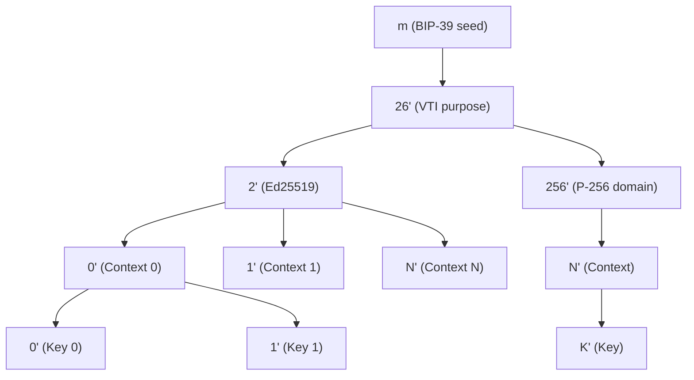

# BIP-32 Derivation Paths

The VTA derives all cryptographic keys from a single BIP-39 mnemonic seed using
[BIP-32](https://github.com/bitcoin/bips/blob/master/bip-0032.mediawiki)
hierarchical deterministic derivation. All paths live under the `m/26'` purpose
level, which is reserved for the First Person Network.

## Path Hierarchy



## Application Contexts

Each **application context** is an isolated key group with its own DID and
BIP-32 subtree. The `vta` context is created automatically during setup:

| Context ID | Index | Base Path     | Purpose                |
| ---------- | ----- | ------------- | ---------------------- |
| `vta`      | 0     | `m/26'/2'/0'` | Verifiable Trust Agent |

If DIDComm messaging is enabled during setup, a `mediator` context is also
created for the mediator DID keys. Additional contexts can be created via
the API or CLI and are assigned sequential indices.

## Sequential Allocation

Each context maintains a **persistent counter** stored in the fjall `keys`
keyspace under the key `path_counter:{base_path}`. Every key allocation:

1. Reads the current counter value `N` (starting at 0)
2. Derives the key at `{base_path}/{N}'`
3. Stores the key record
4. Increments the counter to `N + 1`

All key types within a context (signing, key-agreement, pre-rotation) share
**one counter**, so indices are unique and never reused.

### P-256 Domain-Separated Derivation

P-256 keys share the same BIP-32 path namespace as Ed25519/X25519 but use
**HMAC-SHA512 domain separation** to produce independent key material:

1. Derive the BIP-32 path normally (SLIP-0010 for Ed25519).
2. Compute `HMAC-SHA512(key="p256-key-derivation", data=signing_key_bytes || chain_code)`.
3. Take the first 32 bytes as the P-256 scalar (reduced mod n automatically).

This ensures:
- **No cross-curve key reuse** — Ed25519 and P-256 keys at the same path are
  cryptographically independent.
- **No Ed25519 clamping artifacts** — the HMAC output is uniformly distributed.
- **No group-order bias** — the P-256 group order (~2²⁵⁶) accommodates 32
  random bytes with negligible bias (~2⁻³²).

```
allocate_path(keys_ks, "m/26'/2'/0'")   ->  m/26'/2'/0'/0'   (counter: 0 -> 1)
allocate_path(keys_ks, "m/26'/2'/0'")   ->  m/26'/2'/0'/1'   (counter: 1 -> 2)
allocate_path(keys_ks, "m/26'/2'/0'")   ->  m/26'/2'/0'/2'   (counter: 2 -> 3)
```

## Context Index Allocation

The context index counter is stored in the `contexts` keyspace under
`ctx_counter`. Each new context gets the next available index, which determines
its base path (`m/26'/2'/N'`).

## Typical Setup Allocation

During the setup wizard, keys are allocated in the order they are created. A
typical run produces the following layout:

### VTA keys (`m/26'/2'/0'/K'`)

| Index | Key Type | Label                          |
| ----- | -------- | ------------------------------ |
| 0     | Ed25519  | VTA signing key                |
| 1     | X25519   | VTA key-agreement key          |
| 2+    | Ed25519  | VTA pre-rotation key 0, 1, ... |

### Mediator keys (if DIDComm enabled)

When DIDComm messaging is configured during setup, a `mediator` context is
created with the next available index. For example, if `vta` is index 0, the
mediator context will be index 1 (`m/26'/2'/1'/K'`):

| Index | Key Type | Label                               |
| ----- | -------- | ----------------------------------- |
| 0     | Ed25519  | Mediator signing key                |
| 1     | X25519   | Mediator key-agreement key          |
| 2+    | Ed25519  | Mediator pre-rotation key 0, 1, ... |

### Admin keys (under VTA context: `m/26'/2'/0'/K'`)

Admin keys are derived under the VTA context. The exact indices depend on which
options are chosen during setup. For example, if the admin uses `did:key`, only
one additional index is allocated under the VTA context.

## Server Startup

At startup the server does **not** assume fixed indices. Instead, it looks up
the VTA signing and key-agreement key paths from the stored `KeyRecord` entries
by matching on key ID (`{did}#key-0`, `{did}#key-1`). This means the paths are
always consistent with what the setup wizard actually allocated.

## JWT Signing Key

The JWT signing key is **not** derived from BIP-32. It is a random 32-byte
Ed25519 private key generated during setup and stored as a base64url-no-pad
string in the config file at `auth.jwt_signing_key`. This can also be set via
the `VTA_AUTH_JWT_SIGNING_KEY` environment variable.

## Source

- Path allocation logic: [`vta-keys/src/paths.rs`](../../vta-keys/src/paths.rs)
- Context management: [`vta-support/src/contexts.rs`](../../vta-support/src/contexts.rs)
