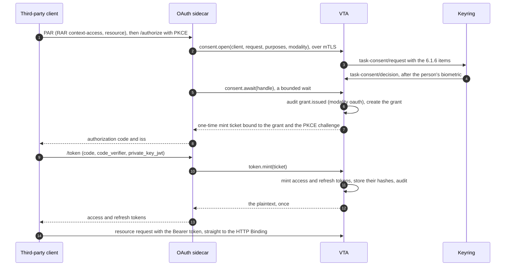

# The Human Context Protocol in the VTA: design

**Status:** proposed. Design only: no code has landed, and no HCP code merges
to `main` until the `hcp/*` Trust Task suite's first release (see
[hcp-plan.md](hcp-plan.md) §5).
**Companion to:** [hcp-plan.md](hcp-plan.md) (the milestones and work
packages), [hcp-tasks.md](hcp-tasks.md) (the demo-milestone checklist) and
[tasks/hcp-demo-plan.md](../../tasks/hcp-demo-plan.md) (the demo week).
**Owner:** Brendan Miller, Alberto Leon
**Last updated:** 2026-11-25

**Normative sources:**
- **HCP 2.0-draft-3**, the Human Context Protocol
  ([loyalagents/hcp-spec](https://github.com/loyalagents/hcp-spec)). Normative
  citations are to commit `b790561`,
  [`spec/2.0-draft-3/specification.md`](https://github.com/loyalagents/hcp-spec/blob/b790561/spec/2.0-draft-3/specification.md).
  Section numbers below written "HCP n.n" are HCP's.
- **The `hcp/*` Trust Task family**: 28 tasks at `0.1` that carry HCP's
  operations, from `hcp/grants/request` to `hcp/import`. It is proposed to
  dtgwg-trust-tasks-tf as one pull request (branch `feat/hcp-suite`), with two
  pull requests stacked on it (declared rules that a payload schema cannot
  check, and the demos), and is not yet published to trusttasks.org.
  Its specifications state the carriage rules this note relies on (token
  binding, notice delivery). V0 pins the family as frozen at X0
  ([hcp-plan.md](hcp-plan.md) §3.1).
- **Framework and shared tasks:** `task-consent/request/0.1`,
  `task-consent/decision/0.2`, `trust-task-next-step/0.1`,
  `trust-task-discovery/0.4`.
- **The VTI specification**: *Access control* (VTI-ACL-*), *Approvals*
  (VTI-APV-*), *Audit* (VTI-AUD-*), *Transports* (VTI-TRN-*) and *Operations*
  (VTI-OPS-*).

Where this note disagrees with any of them, the source is right and this note
is the defect.

---

## 1. What HCP is, and how VTI carries it

HCP is a protocol for a person's **context**: the facts, preferences and
history an AI agent needs to act for them. A **Provider** holds the person's
context as *entries* (HCP 4.2) and discloses them to *clients*, such as an
agent, only under a **grant** the person approved (HCP 6.1). Every disclosure
is bounded by category, purpose and quantity (HCP 7.1–7.2) and carries a
`useUntil` after which the client must not use its copy (HCP 7.6). Every act
is audited (HCP 8), and a revoked grant stops working at once, with a notice
to the client (HCP 6.2).

HCP has three layers (HCP 1.2): **Core** (the data model and rules), two
**Bindings** that put Core on a wire, HTTP (HCP 9) and MCP (HCP 10), and
**Profiles** that tighten Core for a posture or a domain (HCP 11–17). A
provider claims conformance by listing identifiers in `conformsTo` in its
discovery document, and claims a binding or profile whole or not at all
(HCP 18.1).

VTI carries HCP as **Trust Tasks**: each HCP operation is an `hcp/*` task
served by the VTA's existing spine, so it rides TSP, DIDComm or REST like any
other task, with a document proof by its issuer (VTI-OPS-020) under the same
document rules on every transport (VTI-OPS-021).
That carriage is not an HCP binding. HCP has no identifier for it and opens no
extension point for bindings (HCP A.1, A.3), and every `hcp/*` specification
says a provider MUST NOT claim the carriage in `conformsTo`. So the plan
builds the **HTTP Binding beside the Trust Task handlers**, over the same
handlers, and makes the conformance claim on the HTTP side.

The two paths share one set of handlers, one grant store and one audit trail;
read the diagram as "the claim attaches only to the right-hand side":

```text
  +------------------ one VTA: vta-hcp handlers, one grant store -------------------+
  |                                                                                 |
  |  Trust Task carriage                     HTTP Binding /v2/* and discovery       |
  |  (TSP, then DIDComm, then REST)          (HCP-Version, problem+json, Bearer)    |
  |  hcp/* tasks, trust-task-discovery                                              |
  |  never in conformsTo                     listed in conformsTo (from V2)         |
  |  used by: Keyring, the agent client      used by: the conformance suite, HTTP   |
  |                                          clients, an MCP bridge (HCP 10.5)      |
  |                                                                                 |
  +------- Core semantics, audit and revocation are identical on both paths --------+
```

Until the HTTP Binding is complete (V2 in [hcp-plan.md](hcp-plan.md)), the
VTA is an **HCP-aligned pilot**: it implements HCP's semantics, marks every
open reading "pending HCP confirmation", and lists **no** HCP identifier in
`conformsTo`. "Aligned" is our word, not HCP's; HCP has no partial
conformance (HCP 18.1).

## 2. Where the code stands

Read against `main` as of 2026-11-25; there is no HCP code in the workspace.

| Area | Today | What HCP needs from it |
|---|---|---|
| Someone-else-approves | `task-consent/request` + `decision` (`trust_tasks/task_consent.rs`, `consent_request.rs`): the VTA mints one signed request per approver, binds it to a salted digest of the payload, pushes it, and at threshold writes a single-use grant the requester's resubmit consumes (`policy_gate.rs`). `operations/vault/oob_sign_in.rs` `remote_approval` builds a pending consent for a request the policy engine did not raise, with a bound approver and its own digest | The person's affirmative act for a grant (HCP 6.1.6), approved on Keyring. Reused as is, with a new producer |
| Step-up | `auth/step-up/approve-request/0.5` (`trust_tasks/step_up.rs`) elevates the requester's own session; its approver is the requester or the ACL entry's named `stepUp.approver` | Not usable for a third party's request: elevating a session on someone else's approval is what VTI-APV-005 forbids; see §5.1 |
| Outbound push | `vti-common/src/trust_task_push.rs` (`push_trust_task`): one engine (TSP, then DIDComm, then REST); `PushReissuer` re-signs a document with a fresh `id` and `issuedAt` when a retry would fall outside its acceptance window; a `did:key` recipient is reached through the VTA's own mediator. No ACL entry is needed to send | The revocation notice (HCP 6.2.3), re-issued on every attempt (§8) |
| Inbound from a party with no ACL entry | `messaging/auth.rs` admits an ACL entry, a `PUBLIC_URIS` task (proof-optional, read-only), or a module's `is_counterparty_task`; `messaging/tsp_inbound.rs` refuses an unsolicited message from anyone else | The agent client has no ACL entry (§4.3) |
| Revocation | `consent/revoke` pushes nothing | Notice, retry, `revocation.notified` |
| Audit | The chained sink (`vta-audit`), `VtaOperation` dotted actions, the `audit_coverage` census | HCP's event vocabulary (HCP 8.1) |
| Rate limits | `operation_budget` and the REST limiters apply to every task | Revocation MUST NOT be rate-limited (HCP 6.2.1, 6.2.3) |

What is kept: the spine, the policy gate, task consent, the push engine, the
audit chain, key custody and the keyspace discipline. HCP adds a subsystem; it
changes none of them.

## 3. Roles and components

| HCP role (HCP 3.2) | VTI component | Identity and keys | Notes |
|---|---|---|---|
| HCP Provider and Authorization Service (3.2.4, 3.2.5) | The VTA, with the `hcp` cargo feature: the `vta-hcp` subsystem crate behind `vta-service/src/trust_tasks/hcp.rs` | The VTA's DID; signs consent requests, notices and responses | One instance per VTA, so per person; trust contexts are partitions inside it |
| Provider Operator (3.2.8) | The person, when self-hosted; otherwise the host (a lab, a fleet, a Nitro deployment) | — | Recorded in VTA configuration |
| Management Client (HCP Client, 3.2.3), and the consent surface | **Keyring**, the VTA's admin app, over DIDComm v2 | The admin DID in the ACL; biometric or passcode on the decision | Governance tasks, and every approval |
| Context Client (HCP Client, 3.2.3) | **The agent client**: a CLI for the demo, then the agent plugin | Its own VID with a mailbox on a mediator; `client.id` is the `issuer` VID | **No ACL entry.** Its authority is the grant |
| Context Subject and Authorizing Principal (3.2.1, 3.2.2) | The VTA's person | No HCP key; `subject.id` is an HMAC of the client VID under a per-instance secret, so each client sees a different identifier | Delegates arrive with the Delegated Authorization Profile (V3) |
| Authorization Service under OAuth (13) | **The OAuth sidecar** (V3), a separate process | Its own TLS key only | §9 |

The architecture, with each trust boundary; read it as "everything that holds
authority is inside the VTA box, and everything around it either relays or
asks". The HTTP clients on the right include the conformance suite and, from
V3, third-party clients' resource requests, which never pass through the
sidecar:

```text
  person: scans the QR, types the number, approves with a biometric
        |
  +-----v--------------------+                        +---------------------------+
  | Keyring (phone)          |                        | Agent client: CLI, plugin |
  | Management Client and    |                        | Context Client; own VID,  |
  | consent surface          |                        | no ACL entry              |
  +-----------+--------------+                        +-------------+-------------+
              | DIDComm v2 authcrypt: admin DID,                    | TSP, sealed and signed:
              | document proof, ACL admin role                      | issuer proof, grant token
  +-----------v-----------------------------------------------------v-------------+
  | mediator: relays envelopes and holds mailboxes; reads no payload              |
  +---------------------------------------+---------------------------------------+
                                          |
  ==== enclave boundary (Nitro, optional) v========================================
  || VTA                                                                         ||
  ||  spine -> policy gate -> hcp handlers (vta-hcp, cargo feature `hcp`)        ||
  ||  grants, token hashes, tombstones, holds, entries, directives, notices      ||
  ||  audit chain (fails closed); signing keys and the subject.id secret,        ||
  ||  reached only through key custody                                           ||
  ||  HTTP Binding /v2/* (V1 parity, V2 full) <----------------------------------++--- HTTP clients
  ========================================^========================================
                                          | internal API: mTLS (over vsock under Nitro)
  +- - - - - - - - - - - - - - - - - - - -+- - - - - - - - - - - - - - - - - - - -+
  : OAuth sidecar (V3, optional; on the parent instance under Nitro):             :
  : authorize, PAR, token, metadata, registration.                                :
  : Holds no VTA key, no token and no grant.                                      :
  +- - - - - - - - - - - - - - - - - - - -^- - - - - - - - - - - - - - - - - - - -+
                                          | OAuth over HTTPS
                                  third-party clients
```

| Boundary | Protection (V0) | Later |
|---|---|---|
| Agent client → VTA | TSP sealed and signed with `VID_sndr` = `issuer`; a document proof by `issuer` is required; the token's client must equal `issuer`, else `permissionDenied` (a carriage rule of the suite); admitted with no ACL entry only for the agent-sent `hcp/*` tasks (§4.3) | HTTP Bearer over the HTTP Binding (V1); OAuth (V3) |
| Keyring → VTA | DIDComm authcrypt from the admin DID, a required document proof by that DID, the ACL admin role; no token (§4.4) | Dedicated management tokens (V1) |
| VTA → Keyring | A VTA-signed `task-consent/request` carrying the held request's HCP 6.1.6 items; Keyring accepts it only for the VID and `threadId` it scanned | Same |
| VTA → agent client | A VTA-signed notice, a fresh document per attempt with a stable `noticeId`, pushed over TSP | Security Event Tokens over RFC 8935 (V3) |
| REST `/trust-tasks` | `hcp/*` refused: REST carries no sender binding | Allowed with a required `issuer` proof (V1) |
| Retained copies | A token is never logged; the accepted-document store and the idempotency cache keep `accessTokenDigest`, not the token; a proof is verified at receipt only | A census asserts it (V1) |
| Model provider | The demo client answers deterministically from the entries | An editor question (§12, N3) |
| Enclave (Nitro) | The VTA runs inside; the sidecar, when there is one, outside on the parent | §9.3 |

## 4. Authority

### 4.1 Grants

A grant (HCP 6.1.5) names the client, the categories and actions, the
purposes, whether it is temporary or persistent, and when it expires.

- **Temporary by default**: a temporary grant lasts 4 hours unless the
  request says otherwise (`expiresIn` absent, in the `hcp/grants/request`
  specification), and none outlives 24 hours (HCP 6.1.3). A persistent grant is
  never pre-selected; it is its own act after the person confirms (V1).
- **Purposes** (HCP 6.1.5.2) are absolute URIs; here, IRIs. A request may name none; the person is
  then asked to choose. The IRIs are the Trust Over IP DTG registry's,
  `https://registry.trustoverip.org/dtg/purpose/<name>/<n>`; the demo uses the
  two draft entries proposed there, `task-execution/1` and `personalisation/1`,
  the absolute forms of VTI's `taskExecution` and `personalisation`
  (Appendix H). The VTA reads the IRIs from configuration, so a rename in the
  registry's review needs no code change (decision 9).
- **Widening** an existing grant needs a new affirmative act (HCP 6.1.6, last
  item). A client that needs more categories asks for a new grant.

### 4.2 Tokens and the per-request check

- **Opaque, 256-bit, hashed at rest.** The VTA keeps only SHA-256 of each
  token, never logs it, holds it in `Zeroizing` with a redacting `Debug`, and
  never restores a token hash from a backup.
- **One check, one door.** Every context operation runs the per-request check:
  grant status, tombstone, expiry, client VID equals the sender equals
  `issuer`, category and purpose. It returns a `VerifiedGrant`, a typestate
  with private fields that only the check can build; a handler that needs a
  grant takes one.
- **Refusals do not leak.** Revoked, expired, wrong purpose and unknown token
  all answer the same `scope-denied`. A token presented by the wrong VID
  answers `permissionDenied`, which does confirm a stolen token is live; that
  is the suite's rule today and an editor question (§12, N6).
- **Sender binding holds on TSP and DIDComm only**, which is why `hcp/*` is
  refused over REST until REST carries a required `issuer` proof (V1).

### 4.3 Admitting a Context Client that has no ACL entry

The agent client is a third party. It must not hold an ACL entry: an entry
confers authority under VTI-ACL-001, and the client's authority is meant to
be the grant and nothing else.

`messaging/auth.rs` already admits parties with no entry in two ways, and
only one fits:

- **`PUBLIC_URIS` does not.** It is for proof-optional, read-only tasks, and a
  census holds it to that (`every_public_task_is_proof_optional_and_read_only`).
  The agent-sent `hcp/*` tasks mutate and require a proof.
- **A counterparty hook does.** Like `notifications::is_counterparty_task`, a
  new `hcp::is_context_client_task` admits only the agent-sent `hcp/*` URIs,
  and only after the ACL has refused the sender (`AppError::Forbidden`). It
  yields a **zero-authority** claim: the handler reads nothing authoritative
  from it, and authority comes from the grant token or the held request.

The same hook admits the client's acknowledgement of a revocation notice
(§8), which `tsp_inbound.rs` would otherwise refuse as unsolicited.

This is still a party acting on the VTA with no ACL entry, which VTI-ACL-001
does not contemplate. It is recorded as a divergence (§12).

### 4.4 The Management Client

Keyring holds no VTA session token on its DIDComm path: its identity is the
authcrypt sender plus a document proof on every task. So in V0 the governance
tasks (`hcp/grants/revoke`, `hcp/audit/read`, `hcp/disclosures/summary`,
`hcp/entries/create`) authenticate the **admin DID**: authcrypt sender, a
required document proof by that DID, and the ACL admin role through
`act_scope()` and `require_capability`. This is what every Keyring task
already does, it needs no token store, and the ACL can revoke it. HCP reserves
governance to a Management Client holding an HCP credential (HCP 3.2.3, 5.4,
6.1.9); V1 adds dedicated
opaque management tokens, and until then this is a recorded divergence (§12).

## 5. Consent through task-consent

### 5.1 Why task-consent, not step-up

HCP 6.1.6 requires an affirmative act by the person, distinct from
authentication, after they have been told what is asked. The VTA has two
signed approval paths. Step-up (`auth/step-up/approve-request`) elevates the
requester's own session, approved by the requester or a named approver;
using it for a third party's request would be exactly what VTI-APV-005 forbids ("MUST NOT
implement a consent requirement by elevating the requester's session on the
strength of another party's approval"). Task-consent is the path built for
"someone else approves":

- the approval is bound to a salted digest of the exact payload and is
  single-use (VTI-APV-004);
- the request expires (VTI-APV-008);
- what the approver sees is written by the VTA into the request's `effects`
  and covered by the same signature (VTI-APV-011), derived from the same
  octets as the digest (VTI-APV-013);
- Keyring already receives it, checks it, gates the decision on the owner's
  biometric or passcode, and signs `task-consent/decision`;
- the operation is re-checked when it executes (VTI-APV-017).

The HCP 6.1.6 items need no specification change: the shared `Effect` has an
open `kind`, a `summary` and a free `detail`, so the VTA writes one effect per
item (categories and their descriptions, actions, purposes, the longest
`useUntil`, temporary or persistent, the expiry, the client and its Client
Operator, whether directives are followed). The Client Operator comes from the
registration, never from the request; a request's free text is untrusted.

### 5.2 The approval and grant flow

Read the diagram as two halves: steps 1–7 hold the request and ask the person;
steps 8–13 turn the person's decision into a grant the client can use.

```mermaid
sequenceDiagram
    autonumber
    participant C as Agent client
    participant P as Person
    participant K as Keyring
    participant V as VTA (vta-hcp)
    C->>P: QR (client VID, threadId, VTA DID) and a four-digit number
    P->>K: scans the QR and types the number
    C->>V: hcp/grants/request over TSP, proof by issuer
    Note over V: admitted with no ACL entry, zero authority (§4.3)
    V->>V: pending task-consent: request digest, bound approver,<br/>6.1.6 items as effects
    V-->>C: trust-task-next-step, continuation resubmit (never an error)
    V->>K: task-consent/request, VTA-signed, through the mediator
    K->>P: checklist, if the VID and threadId match the scan
    P->>K: approves with a biometric
    K->>V: task-consent/decision, signed by the admin DID
    V->>V: verify; record the client registration; single-use consent grant
    C->>V: resubmits hcp/grants/request (same threadId)
    V->>V: audit grant.issued (modality, acr), then grant (4 h) and token hash
    V-->>C: grant and token (once)
```

- **The hold is a next step, never an error.** HCP 6.1.7 leaves the shape of
  the request to the authorization profile and requires only the 6.1.6
  outcome; the `hcp/grants/request` specification answers a pending request
  with `trust-task-next-step` and `continuation: resubmit`. The policy gate's
  `auth:consent_required` refusal is the form to avoid.
- **Holds are keyed by (`threadId`, `issuer`).** A replay inside an hour
  returns the same `grantId` and no token is stored anywhere; the VTA ends a
  hold not approved within 300 seconds (how long to hold is provider policy); a decline answers `permissionDenied`.
- **Registration at first approval.** HCP requires a registered client. The
  demo records the registration when the person approves: the name they
  confirm, the operator from VTA configuration. No new wire specification is
  needed; it is an editor question (§12, N9).
- **The number** is the first four decimal digits of SHA-256 over the
  `threadId` and the client VID, so a person who types it has bound the
  phone's approval to the client they are looking at.

## 6. Enforcement

- **`hcp/entries/query`** returns at most 20 entries in a declared recency
  order (HCP 7.2–7.3), each with a grant-scoped `ref` (an HMAC, so two grants
  cannot correlate entries), a minimisation report (HCP 7.5) and a `useUntil`
  (HCP 7.6). A client with no notification endpoint gets at most 1 hour
  (HCP 6.2.3, 7.6).
- **`hcp/entries/create`** accepts `person-declared` entries only. Accepting
  `model-inferred` ones obliges the provider to claim the Memory Manager
  Profile (HCP 4.7, 15.1), so the VTA refuses them until that profile lands
  (V3).
- **Directives** (HCP 6.4) are delivered with query results from V1; the
  client applies them in code, never in a model's context. "Answers other
  people" has no HCP action, so its custom action URI is on a domain the
  Keyring team controls, read from configuration like the purposes
  (decision 16); whether such a URI is an extension point is question N8.
- **Same handlers on every path.** HTTP routes and Trust Task handlers call one
  `vta-hcp` operation each, so parity is by construction and a parity test
  proves it (V1).

## 7. Audit

HCP 8.1 names the events: `grant.issued` (carrying the `modality` and `acr`
that HCP 6.1.6 requires),
`context.read` (with what was disclosed and its `useUntil`),
`context.created`, `context.shared`, `grant.revoked`, `revocation.notified`,
`directive.set`.

- They are recorded as `VtaOperation` dotted actions (`hcp.grant.issued`, …)
  in the existing chained sink, not as new `VtaAuditEvent` variants, with an
  HCP index for `hcp/audit/read` and `hcp/disclosures/summary`.
- **Audit before the state change, and fail closed.** If the row cannot be
  written, the operation answers `unavailable` (VTI-AUD-003).
  The one exception is revocation and its notices: a revocation must never be
  refused for want of an audit row (HCP 6.2.1, 6.2.3), so it records best-effort,
  never `let _ =`.
- **Refusals are audited too** (VTI-AUD-003). A refusal an honest client never
  triggers, such as a token presented by the wrong VID, also logs
  `security_alert = true`.
- **Integrity.** The discovery posture declares `audit_integrity:
  hash-chained`, the tamper evidence VTI-AUD-004 asks for. Signed
  checkpoints come in V2, which matters once the operator is not the person.
- **Personal data** in a row is referenced, not embedded (VTI-AUD-005);
  reading the trail is itself authorized and audited (VTI-AUD-006).

## 8. Revocation and notices

Revocation takes effect at the VTA immediately and does not wait for the
notice (HCP 6.2.2, 6.2.3).

- **Immediate.** `hcp/grants/revoke` writes a tombstone and the per-request
  check refuses the grant from then on.
- **Never rate-limited.** HCP forbids rate-limiting revocation (HCP 6.2.1)
  and limiting, delaying or conditioning it (HCP 6.2.3). `hcp/grants/revoke` is on a code-level
  exempt-URI list for `operation_budget` and the REST limiters, never a
  setting, with a census test. VTI-TRN-029 requires a node to bound what any
  one subject can consume; this exemption is recorded as a divergence (§12).
- **One retry owner.** The notice `hcp/grants/revoked` goes out through
  `push_trust_task`, and its schedule extends `PushReissuer`'s; there is no
  second retry loop (see [retry-and-idempotency.md](retry-and-idempotency.md)).
- **Fresh document per attempt, stable `noticeId`.** Each attempt is re-signed
  with a new `id` and `issuedAt` (`PushReissuer` today re-issues only past the
  acceptance window; A5 makes it every attempt for this notice), so the replay and acceptance-window rules
  (VTI-OPS-024, VTI-OPS-026) hold; the client de-duplicates on `noticeId`. At
  least 5 attempts over at least an hour (HCP 9.9), nothing after 24 hours.
  HCP 9.9 resends the same SET; the fresh document and the 24-hour cap are
  carriage rules of the suite, and the difference is editor question N10.
- **Delivered means acknowledged.** A push that returns `Ok` is only queued,
  and a mediator handoff is not delivery. The notice counts as delivered when
  the client's acknowledgement arrives; the VTA then records
  `revocation.notified`, and records it again, with the outcome, on
  abandonment.
- **The person is told** (HCP 6.2.4). `hcp/disclosures/summary` carries the
  notice state; Keyring polls it while the revoke screen is open and shows
  "Telling…", then "was told at <time>", or that the client was not told and
  when the last copy stops being usable.

Read the diagram as the person's view (Keyring, top) and the client's view
(the notice loop) running side by side after one revoke:

```mermaid
sequenceDiagram
    autonumber
    participant P as Person
    participant K as Keyring
    participant V as VTA (vta-hcp)
    participant C as Agent client
    P->>K: Revoke
    K->>V: hcp/grants/revoke (admin DID, proof, ACL role)
    V->>V: audit grant.revoked (best effort), tombstone; exempt from rate limits
    V-->>K: revoked
    loop until acknowledged: at least 5 attempts over at least 1 h, none after 24 h
        V->>C: hcp/grants/revoked, a fresh signed document, same noticeId
    end
    C-->>V: acknowledgement (admitted with no ACL entry)
    V->>V: audit revocation.notified (delivered)
    loop while the revoke screen is open
        K->>V: hcp/disclosures/summary
        V-->>K: notification: delivered at <time>
    end
    C->>V: hcp/entries/query with the old token
    V-->>C: scope-denied
```

## 9. Keep the VTA lightweight: the OAuth sidecar

### 9.1 The rule

The VTA is the trust anchor: keys, authority, enforcement and audit. A large
or fast-changing protocol surface that is not core to that goes in a
**sidecar**: a separate process, off by default, enabled per deployment, and
never compiled into the VTA. The first case is HCP's OAuth Interop Profile
(HCP 13). HCP already separates the roles: the Authorization Service "MAY be
deployed within the HCP Provider" (HCP 3.2.5), so it may also be deployed
beside it.

Why: it keeps the VTA's attack surface, dependency graph and enclave image
small; deployments that do not accept third-party clients carry none of it;
and the sidecar can adopt a mature OAuth library, or be replaced, without
touching the trust anchor. The costs: one more image, an internal API with
its own authentication, versioning and tests, and a test that the VTA works
with the sidecar absent.

| | OAuth sidecar | VTA |
|---|---|---|
| Owns | The OAuth surface: `/authorize` with PKCE, PAR (required for the RAR `context-access` type), `resource`, RFC 9207 `iss`; `/token`; RFC 8414 and 9728 metadata, with values the VTA supplies; client registration (client ID metadata documents first; a DID `client_id` as an extension); `private_key_jwt` with a `jti` replay cache; RFC 7009 revocation; device authorization and its pages; browser login | Grants, the person's consent (through Keyring), the token store (hashes only) and every mint, refresh rotation bound to the grant, the per-request check on every resource request, audit, revocation, tombstones, notices and SETs |
| Holds | Short-lived protocol state: authorization codes bound to a PKCE challenge and a mint ticket, PAR `request_uri`s, device codes, registrations, the `jti` cache, its own TLS key | Every key and secret that grants or protects context |
| Never | Stores a token, a token hash or a grant; decides consent; signs as the VTA; writes a VTA keyspace | Speaks OAuth on its own public interface |

### 9.2 The ticket flow

The VTA is the **sole owner of the token store**: the sidecar asks it to mint
each token against a one-time ticket that only a real consent produces. Read
the diagram for where the plaintext token exists: it is minted in the VTA
(step 11) and passes through the sidecar once (steps 12–13), and resource
requests never touch the sidecar (step 14).



The internal API is enumerated: `consent.open`, `consent.await`,
`token.mint`, `token.refresh`, `token.check` (only for the sidecar's own
endpoints that receive a token, such as RFC 7009 and device polling) and
`grant.revoke`. Each call is authorized and audited by the VTA like any other
caller's.

Why not a shared token store, or introspection: a shared store saves one hop
at issuance only, but gives the sidecar write access to VTA state and copies
the backup rule (tokens never restored) into a second place; introspection the
other way round makes the sidecar the token owner and puts a hop on every
resource request. With the VTA as owner, a compromised sidecar cannot mint a
token without a fresh consent, cannot read existing tokens, and cannot revive a
revoked grant. It does see each token once, in transit, because it terminates
the client's TLS.

### 9.3 Channel and Nitro

- **Mutually authenticated TLS on a private network**, with per-deployment
  pinned certificates and the sidecar's identity checked on every call; the
  internal API is never bound to a public interface. A Unix socket with peer
  credentials is acceptable for a single-host developer setup.
- **Under Nitro**, the VTA runs in the enclave and the sidecar outside it, on
  the parent, as the internet-facing endpoint. The mTLS session terminates
  inside the enclave, so the parent cannot read consent requests or minted
  tokens on the vsock. A sidecar inside the enclave would still need an
  ingress proxy outside and would grow the enclave image. The trade-off: a
  minted token leaves the enclave to reach its client, and the parent sees it
  only if the sidecar host is compromised. See
  [../02-vta/tee-architecture.md](../02-vta/tee-architecture.md).

### 9.4 Other surfaces

The same question applies to every non-core surface. Only OAuth is decided;
these are recommendations:

| Surface | Recommendation, and why |
|---|---|
| HTTP Binding | **Keep in the VTA, behind its own feature.** It is the resource-server surface the conformance claim rests on, and every request needs the per-request check against VTA state; a façade would only proxy |
| MCP over Streamable HTTP | **Extend the separate `vta-mcp` process; nothing in the VTA.** HCP 10.5 already makes a bridge a client of the provider |
| SETs over RFC 8935 | **Keep in the VTA as another `PushReissuer` channel**: one retry owner, and the SET is signed with VTA keys. Needs an SSRF guard on outbound HTTP |
| Discovery | **HCP discovery in the VTA** (it reflects the served, feature-gated tasks); **OAuth metadata in the sidecar**, with a census over both |
| Device and login pages | **In the sidecar; consent stays in Keyring** |

## 10. State and backup

Each keyspace is a `const` in `vta-keyspaces`, in `ALL`, and in exactly one of
`BACKED_UP` or `EXCLUDED_FROM_BACKUP` with a reason, with its context-deletion
purge declared. No bare keyspace literals.

| Keyspace | Holds | Backup |
|---|---|---|
| `hcp_grants` | Grants (HCP 6.1.5): status, client, purposes, expiry | Backed up; a restored grant comes back suspended |
| `hcp_tokens` | SHA-256 of each token → grant | Excluded: never restored |
| `hcp_tombstones` | Revoked grant ids | Placed so that a restore can never drop one |
| `hcp_holds` | Held `grants/request` by (`threadId`, `issuer`) | Excluded |
| `hcp_entries` | Entries, with linear versions | Backed up |
| `hcp_directives` | Directives (V1) | Backed up |
| `hcp_notices` | The notice schedule per `noticeId` | Backed up |

`storage_encryption` is declared `server`. Custody of the keys is VTI's
argument ([key-custody.md](key-custody.md)), not something HCP 4.8 is asked to
cover.

## 11. Decisions

Each was taken with the reason shown; the plan records which milestone
carries it.

| # | Decision | Reason |
|---|---|---|
| 1 | HCP lives **in the VTA**, as the `vta-hcp` subsystem crate behind the `hcp` feature, off by default; wire types from a `vti-specs-hcp` crate | The VTA already holds the person's context, keys, ACL and audit; a separate provider would duplicate all of them. A subsystem crate is inside the line [vta-service-decomposition.md](vta-service-decomposition.md) draws |
| 2 | **One instance per VTA**, so per person; trust contexts are partitions; `subject.id` pairwise per client | HCP's Context Subject is one person; pairwise identifiers stop two clients correlating them |
| 3 | **Consent through task-consent** (`request/0.1`, `decision/0.2`), from a `remote_approval`-style producer with a bound approver | §5.1: the only path built for someone else approving, already in Keyring, bound to the payload digest |
| 4 | **The hold is `trust-task-next-step`**, never an error | HCP treats a pending request as a state, not a failure |
| 5 | **Opaque, hashed, sender-bound tokens**; `hcp/*` refused over REST until REST carries an `issuer` proof | Sender binding holds only where the transport authenticates the sender |
| 6 | **No-ACL admission through a counterparty hook**, never `PUBLIC_URIS` | §4.3 |
| 7 | **Management by DID-proven request** in V0; management tokens in V1 | §4.4: there is no session token on Keyring's path to reuse |
| 8 | **Revocation exempt from rate limits**, as a code-level list with a census | HCP's MUST protects the person; a hidden exception would be worse than a recorded one |
| 9 | **Purpose IRIs in the Trust Over IP DTG registry** (`trustoverip/dtgwg-vsc-registry`), at `https://registry.trustoverip.org/dtg/purpose/<name>/<n>`; the entries are drafts in the registry's review; the VTA reads them from configuration | A shared, governed vocabulary beside the registry's `/dtg/vsc/`; a rename in review is a configuration change |
| 10 | **Register the client at the person's first approval**; operator from VTA configuration | The smallest reading that keeps the agent out of the ACL; no new wire specification |
| 11 | **`person-declared` entries only** until the Memory Manager Profile | Accepting `model-inferred` obliges the profile (HCP 15.1) |
| 12 | **The HTTP Binding beside the handlers from V1**, the full binding and the First-Party claim in V2 | The carriage cannot be claimed (§1); building HTTP beside each handler costs less than a retrofit |
| 13 | **MCP is not a shortcut** | HCP 10.5 makes a stdio bridge such as `vta-mcp` a client, and MCP over Streamable HTTP maps onto OAuth (HCP 10.1) |
| 14 | **The OAuth Authorization Service is a sidecar** (V3); the VTA is the sole owner of the token store and mints each token against a one-time ticket; mTLS between them | §9 |
| 15 | **The demo's client answers deterministically**, citing entries and purposes | Repeatable, and no disclosure to a model provider |
| 16 | **The directive action URI for "answers other people" is on a domain the Keyring team controls**, read from configuration | HCP 6.4 allows an absolute URI; no registry home fits yet, since a shared action list would mix acting as oneself with acting in the person's name (N8) |
| 17 | **The demo runs on openvti-starter's MODE=tunnel** | A phone cannot reach MODE=local, which binds loopback, uses `localhost` DIDs and runs no mediator ([tasks/hcp-demo-plan.md](../../tasks/hcp-demo-plan.md)) |

Open: whether the sidecar is our own small binary or embeds a mature
authorization server (a Rust library survey decides it, before V3); and the
placements in §9.4.

## 12. Divergences, and where each is recorded

A divergence is recorded, not hidden, and recording it is not an exemption.
Three registers hold them:

- **Divergences** from a VTI requirement, or from an HCP rule the VTA departs
  from for a stated reason, go to Appendix F of the VTI specification, as a
  dtgwg-vti-spec PR, separate from any change proposal.
- **Proposed VTI changes** go to dtgwg-vti-spec as change proposals of their
  own: the new requirements for HCP (`VTI-HCP-*`), and an Appendix H change
  that lists each purpose's DTG registry IRI as its canonical identifier, with
  the bare name (`taskExecution`, `personalisation`, …) kept as a deprecated
  alias that a verifier maps to the IRI before the exact comparison
  (VTI-ACL-109). Without it, a grant naming the IRI and an ACL or credential
  naming the bare name are two strings for one purpose.
- **Readings of HCP** that HCP leaves open are marked "pending HCP
  confirmation" in the `hcp/*` specifications and sent to the HCP editors as
  questions, with the working demo.

| Divergence | From | Recorded in |
|---|---|---|
| No HCP `conformsTo` until V2: an aligned pilot | HCP 18.1 (posture, not a breach) | This note §1; the discovery document |
| A Context Client acts with no ACL entry, through a zero-authority hook | VTI-ACL-001 | Appendix F |
| `hcp/grants/revoke` exempt from the operation budget | VTI-TRN-029 | Appendix F |
| Management by DID-proven request, not an HCP token (V0) | HCP 1.6, 5.4 | Appendix F |
| `hcp/*` refused over REST (V0), so the decision depends on the transport | VTI-TRN-002, VTI-OPS-092 | Appendix F |
| A token is bound to the `issuer` VID | HCP 9.3, a plain Bearer token (stricter) | Suite carriage rule |
| A fresh notice document per attempt; nothing after 24 hours | HCP 9.9 (same SET resent) | Suite carriage rule; editor question N10 |
| A wrong-VID token answers `permissionDenied`, not `scope-denied` | HCP 9.7 (an oracle) | Editor question N6 |
| The client is registered at the person's first approval | HCP 6.1.7 (left to the profile) | Editor question N9 |
| A custom directive action URI for "answers other people", on a Keyring-controlled domain | HCP 6.4, A.3 | Editor question N8 |
| A demo-only pairing (QR and number) | Keyring's agent-connect pairing | The Keyring companion plan; merged in V1 |

Editor questions new with this work, sent with the working demo:

| # | Question |
|---|---|
| N1 | May an HCP 10.5 bridge reach the provider over a recognised non-HTTP carriage (TSP or DIDComm Trust Tasks)? |
| N2 | Who is the Client Operator when a person runs a published agent plugin inside a commercial agent host? |
| N3 | Is sending disclosed context to a model API run by another organisation onward disclosure (HCP 3.12) or processing under the client? |
| N4 | May MCP over Streamable HTTP be used under First-Party without OAuth (HCP 10.1 against 12.2)? |
| N5 | Where is the HCP 20.2 test hook defined, and is there a published suite? |
| N6 | Should a wrong-VID token answer `scope-denied` like the others, since `permissionDenied` confirms the token is live? |
| N7 | Is a person in a data room "a party operated by a different organization" for `onwardSharing.domains`? |
| N8 | Is a custom directive action URI an extension point, and who registers it? |
| N9 | May a provider register a client at the person's first approval of its grant request? |
| N10 | May a carriage resend a revocation notice as a fresh signed document with a stable notice id, and stop after 24 hours, where HCP 9.9 resends the same SET? |

## 13. Conformance

| Rung | What is built | Claim | Milestone |
|---|---|---|---|
| Aligned pilot | `vta-hcp` behind the Trust Task carriage | None | V0, V1 |
| **First-Party package** (HCP 18.2) | Core, General Context (HCP 11), the whole HTTP Binding (HCP 9.5–9.9), discovery (HCP 19), First-Party Authorization (HCP 12), the HCP 20.2 test hook on lab builds only | Listed on one deployment whose operator also runs Keyring and the agent client (HCP 12.1) | V2 |
| Add-ons | Delegated Authorization (HCP 17), VC Evidence (HCP 14), Memory Manager (HCP 15) | Each, once built | V3 (H3) |
| **Provider Interop** | OAuth Interop (HCP 13) through the sidecar; First-Party dropped, since the two exclude each other (HCP 12.2) | Required once another organisation's clients connect (HCP 18.3) | V3 (H4) |
| **Agent Interop** | MCP over Streamable HTTP from `vta-mcp`, MCP authorization onto HCP 13.5 | | V3 (H5) |

HCP calls First-Party "not a durable end state" (HCP 12.3); Provider Interop is
where this ends.

## 14. Not verified

- That `trust-tasks-build` generates every `hcp/*` bundle the VTA pins
  (checked when the crate is pinned, [hcp-plan.md](hcp-plan.md) A1).
- What the policy gate's consent path answers while a request is pending was
  read only in part; A3 confirms it.
- The phone leg of the tunnelled demo environment, and the agent client's
  mediator receive loop, are reasoned from the code, not run.
- The Rust OAuth libraries' maturity (V3). The OAuth RFCs cited in §9 (7009,
  8414, 8935, 9207, 9700, 9728) were not re-read against their texts for this
  note.
