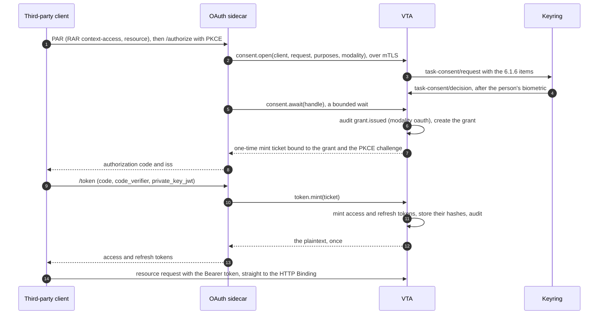

# The Human Context Protocol in the VTA: design

**Status:** proposed. Design only: no code has landed. The gate this note set,
no HCP code on `main` before the `hcp/*` suite's first release, is met: the
suite was released on 2026-11-27 (see below and [hcp-plan.md](hcp-plan.md) §5).
**Companion to:** [hcp-plan.md](hcp-plan.md) (the milestones and work
packages), [hcp-tasks.md](hcp-tasks.md) (the demo-milestone checklist) and
[tasks/hcp-demo-plan.md](../../tasks/hcp-demo-plan.md) (the demo week).
**Owner:** Brendan Miller, Alberto Leon
**Last updated:** 2026-11-26

**Normative sources:**
- **HCP 2.0-draft-3**, the Human Context Protocol
  ([loyalagents/hcp-spec](https://github.com/loyalagents/hcp-spec)). Normative
  citations are to commit `b790561`,
  [`spec/2.0-draft-3/specification.md`](https://github.com/loyalagents/hcp-spec/blob/b790561/spec/2.0-draft-3/specification.md).
  Section numbers below written "HCP n.n" are HCP's.
- **The `hcp/*` Trust Task family**: 28 tasks at `0.1`, status `draft`,
  targeting framework `0.6.0`, that carry HCP's operations, from
  `hcp/grants/request` to `hcp/import`. They are merged on `main` of
  [trustoverip/dtgwg-trust-tasks-tf](https://github.com/trustoverip/dtgwg-trust-tasks-tf)
  under [`specs/hcp/`](https://github.com/trustoverip/dtgwg-trust-tasks-tf/tree/main/specs/hcp)
  (#1380, with the declared unchecked rules in #1381 and the demos in
  `examples/hcp-demo{,-ts,-go,-dart}` in #1382), published at trusttasks.org,
  and released in `trust-tasks-rs` 0.42.0, `trust-tasks-build` 0.3.0 and
  `@openvtc/trust-tasks` 0.31.10. A `draft` may change without a version bump,
  so V0 still pins the bundles by digest at X0 ([hcp-plan.md](hcp-plan.md)
  §3.1). Two shared documents state what every task relies on:
  [`specs/hcp/_shared/0.1/CONVENTIONS.md`](https://github.com/trustoverip/dtgwg-trust-tasks-tf/blob/main/specs/hcp/_shared/0.1/CONVENTIONS.md)
  (the family error codes, §1) and
  [`specs/hcp/_shared/0.1/QUESTIONS.md`](https://github.com/trustoverip/dtgwg-trust-tasks-tf/blob/main/specs/hcp/_shared/0.1/QUESTIONS.md)
  (the questions put to the HCP editors, each with the assumption the suite
  takes). "Question n" below is that file's numbering, and a task named
  `hcp/x/y` below means `specs/hcp/x/y/0.1/spec.md` there.
- **Framework and shared tasks:** `task-consent/request/0.1`,
  `task-consent/decision/0.2`, `trust-task-next-step/0.1`,
  `trust-task-discovery/0.4`.
- **Transport:** the Trust Tasks TSP binding `tsp/0.3`
  (`bindings/tsp/0.3/spec.md`), which requires TSP 1.0 (version code
  `YTSP-BAA`) and refuses a TSP draft. The VTA already speaks TSP 1.0
  (`affinidi-tsp` 0.5); refusing a draft as `tsp/0.3` §2.2 requires comes with
  the `trust-tasks-tsp` 0.42 adoption ([hcp-plan.md](hcp-plan.md) §5). An
  agent client on `@openvtc/trust-tasks-tsp` older than 0.2.0 speaks only the
  Rev 2 draft and cannot exchange a message with the VTA.
- **The VTI specification**: *Access control* (VTI-ACL-*), *Approvals*
  (VTI-APV-*), *Audit* (VTI-AUD-*), *Transports* (VTI-TRN-*) and *Operations*
  (VTI-OPS-*).

Where this note disagrees with any of them, the source is right and this note
is the defect.

---

## 1. What HCP is, and how VTI carries it

HCP is a protocol for a person's **context**: the facts, preferences and
history an AI agent needs to act for them. A **Provider** holds the person's
context as *entries* (HCP 4.2) and discloses them to *clients*, such as an
agent, only under a **grant** the person approved (HCP 6.1). Every disclosure
is bounded by category, purpose and quantity (HCP 7.1–7.2) and carries a
`useUntil` after which the client must not use its copy (HCP 7.6). Every act
is audited (HCP 8), and a revoked grant stops working at once, with a notice
to the client (HCP 6.2).

HCP has three layers (HCP 1.2): **Core** (the data model and rules), two
**Bindings** that put Core on a wire, HTTP (HCP 9) and MCP (HCP 10), and
**Profiles** that tighten Core for a posture or a domain (HCP 11–17). A
provider claims conformance by listing identifiers in `conformsTo` in its
discovery document, and claims a binding or profile whole or not at all
(HCP 18.1).

VTI carries HCP as **Trust Tasks**: each HCP operation is an `hcp/*` task
served by the VTA's existing spine, so it rides TSP, DIDComm or REST like any
other task, with a document proof by its issuer (VTI-OPS-020) under the same
document rules on every transport (VTI-OPS-021).
That carriage is not an HCP binding. HCP has no identifier for it and opens no
extension point for bindings (HCP A.1, A.3), and every `hcp/*` specification
says a provider MUST NOT claim the carriage in `conformsTo` and advertises the
tasks through `trust-task-discovery` instead (question 1). So the plan
builds the **HTTP Binding beside the Trust Task handlers**, over the same
handlers, and makes the conformance claim on the HTTP side.

The two paths share one set of handlers, one grant store and one audit trail;
read the diagram as "the claim attaches only to the right-hand side":

```text
  +------------------ one VTA: vta-hcp handlers, one grant store -------------------+
  |                                                                                 |
  |  Trust Task carriage                     HTTP Binding /v2/* and discovery       |
  |  (TSP, then DIDComm, then REST)          (HCP-Version, problem+json, Bearer)    |
  |  hcp/* tasks, trust-task-discovery                                              |
  |  never in conformsTo                     listed in conformsTo (from V2)         |
  |  used by: Keyring, the agent client      used by: the conformance suite, HTTP   |
  |                                          clients, an MCP bridge (HCP 10.5)      |
  |                                                                                 |
  +------- Core semantics, audit and revocation are identical on both paths --------+
```

Until the HTTP Binding is complete (V2 in [hcp-plan.md](hcp-plan.md)), the
VTA is an **HCP-aligned pilot**: it implements HCP's semantics, marks every
open reading "pending HCP confirmation", and lists **no** HCP identifier in
`conformsTo`. "Aligned" is our word, not HCP's; HCP has no partial
conformance (HCP 18.1).

## 2. Where the code stands

Read against `main` as of 2026-11-25; there is no HCP code in the workspace.

| Area | Today | What HCP needs from it |
|---|---|---|
| Someone-else-approves | `task-consent/request` + `decision` (`trust_tasks/task_consent.rs`, `consent_request.rs`): the VTA mints one signed request per approver, binds it to a salted digest of the payload, pushes it, and at threshold writes a single-use grant the requester's resubmit consumes (`policy_gate.rs`). `operations/vault/oob_sign_in.rs` `remote_approval` builds a pending consent for a request the policy engine did not raise, with a bound approver and its own digest. The policy gate raises consent only from the Policy Decision Point (a `requireConsent` rule), which is off by default (`[policy] enforcement = false`, `vta-config/src/lib.rs`), and no ACL entry field raises it; a `remote_approval`-style producer does not go through the PDP | The person's affirmative act for a grant (HCP 6.1.6), approved on Keyring. Reused as is, with a new producer, so HCP does not depend on enabling the PDP |
| Step-up | `auth/step-up/approve-request/0.5` (`trust_tasks/step_up.rs`) elevates the requester's own session; its approver is always the requester (`initiate_self_step_up`). The ACL entry's `stepUp.approver` and `stepUp.require` are stored but gate nothing | Not usable for a third party's request: elevating a session on someone else's approval is what VTI-APV-005 forbids; see §5.1 |
| Outbound push | `vti-common/src/trust_task_push.rs` (`push_trust_task`): one engine (TSP, then DIDComm, then REST); `PushReissuer` re-signs a document with a fresh `id` and `issuedAt` when a retry would fall outside its acceptance window; a `did:key` recipient is reached through the VTA's own mediator. No ACL entry is needed to send | The revocation notice (HCP 6.2.3), re-issued on every attempt (§8) |
| Inbound from a party with no ACL entry | `messaging/auth.rs` admits an ACL entry, a `PUBLIC_URIS` task (proof-optional, read-only), or a module's `is_counterparty_task`; `messaging/tsp_inbound.rs` refuses an unsolicited message from anyone else | The agent client has no ACL entry (§4.3) |
| Revocation | `consent/revoke` pushes nothing | Notice, retry, `revocation.notified` |
| Audit | The chained sink (`vta-audit`), `VtaOperation` dotted actions, the `audit_coverage` census | HCP's event vocabulary (HCP 8.1) |
| Rate limits | `operation_budget` and the REST limiters apply to every task | Revocation MUST NOT be rate-limited (HCP 6.2.1, 6.2.3) |

What is kept: the spine, the policy gate, task consent, the push engine, the
audit chain, key custody and the keyspace discipline. HCP adds a subsystem; it
changes none of them.

## 3. Roles and components

| HCP role (HCP 3.2) | VTI component | Identity and keys | Notes |
|---|---|---|---|
| HCP Provider and Authorization Service (3.2.4, 3.2.5) | The VTA, with the `hcp` cargo feature: the `vta-hcp` subsystem crate behind `vta-service/src/trust_tasks/hcp.rs` | The VTA's DID; signs consent requests, notices and responses | One instance per VTA, so per person; trust contexts are partitions inside it |
| Provider Operator (3.2.8) | The person, when self-hosted; otherwise the host (a lab, a fleet, a Nitro deployment) | — | Recorded in VTA configuration |
| Management Client (HCP Client, 3.2.3), and the consent surface | **Keyring**, the VTA's admin app, over DIDComm v2 | The admin DID in the ACL; biometric or passcode on the decision | Governance tasks, and every approval |
| Context Client (HCP Client, 3.2.3) | **The agent client**: a CLI for the demo, then the agent plugin | Its own VID with a mailbox on a mediator; `client.id` is the `issuer` VID | **No ACL entry.** Its authority is the grant |
| Context Subject and Authorizing Principal (3.2.1, 3.2.2) | The VTA's person | No HCP key; `subject.id` is an HMAC of the client VID under a per-instance secret, so each client sees a different identifier | Delegates arrive with the Delegated Authorization Profile (V3) |
| Authorization Service under OAuth (13) | **The OAuth sidecar** (V3), a separate process | Its own TLS key only | §9 |

The architecture, with each trust boundary; read it as "everything that holds
authority is inside the VTA box, and everything around it either relays or
asks". The HTTP clients on the right include the conformance suite and, from
V3, third-party clients' resource requests, which never pass through the
sidecar:

```text
  person: scans the QR, types the number, approves with a biometric
        |
  +-----v--------------------+                        +---------------------------+
  | Keyring (phone)          |                        | Agent client: CLI, plugin |
  | Management Client and    |                        | Context Client; own VID,  |
  | consent surface          |                        | no ACL entry              |
  +-----------+--------------+                        +-------------+-------------+
              | DIDComm v2 authcrypt: admin DID,                    | TSP, sealed and signed:
              | document proof, ACL admin role                      | issuer proof, grant token
  +-----------v-----------------------------------------------------v-------------+
  | mediator: relays envelopes and holds mailboxes; reads no payload              |
  +---------------------------------------+---------------------------------------+
                                          |
  ==== enclave boundary (Nitro, optional) v========================================
  || VTA                                                                         ||
  ||  spine -> policy gate -> hcp handlers (vta-hcp, cargo feature `hcp`)        ||
  ||  grants, token hashes, tombstones, holds, entries, directives, notices      ||
  ||  audit chain (fails closed); signing keys and the subject.id secret,        ||
  ||  reached only through key custody                                           ||
  ||  HTTP Binding /v2/* (V1 parity, V2 full) <----------------------------------++--- HTTP clients
  ========================================^========================================
                                          | internal API: mTLS (over vsock under Nitro)
  +- - - - - - - - - - - - - - - - - - - -+- - - - - - - - - - - - - - - - - - - -+
  : OAuth sidecar (V3, optional; on the parent instance under Nitro):             :
  : authorize, PAR, token, metadata, registration.                                :
  : Holds no VTA key, no token and no grant.                                      :
  +- - - - - - - - - - - - - - - - - - - -^- - - - - - - - - - - - - - - - - - - -+
                                          | OAuth over HTTPS
                                  third-party clients
```

| Boundary | Protection (V0) | Later |
|---|---|---|
| Agent client → VTA | TSP 1.0 under binding `tsp/0.3`, sealed and signed with `VID_sndr` = `issuer`; a document proof by `issuer` (`proofPurpose: authentication`) is required on every `hcp/*` request (question 53); the token's client must equal `issuer`, else `permissionDenied` (the suite's token binding, question 22); admitted with no ACL entry only for the agent-sent `hcp/*` tasks (§4.3) | HTTP Bearer over the HTTP Binding (V1); OAuth (V3) |
| Keyring → VTA | DIDComm authcrypt from the admin DID, a required document proof by that DID, the ACL admin role; `accessToken` omitted, which the suite allows on the 18 governance requests and on `hcp/entries/create` (question 56): the VTA checks that the proven `issuer` is the enrolled admin DID (§4.4) | Dedicated management tokens (V1) |
| VTA → Keyring | A VTA-signed `task-consent/request` carrying the held request's HCP 6.1.6 items, with `parentThreadId` set to the held request's `threadId` (the suite's SHOULD, `hcp/grants/request`, "Holding while the person decides"; the VTA always sets it); Keyring accepts it only for the VID it scanned and when `parentThreadId` equals the `threadId` it scanned (§5.2) | Same |
| VTA → agent client | A VTA-signed notice (`hcp/grants/revoked`), a fresh document per attempt with a stable `noticeId`, pushed over TSP to the VID the client registered for notices (§8) | Security Event Tokens over RFC 8935 (V3) |
| REST `/trust-tasks` | `hcp/*` refused: REST carries no sender binding | Allowed with a required `issuer` proof (V1) |
| Retained copies | A token is never logged; the accepted-document store and the idempotency cache keep `accessTokenDigest`, not the token; a proof is verified at receipt only | A census asserts it (V1) |
| Model provider | The demo client answers deterministically from the entries; the token never enters a model's context or a tool result (HCP 10.5, §4.2) | Question 46 (N3), on which the suite takes no assumption yet; a dedicated `vta-mcp` HCP tool (V1, §9.4) |
| Enclave (Nitro) | The VTA runs inside; the sidecar, when there is one, outside on the parent | §9.3 |

## 4. Authority

### 4.1 Grants

A grant (HCP 6.1.5) names the client, the categories and actions, the
purposes, whether it is temporary or persistent, and when it expires.

- **Temporary by default**: a temporary grant lasts 4 hours unless the
  request says otherwise (`expiresIn` absent, in the `hcp/grants/request`
  specification), and none outlives 24 hours (HCP 6.1.3). A persistent grant is
  never pre-selected; it is its own act after the person confirms (V1).
- **Purposes** (HCP 6.1.5.2): each purpose in a request's `access` detail
  carries a `code`, an absolute URI (here an IRI), and a `description`, both
  REQUIRED by `hcp/grants/request`; the VTA shows its own description where it
  has one for that code. A detail may name none; the person is then asked to
  choose. The IRIs are the Trust Over IP DTG registry's,
  `https://registry.trustoverip.org/dtg/purpose/<name>/<n>`; the demo uses the
  two draft entries proposed there, `task-execution/1` and `personalisation/1`,
  the absolute forms of VTI's `taskExecution` and `personalisation`
  (Appendix H). The VTA reads the IRIs from configuration, so a rename in the
  registry's review needs no code change (decision 9).
- **Widening** an existing grant needs a new affirmative act (HCP 6.1.6, last
  item). A client that needs more categories asks for a new grant.
- **Narrowing** at approval is not in V0. The suite allows it:
  `hcp/grants/request` returns `grant.access` as the person approved it, which
  may be narrower than asked, and the person may choose a shorter lifetime than
  `expiresIn`. The VTA does not offer it in V0 because
  `task-consent/decision` carries approve or deny and no choices, so the person
  approves the grant as asked or declines it; a client still reads what was
  granted from `grant.access`, never from its request. A narrower grant
  afterwards comes from governance tasks: in V0,
  revoke and let the client ask again for less; from V2, `hcp/rules/*` and
  `hcp/entries/restrict-purposes`. Carrying choices in the decision would need
  a new `task-consent/decision` version, and none is planned.
- **A grant belongs to the client VID it was issued to.** A new identity is a
  new client, with a new grant. `acl/swap-key` moves an ACL entry to a new key
  and never moves a grant. Where an agent holds both a grant and an ACL entry
  (for example, one also connected on Keyring's base agent-connect path),
  disconnecting it in Keyring revokes both: the grant through
  `hcp/grants/revoke`, with its notice (§8), and the ACL entry.

### 4.2 Tokens and the per-request check

- **Opaque, 256-bit, hashed at rest.** The VTA keeps only SHA-256 of each
  token, never logs it, holds it in `Zeroizing` with a redacting `Debug`, and
  never restores a token hash from a backup.
- **One check, one door.** Every context operation runs the per-request check:
  grant status, tombstone, expiry, client VID equals the sender equals
  `issuer`, category and purpose. It returns a `VerifiedGrant`, a typestate
  with private fields that only the check can build; a handler that needs a
  grant takes one.
- **The token lives as long as the grant.** The suite's `0.1` has no refresh,
  so the response's `tokenExpiresAt` equals the grant's `expiresAt` (4 hours by
  default), as `hcp/grants/request` ("Response") says it SHOULD. A shorter
  token would end in `hcp:invalidToken` under a grant that is still live. The
  same section sets two caps that take precedence and that V0 never reaches: a
  persistent grant's token (its `expiresAt` is `null`) ends within 24 hours
  (HCP 13.4), and a token under a grant covering `health_context` SHOULD NOT
  last more than 1 hour (HCP 16.2).
- **Refusals use the suite's wire codes.** A revoked, expired or unknown token
  answers `hcp:invalidToken` (`retryable: false`), which the client reads as
  notice of revocation (HCP 6.2.2). A request outside the grant (a category or
  purpose it does not cover, or an entry that does not exist) answers
  `permissionDenied` with one fixed `message` whatever the reason (HCP 5.5).
  HCP's `invalid-token` and `scope-denied` are its Core error codes (HCP 5.5),
  sent over HTTP as problem details (HCP 9.7); they are not codes on this wire,
  and the VTA never sends them over the Trust Task carriage. The three family
  codes, `hcp:invalidToken`, `hcp:versionConflict` and `hcp:credentialInvalid`,
  are defined once in the suite's `CONVENTIONS.md` §1, each `retryable: false`;
  V0 reaches only the first. A code only one task can reach is namespaced under
  that task (`hcp/export:tooLarge`, V2). Throttling answers `unavailable` with
  `retryAfter`, never on a revocation (§8). A token presented by the wrong VID
  answers `permissionDenied` (the suite's token binding, question 22), which
  tells the sender the token is live where an unknown one answers
  `hcp:invalidToken`; that is the suite's rule today and question 49 (N6).
- **A proof on every token-carrying request.** The suite makes the request
  proof REQUIRED wherever a request carries `accessToken` (question 53), so the
  binding always applies: an unsigned request with a valid token is refused,
  where HCP's HTTP Binding would serve it. Every `hcp/*` document is signed for
  `proofPurpose: authentication`, the framework default, both what the VTA
  verifies and what it signs (next steps, responses, notices).
- **Out of the model's context** (HCP 10.5). An agent runtime holds the token
  in the component that builds and sends the document. The token never enters
  a model's context and is never returned as tool content, the rule
  `hcp/entries/query` ("The access token") states for every `hcp/*` task. The
  demo's client has no model in the loop (decision 15); `vta-mcp` needs a
  dedicated HCP tool
  for it, never the generic `vta_call` (§9.4).
- **Sender binding holds on TSP and DIDComm only**, which is why `hcp/*` is
  refused over REST until REST carries a required `issuer` proof (V1).

### 4.3 Admitting a Context Client that has no ACL entry

The agent client is a third party. It must not hold an ACL entry: an entry
confers authority under VTI-ACL-001, and the client's authority is meant to
be the grant and nothing else.

`messaging/auth.rs` already admits parties with no entry in two ways, and
only one fits:

- **`PUBLIC_URIS` does not.** It is for proof-optional, read-only tasks, and a
  census holds it to that (`every_public_task_is_proof_optional_and_read_only`).
  The agent-sent `hcp/*` tasks mutate and require a proof.
- **A counterparty hook does.** Like `notifications::is_counterparty_task`, a
  new `hcp::is_context_client_task` admits only the agent-sent `hcp/*` URIs,
  and only after the ACL has refused the sender (`AppError::Forbidden`). It
  yields a **zero-authority** claim: the handler reads nothing authoritative
  from it, and authority comes from the grant token or the held request.

The same hook admits the client's acknowledgement of a revocation notice
(§8), which `tsp_inbound.rs` would otherwise refuse as unsolicited.

This is still a party acting on the VTA with no ACL entry, which VTI-ACL-001
does not contemplate. It is recorded as a divergence (§12).

### 4.4 The Management Client

Keyring holds no VTA session token on its DIDComm path: its identity is the
authcrypt sender plus a document proof on every task. So in V0 Keyring's
tasks, the governance tasks `hcp/grants/revoke`, `hcp/audit/read` and
`hcp/disclosures/summary`, and `hcp/entries/create` (a context operation, here
the person's own write under no grant), **omit `accessToken`**, and the VTA
checks that the
request's proven `issuer` is the **admin DID** the person enrolled as the
Management Client: authcrypt sender, a required document proof by that DID,
and the ACL admin role through `act_scope()` and `require_capability`. Any
other issuer is refused `permissionDenied`. This is what every Keyring task
already does, it needs no token store, and the ACL can revoke it.

The suite states this rule in each of those specifications' "Authorization"
section, as a working assumption pending HCP confirmation: `accessToken` is
OPTIONAL on the 18 governance requests and on `hcp/entries/create`; where it is
absent, the provider authenticates the request's `issuer`, by the REQUIRED
request proof, as a Management Client the Authorizing Principal enrolled by
authenticating (HCP 3.2.3, "credentials"), and refuses any other issuer with
`permissionDenied` and the one fixed `message`; where a token is present, the
token rules apply as before, the binding included. A create with no token is
the Management Client's write for the person, under no grant. The suite asks
the HCP editors whether such a proof counts as those credentials (question 56,
one of the three it lists as most important, cross-referring questions 22, 37
and 53); question 37 asks whether governance may travel off HCP's HTTP Binding
at all. HCP otherwise reserves governance to a Management Client holding an HCP
credential (HCP 3.2.3, 5.4, 6.1.9). V1 adds dedicated opaque management tokens;
until then the VTA relies on the suite's assumption, and the departure from
HCP's token model is recorded (§12).

Keyring's own governance tasks are **never held** for consent in V0: each is
the person's own act, authenticated as above, and only `hcp/grants/request`
from a Context Client is held (§5).

## 5. Consent through task-consent

### 5.1 Why task-consent, not step-up

HCP 6.1.6 requires an affirmative act by the person, distinct from
authentication, after they have been told what is asked. The VTA has two
signed approval paths. Step-up (`auth/step-up/approve-request`) elevates the
requester's own session and is self-approve only: its approver is always the
requester (`initiate_self_step_up`), and the ACL's `stepUp.approver` is stored
but gates nothing. Someone else approving is the consent flow's job, and
using step-up for a third party's request would be exactly what VTI-APV-005 forbids ("MUST NOT
implement a consent requirement by elevating the requester's session on the
strength of another party's approval"). Task-consent is the path built for
"someone else approves":

- the approval is bound to a salted digest of the exact payload and is
  single-use (VTI-APV-004);
- the request expires (VTI-APV-008);
- what the approver sees is written by the VTA into the request's `effects`
  and covered by the same signature (VTI-APV-011), derived from the same
  octets as the digest (VTI-APV-013);
- Keyring already receives it, checks it, gates the decision on the owner's
  biometric or passcode, and signs `task-consent/decision`. The VTA accepts a
  decision (`task-consent/decision/0.2`) only with a proof made for
  `assertionMethod`, by a key listed under the approver's `assertionMethod`,
  and refuses one made for `authentication`, so the admin DID needs an
  `assertionMethod` verification method, beside the `authentication` one its
  `hcp/*` governance requests are signed under (§4.2);
- the operation is re-checked when it executes (VTI-APV-017).

The HCP 6.1.6 items need no specification change: the shared `Effect` has an
open `kind`, a `summary` and a free `detail`, so the VTA writes one effect per
item (categories and their descriptions, actions, purposes, the longest
`useUntil`, temporary or persistent, the expiry, the client and its Client
Operator, whether directives are followed). The Client Operator comes from the
registration, never from the request; a request's free text is untrusted.

The effect kinds are published here so that Keyring can render a structured
checklist rather than only each `summary`. Every effect still carries a
`summary` a surface must show, so a kind Keyring does not know degrades to its
text. The kinds and `detail` shapes are the V0 contract between A3 and Keyring's
C1 ([hcp-plan.md](hcp-plan.md) §4):

| `kind` | One per | `detail` |
|---|---|---|
| `hcpClient` | request | `clientId` (the client VID), `name` (as the person will confirm it), `operator` (from VTA configuration) |
| `hcpCategory` | requested category | `category` (slug or URI), `description`, `actions` (the HCP actions asked for it) |
| `hcpPurpose` | requested purpose; one with `choose: true` when the request names none | `purpose` (the IRI), `description` |
| `hcpUseUntil` | request | `maxUseSeconds` (the longest `useUntil` a disclosure may carry) |
| `hcpGrantTerm` | request | `persistence` (`temporary` in V0), `expiresAt` (RFC 3339) |
| `hcpDirectives` | request | `followsDirectives` (boolean) |

The approval binds to the payload digest, not to these members: they describe
the request, and a surface that ignores `detail` loses only structure.

### 5.2 The approval and grant flow

Read the diagram as two halves: steps 1–7 hold the request and ask the person;
steps 8–13 turn the person's decision into a grant the client can use.

```mermaid
sequenceDiagram
    autonumber
    participant C as Agent client
    participant P as Person
    participant K as Keyring
    participant V as VTA (vta-hcp)
    C->>P: QR (client VID, threadId, VTA DID) and a four-digit number
    P->>K: scans the QR and types the number
    C->>V: hcp/grants/request over TSP, proof by issuer
    Note over V: admitted with no ACL entry, zero authority (§4.3)
    V->>V: pending task-consent: request digest, bound approver,<br/>6.1.6 items as effects
    V-->>C: trust-task-next-step, continuation resubmit, hint.retryAfter (never an error)
    V->>K: task-consent/request, VTA-signed, parentThreadId = held threadId,<br/>push engine: TSP, then DIDComm, then REST, via Keyring's mediator
    Note over V,K: doorbell once: the DeviceBinding gateway (push/wake),<br/>else the mediator wake; no route: nothing is sent
    K->>P: checklist, if the VID and parentThreadId match the scan
    P->>K: approves with a biometric
    K->>V: task-consent/decision, proof by the admin DID (assertionMethod)
    V->>V: verify; record the client registration; single-use consent grant
    C->>V: resubmits hcp/grants/request (same threadId)
    V->>V: audit grant.issued (modality, acr), then grant (4 h) and token hash
    V-->>C: grant and token, tokenExpiresAt = grant expiresAt
```

- **The hold is a next step, never an error.** HCP 6.1.7 leaves the shape of
  the request to the authorization profile and requires only the 6.1.6
  outcome; `hcp/grants/request` ("Holding while the person decides", rule 1)
  answers a pending request with `trust-task-next-step`, `expects` naming the
  request's Type URI, and `continuation: resubmit`. The policy gate's
  `auth:consent_required` refusal is the form to avoid.
- **The next step says when to come back.** The VTA sets
  `expects[].hint.retryAfter`, a whole number of seconds from 1 to 3600
  counted from receipt (the suite's `$defs.NextStepHint`, rule 5), not
  `trust-task-error`'s RFC 3339 `retryAfter`; the client validates the hint
  and does not resubmit sooner.
- **Rules for a resubmission** (rules 2 to 4). It is a new document with a
  fresh `id` and the same `threadId`, `issuer` and payload. One whose payload
  differs is refused `malformedRequest`; a document on a held or approved
  thread from another `issuer` is refused `permissionDenied`, gets no next
  step and no token, and leaves the hold as it was. The person is never asked
  twice for one thread. Every next step and the response go to the held
  request's `issuer`.
- **The person is the VTA's.** One VTA serves one person, so it ignores
  `subjectHint` (`hcp/grants/request`, "Finding the person").
- **How the request reaches Keyring.** `push_to_device` decides the route
  (`approver_mediator`): a `did:key` approver through the VTA's configured
  `[messaging] mediator_did`, any other through the mediator its DID document
  advertises. With no route, nothing is sent and only the relay copy exists,
  which a CLI requester cannot pass on. Otherwise the push engine queues it
  durably over the transports both sides speak, TSP, then DIDComm, then REST,
  escalating when an attempt shows no evidence of collection, and rings the
  doorbell once: a `push/wake` to the gateway in Keyring's ACL `DeviceBinding`
  where one is set, else `messaging/wake/request/0.1` to Keyring's mediator. A
  mediator that does not serve that task ignores it, and the device collects on
  its next connection; whether the starter's pinned mediator serves it is not
  verified. The push fires only when the pending is newly raised, so a
  resubmission never re-rings the phone. The demo keeps Keyring in the
  foreground, so it does not depend on the wake.
- **Holds are keyed by (`threadId`, `issuer`).** After approval, a
  resubmission on the thread within an hour of the first response gets a
  response for the same grant, the same `grantId` and no second `grant.issued`
  (`hcp/grants/request`, "After approval", question 39). The suite lets the
  provider repeat the token or mint a new one under the same grant; the VTA
  keeps only token hashes, so it mints a new one, ending with the grant. A
  resubmission after that hour, or after the grant was revoked or expired, is
  refused `permissionDenied`. A re-delivered copy with the same `id` is
  answered from the duplicate-execution record, which holds no token (§3
  "Retained copies"), so it too is answered with a newly minted token for the
  same grant; see §12 for how that reads against SPEC §7.2 item 11.
- **Four timers, each stated on its own.** The hold's 300 seconds is the HCP
  producer's own `expiresAt`, set the way `remote_approval` sets its window;
  it does not inherit the policy gate's 900-second pending lifetime
  (`CONSENT_PENDING_TTL_SECS`). The push engine's 300-second `deliver_by`
  (`CONSENT_PUSH_DELIVER_BY_SECS`) bounds retries of the push hop only, not the
  request's validity. The single-use consent grant an approval writes lasts 600
  seconds (`task_consent.rs`); the client's resubmission consumes it, and the
  HCP grant it then issues lasts 4 hours (§4.1).
- **A hold ends once, and its thread is never reopened.** A decline answers
  `permissionDenied`: `hcp/grants/request` issues a grant rather than
  producing a decision, so the framework's rule for a declined referral applies
  (SPEC §4.13.3 rule 2). A hold not approved within 300 seconds (how long to
  hold is provider policy) is **denied, not reopened** (the suite's "expired
  hold", rule 6): the policy denies, and the next resubmission on that thread
  gets the same `permissionDenied`, with the same fixed message, as a decline
  and an unknown person (SPEC §4.13.3 rule 5). The VTA never abandons a hold
  as `cancelled`, which a client could tell from a decline. A new ask needs a
  new request on a new thread. The VTA remembers an ended thread (declined,
  timed out, or approved and past its hour) for at least as long as it would
  accept a resubmission on it. One visible end per
  hold also stops a client telling an abandoned hold from an unknown person.
- **The consent request names the held thread.** The VTA sets the envelope's
  `parentThreadId` on `task-consent/request` to the held request's `threadId`
  (SPEC §4.9.2, §4.13.3 rule 3), and Keyring accepts the request only when it
  equals the `threadId` it scanned. `hcp/grants/request` says the nested
  exchange's documents SHOULD carry it; the VTA always sets it on the
  request. `parentThreadId` is an envelope member, so no schema changes. This is new work: today `consent_request.rs` builds the
  document with `id`, `type`, `issuer`, `recipient`, `issuedAt` and `payload`,
  and sets no thread member (A3), and Keyring keeps only the payload (its C1).
- **Registration at first approval: a declared divergence from the suite.**
  HCP requires a registered client, and `hcp/grants/request`
  ("Authorization") says the provider MUST refuse a request whose `issuer` is
  not a registered client with `permissionDenied`. The VTA departs from that
  MUST in V0: it holds a request from an unregistered `issuer` and records
  the registration when the person approves, with the name they confirm and
  the operator from VTA configuration; nothing the request supplies becomes the
  registered name. The registration also records the `issuer` VID as the VID
  the client receives notices at, which `hcp/grants/revoked` ("Parties")
  requires a registration to name. The suite records this divergence as the
  demo's in question 52 (N9) and keeps its rule until the HCP editors answer;
  no new wire specification is needed.
- **The number** is the first four decimal digits of SHA-256 over the
  `threadId` and the client VID, so a person who types it has bound the
  phone's approval to the client they are looking at.

## 6. Enforcement

- **`hcp/entries/query`** returns at most the lesser of `maxEntries`
  (default 5) and 20 entries, never padded (HCP 7.2), in relevance order
  (HCP 7.3), each a `Disclosure` with a grant-scoped `ref` (an HMAC, so two
  grants cannot correlate entries) and a `useUntil` (HCP 7.6), with a
  minimisation report (HCP 7.5) whose `method` names the relevance method that
  ordered them. Recency alone is not a relevance method, so V0 orders by a
  lexical match on the query text, reported as `lexical`, one of the values
  `hcp/entries/query` names, with recency only to break ties.
  HCP has the provider declare that method in its discovery document (HCP 7.3,
  19.3), which V0 does not publish (§9.4); see §12. A client with no
  notification endpoint gets at most 1 hour (HCP 6.2.3, 7.6); in V0 every
  client has one, the VID recorded at registration (§5.2). The response may be
  up to 12 MiB under the task's `maxDocumentBytes`, but a mediator may cap a
  message lower, so V0's entries are kept small.
- **`hcp/entries/create`** accepts `person-declared` entries only. Accepting
  `model-inferred` ones obliges the provider to claim the Memory Manager
  Profile (HCP 4.7, 15.1), so the VTA refuses them until that profile lands
  (V3).
- **Directives** (HCP 6.4) are delivered with query results from V1; the
  client applies them in code, never in a model's context. "Answers other
  people" has no HCP action, so its custom action URI is on a domain the
  Keyring team controls, read from configuration like the purposes
  (decision 16); whether such a URI is an extension point is question N8.
- **`vta/memory/*` stays beside the HCP entry store in V0**, unchanged. The
  two are separate stores: nothing is copied between them, and a Context
  Client with a grant sees only `hcp_entries`. A bridge between them, or a
  migration of one into the other, is **deferred**, not decided
  ([hcp-plan.md](hcp-plan.md) §8).
- **Same handlers on every path.** HTTP routes and Trust Task handlers call one
  `vta-hcp` operation each, so parity is by construction and a parity test
  proves it (V1).

## 7. Audit

HCP 8.1 names the events: `grant.issued` (carrying the `modality` and `acr`
that HCP 6.1.6 requires),
`context.read` (with what was disclosed and its `useUntil`),
`context.created`, `context.shared`, `grant.revoked`, `revocation.notified`,
`directive.set`.

- They are recorded as `VtaOperation` dotted actions (`hcp.grant.issued`, …)
  in the existing chained sink, not as new `VtaAuditEvent` variants, with an
  HCP index for `hcp/audit/read` and `hcp/disclosures/summary`.
- **Audit before the state change, and fail closed.** If the row cannot be
  written, the operation answers `unavailable` (VTI-AUD-003).
  The one exception is revocation and its notices: a revocation must never be
  refused for want of an audit row (HCP 6.2.1, 6.2.3), so it records best-effort,
  never `let _ =`.
- **Refusals are audited too** (VTI-AUD-003). A refusal an honest client never
  triggers, such as a token presented by the wrong VID, also logs
  `security_alert = true`.
- **Integrity.** The trail is hash-chained, the tamper evidence VTI-AUD-004
  asks for. The HCP discovery document's posture declares it
  (`audit_integrity: hash-chained`) once there is one (V2, §9.4). Signed
  checkpoints come in V2, which matters once the operator is not the person.
- **Personal data** in a row is referenced, not embedded (VTI-AUD-005);
  reading the trail is itself authorized and audited (VTI-AUD-006).

## 8. Revocation and notices

Revocation takes effect at the VTA immediately and does not wait for the
notice (HCP 6.2.2, 6.2.3).

- **Immediate.** `hcp/grants/revoke` writes a tombstone and the per-request
  check refuses the grant from then on; the `grant.revoked` event is appended
  within 60 seconds (HCP 6.2.2).
- **Repeats and unknown grants** (`hcp/grants/revoke`, "Repeated requests",
  question 15). Revoking an already-revoked or expired grant succeeds with the
  empty response, appends no second event and sends no second notice; an
  unknown `grantId`, or one the caller may not see, is refused
  `permissionDenied` with the one fixed message. A Context Client's token is
  refused whatever grant it names; a client gives up its own grant with
  `hcp/grants/relinquish` (V1), which sends no notice.
- **Who is told** (`hcp/grants/revoked`, "Delivery rules carried from HCP").
  A notice goes only to a client that holds entries disclosed under the grant
  and registered a notification endpoint, here the VID recorded at
  registration (§5.2). A client that never queried is not told; there is
  nothing for it to stop using.
- **Never rate-limited.** HCP forbids rate-limiting revocation (HCP 6.2.1)
  and limiting, delaying or conditioning it (HCP 6.2.3). `hcp/grants/revoke` is on a code-level
  exempt-URI list for `operation_budget` and the REST limiters, never a
  setting, with a census test. VTI-TRN-029 requires a node to bound what any
  one subject can consume; this exemption is recorded as a divergence (§12).
- **One retry owner.** The notice `hcp/grants/revoked` goes out through
  `push_trust_task`, and its schedule extends `PushReissuer`'s; there is no
  second retry loop (see [retry-and-idempotency.md](retry-and-idempotency.md)).
- **Fresh document per attempt, stable `noticeId`.** Each attempt is re-signed
  with a new `id` and `issuedAt` (`PushReissuer` today re-issues only past the
  acceptance window; A5 makes it every attempt for this notice), so the
  replay and acceptance-window rules (VTI-OPS-024, VTI-OPS-026) and HCP's
  300-second `iat` check hold; the `threadId` and payload stay the same, and
  the client de-duplicates on `noticeId`, keeping each for at least 25 hours.
  At least 5 attempts over at least an hour, with exponential backoff
  (HCP 9.9), and none more than 24 hours after the first. HCP 9.9 resends the
  same SET; the fresh document and the 24-hour cap are the suite's declared
  departure, question 16 (N10). The notice is signed for `authentication` with
  a key the VTA's DID document authorizes; with no HCP discovery document
  (§9.4) there is no JWKS for it to appear in.
- **Delivered means acknowledged.** A push that returns `Ok` is only queued,
  and a mediator handoff is not delivery; nor is a `tsp/0.3` delivery receipt
  (`messaging/receipt`), which says the client's endpoint holds the message,
  not that the client accepted the notice. The notice counts as delivered when
  the client's acknowledgement (the empty `#response`, its proof RECOMMENDED)
  arrives, from any attempt; the VTA then records `revocation.notified`. A
  non-retryable error from the client ends delivery as abandoned, as does the
  24-hour limit, and the VTA records `revocation.notified` with that outcome
  and meets HCP 6.2.4's duties. A client answering `unavailable` is retried.
- **The person is told** (HCP 6.2.4). `hcp/disclosures/summary` carries, per
  client that received context, `notification` (`delivered`, `abandoned` or
  `none`, for the most recent notice) and `usableUntil` (the delivery time
  once delivered). Keyring polls it while the revoke screen is open and shows
  "Telling…" while the revoked grant's client still reads `none`, then "was
  told at <time>" on `delivered`, or that the client was not told and when the
  last copy stops being usable on `abandoned`. HCP's values have no "in
  progress" state, so "Telling…" is Keyring's reading of `none` after its own
  revoke; see §12.

Read the diagram as the person's view (Keyring, top) and the client's view
(the notice loop) running side by side after one revoke:

```mermaid
sequenceDiagram
    autonumber
    participant P as Person
    participant K as Keyring
    participant V as VTA (vta-hcp)
    participant C as Agent client
    P->>K: Revoke
    K->>V: hcp/grants/revoke (admin DID, proof, ACL role)
    V->>V: audit grant.revoked (best effort), tombstone; exempt from rate limits
    V-->>K: revoked
    loop until acknowledged: at least 5 attempts over at least 1 h, none after 24 h
        V->>C: hcp/grants/revoked, a fresh signed document, same noticeId
    end
    C-->>V: acknowledgement (admitted with no ACL entry)
    V->>V: audit revocation.notified (delivered)
    loop while the revoke screen is open
        K->>V: hcp/disclosures/summary
        V-->>K: notification: delivered at <time>
    end
    C->>V: hcp/entries/query with the old token
    V-->>C: hcp:invalidToken
```

## 9. Keep the VTA lightweight: the OAuth sidecar

### 9.1 The rule

The VTA is the trust anchor: keys, authority, enforcement and audit. A large
or fast-changing protocol surface that is not core to that goes in a
**sidecar**: a separate process, off by default, enabled per deployment, and
never compiled into the VTA. The first case is HCP's OAuth Interop Profile
(HCP 13). HCP already separates the roles: the Authorization Service "MAY be
deployed within the HCP Provider" (HCP 3.2.5), so it may also be deployed
beside it.

Why: it keeps the VTA's attack surface, dependency graph and enclave image
small; deployments that do not accept third-party clients carry none of it;
and the sidecar can adopt a mature OAuth library, or be replaced, without
touching the trust anchor. The costs: one more image, an internal API with
its own authentication, versioning and tests, and a test that the VTA works
with the sidecar absent.

| | OAuth sidecar | VTA |
|---|---|---|
| Owns | The OAuth surface: `/authorize` with PKCE, PAR (required for the RAR `context-access` type), `resource`, RFC 9207 `iss`; `/token`; RFC 8414 and 9728 metadata, with values the VTA supplies; client registration (client ID metadata documents first; a DID `client_id` as an extension); `private_key_jwt` with a `jti` replay cache; RFC 7009 revocation; device authorization and its pages; browser login | Grants, the person's consent (through Keyring), the token store (hashes only) and every mint, refresh rotation bound to the grant, the per-request check on every resource request, audit, revocation, tombstones, notices and SETs |
| Holds | Short-lived protocol state: authorization codes bound to a PKCE challenge and a mint ticket, PAR `request_uri`s, device codes, registrations, the `jti` cache, its own TLS key | Every key and secret that grants or protects context |
| Never | Stores a token, a token hash or a grant; decides consent; signs as the VTA; writes a VTA keyspace | Speaks OAuth on its own public interface |

### 9.2 The ticket flow

The VTA is the **sole owner of the token store**: the sidecar asks it to mint
each token against a one-time ticket that only a real consent produces. Read
the diagram for where the plaintext token exists: it is minted in the VTA
(step 11) and passes through the sidecar once (steps 12–13), and resource
requests never touch the sidecar (step 14).



The internal API is enumerated: `consent.open`, `consent.await`,
`token.mint`, `token.refresh`, `token.check` (only for the sidecar's own
endpoints that receive a token, such as RFC 7009 and device polling) and
`grant.revoke`. Each call is authorized and audited by the VTA like any other
caller's.

Why not a shared token store, or introspection: a shared store saves one hop
at issuance only, but gives the sidecar write access to VTA state and copies
the backup rule (tokens never restored) into a second place; introspection the
other way round makes the sidecar the token owner and puts a hop on every
resource request. With the VTA as owner, a compromised sidecar cannot mint a
token without a fresh consent, cannot read existing tokens, and cannot revive a
revoked grant. It does see each token once, in transit, because it terminates
the client's TLS.

### 9.3 Channel and Nitro

- **Mutually authenticated TLS on a private network**, with per-deployment
  pinned certificates and the sidecar's identity checked on every call; the
  internal API is never bound to a public interface. A Unix socket with peer
  credentials is acceptable for a single-host developer setup.
- **Under Nitro**, the VTA runs in the enclave and the sidecar outside it, on
  the parent, as the internet-facing endpoint. The mTLS session terminates
  inside the enclave, so the parent cannot read consent requests or minted
  tokens on the vsock. A sidecar inside the enclave would still need an
  ingress proxy outside and would grow the enclave image. The trade-off: a
  minted token leaves the enclave to reach its client, and the parent sees it
  only if the sidecar host is compromised. See
  [../02-vta/tee-architecture.md](../02-vta/tee-architecture.md).

### 9.4 Other surfaces

The same question applies to every non-core surface. Only OAuth is decided;
these are recommendations:

| Surface | Recommendation, and why |
|---|---|
| HTTP Binding | **Keep in the VTA, behind its own feature.** It is the resource-server surface the conformance claim rests on, and every request needs the per-request check against VTA state; a façade would only proxy |
| MCP over Streamable HTTP | **Extend the separate `vta-mcp` process; nothing in the VTA.** HCP 10.5 already makes a bridge a client of the provider |
| `vta-mcp` today (stdio) | **A client bridge, not a provider front end** (HCP 10.5; question 44, N1, on which the suite takes no assumption yet). Work listed for V1 ([hcp-plan.md](hcp-plan.md) §3.4): `vta-sdk` handles held replies (it sets a `threadId`, never returns a `trust-task-next-step` as the result, and resubmits per its continuation or gives up); `vta-mcp` gets a dedicated HCP tool that keeps the token out of the model's context, and until then `vta_call` refuses `hcp/*` |
| SETs over RFC 8935 | **Keep in the VTA as another `PushReissuer` channel**: one retry owner, and the SET is signed with VTA keys. Needs an SSRF guard on outbound HTTP |
| Discovery | **The `hcp/*` tasks through `trust-task-discovery/0.4` from V0**, reflecting the served, feature-gated tasks, never in an HCP `conformsTo`. **No HCP discovery document until V2**: HCP's schema needs at least one HCP binding in `conformsTo`, which the carriage cannot be (questions 1, 36), so until the HTTP Binding is claimed a client's trust anchor for the VTA is the VID it got from the person's pairing (the QR), as every `hcp/*` specification's "Parties" rule allows. From V2 the HCP discovery document is **in the VTA**, and the VTA's DID document lists it as a service, or the document names the VID, the binding those rules require a client to check. **OAuth metadata in the sidecar**, with a census over both |
| Device and login pages | **In the sidecar; consent stays in Keyring** |

## 10. State and backup

Each keyspace is a `const` in `vta-keyspaces`, in `ALL`, and in exactly one of
`BACKED_UP` or `EXCLUDED_FROM_BACKUP` with a reason, with its context-deletion
purge declared. No bare keyspace literals.

| Keyspace | Holds | Backup |
|---|---|---|
| `hcp_grants` | Grants (HCP 6.1.5): status, client, purposes, expiry | Backed up; a restored grant comes back suspended |
| `hcp_tokens` | SHA-256 of each token → grant | Excluded: never restored |
| `hcp_tombstones` | Revoked grant ids | Placed so that a restore can never drop one |
| `hcp_holds` | Held `grants/request` by (`threadId`, `issuer`), and ended threads for as long as a resubmission on them would be accepted (§5.2) | Excluded |
| `hcp_entries` | Entries, with linear versions | Backed up |
| `hcp_directives` | Directives (V1) | Backed up |
| `hcp_notices` | The notice schedule per `noticeId` | Backed up |

`storage_encryption` is declared `server`. Custody of the keys is VTI's
argument ([key-custody.md](key-custody.md)), not something HCP 4.8 is asked to
cover.

## 11. Decisions

Each was taken with the reason shown; the plan records which milestone
carries it.

| # | Decision | Reason |
|---|---|---|
| 1 | HCP lives **in the VTA**, as the `vta-hcp` subsystem crate behind the `hcp` feature, off by default; wire types from a `vti-specs-hcp` crate | The VTA already holds the person's context, keys, ACL and audit; a separate provider would duplicate all of them. A subsystem crate is inside the line [vta-service-decomposition.md](vta-service-decomposition.md) draws |
| 2 | **One instance per VTA**, so per person; trust contexts are partitions; `subject.id` pairwise per client | HCP's Context Subject is one person; pairwise identifiers stop two clients correlating them |
| 3 | **Consent through task-consent** (`request/0.1`, `decision/0.2`), from a `remote_approval`-style producer with a bound approver | §5.1: the only path built for someone else approving, already in Keyring, bound to the payload digest |
| 4 | **The hold is `trust-task-next-step`**, never an error | HCP treats a pending request as a state, not a failure |
| 5 | **Opaque, hashed, sender-bound tokens**; `hcp/*` refused over REST until REST carries an `issuer` proof | Sender binding holds only where the transport authenticates the sender |
| 6 | **No-ACL admission through a counterparty hook**, never `PUBLIC_URIS` | §4.3 |
| 7 | **Management by DID-proven request** in V0: no `accessToken`, the proven `issuer` must be the enrolled admin DID; management tokens in V1 | §4.4: there is no session token on Keyring's path to reuse; `accessToken` is OPTIONAL on the 18 governance requests and `hcp/entries/create`, the suite's working assumption, pending HCP confirmation (question 56) |
| 8 | **Revocation exempt from rate limits**, as a code-level list with a census | HCP's MUST protects the person; a hidden exception would be worse than a recorded one |
| 9 | **Purpose IRIs in the Trust Over IP DTG registry** (`trustoverip/dtgwg-vsc-registry`), at `https://registry.trustoverip.org/dtg/purpose/<name>/<n>`; the entries are drafts in the registry's review; the VTA reads them from configuration | A shared, governed vocabulary beside the registry's `/dtg/vsc/`; a rename in review is a configuration change |
| 10 | **Register the client at the person's first approval**; operator from VTA configuration; the `issuer` VID recorded as its notice VID | The smallest reading that keeps the agent out of the ACL; no new wire specification. It departs from `hcp/grants/request`'s MUST refuse an unregistered `issuer`, a divergence the suite records as the demo's (question 52) |
| 11 | **`person-declared` entries only** until the Memory Manager Profile | Accepting `model-inferred` obliges the profile (HCP 15.1) |
| 12 | **The HTTP Binding beside the handlers from V1**, the full binding and the First-Party claim in V2 | The carriage cannot be claimed (§1); building HTTP beside each handler costs less than a retrofit |
| 13 | **MCP is not a shortcut** | HCP 10.5 makes a stdio bridge such as `vta-mcp` a client, and MCP over Streamable HTTP maps onto OAuth (HCP 10.1) |
| 14 | **The OAuth Authorization Service is a sidecar** (V3); the VTA is the sole owner of the token store and mints each token against a one-time ticket; mTLS between them | §9 |
| 15 | **The demo's client answers deterministically**, citing entries and purposes | Repeatable, and no disclosure to a model provider |
| 16 | **The directive action URI for "answers other people" is on a domain the Keyring team controls**, read from configuration | HCP 6.4 allows an absolute URI; no registry home fits yet, since a shared action list would mix acting as oneself with acting in the person's name (question 51, N8) |
| 17 | **The demo runs on openvti-starter's MODE=tunnel** | A phone cannot reach MODE=local, which binds loopback, uses `localhost` DIDs and runs no mediator ([tasks/hcp-demo-plan.md](../../tasks/hcp-demo-plan.md)) |
| 18 | **An expired hold is denied, never reopened**; decline, timeout and unknown person answer the same `permissionDenied` | §5.2: one end per hold, and no probe |
| 19 | **The consent request carries `parentThreadId`** equal to the held request's `threadId` | The framework's carrier for a nested exchange (SPEC §4.13.3 rule 3); no schema change |
| 20 | **The suite's wire codes**: `hcp:invalidToken` for a revoked, expired or unknown token, `permissionDenied` outside the grant, the family codes as `CONVENTIONS.md` §1 defines them | §4.2: `scope-denied` is HCP's Core name, sent over HTTP, not a code on this wire |
| 21 | **The token expires with its grant** (`tokenExpiresAt` = grant `expiresAt`) | The suite's `0.1` has no refresh |
| 22 | **No narrowing at approval in V0**: approve as asked, then narrow with governance tasks | §4.1: `task-consent/decision` carries no choices; the suite allows a narrower grant, V0 does not offer one |
| 23 | **A key swap never moves a grant; disconnect revokes both grant and ACL entry** | §4.1: a new identity is a new client |
| 24 | **`vta/memory/*` stays beside HCP in V0**; a bridge is deferred | §6: two stores, nothing copied |
| 25 | **`vta-mcp` is a client bridge**; Keyring's governance tasks are never held in V0 | §9.4, §4.4 |
| 26 | **No HCP discovery document before V2**; the `hcp/*` tasks are advertised through `trust-task-discovery/0.4`, and a client anchors on the VID from the pairing | §9.4: a valid HCP discovery document needs an HCP binding in `conformsTo`; the suite's anchor rule (question 36) covers a provider with none |
| 27 | **Query results in relevance order**, `lexical`, recency breaking ties | §6: HCP 7.3 and `hcp/entries/query` order by relevance |

Open: whether the sidecar is our own small binary or embeds a mature
authorization server (a Rust library survey decides it, before V3); and the
placements in §9.4.

## 12. Divergences, and where each is recorded

A divergence is recorded, not hidden, and recording it is not an exemption.
Three registers hold them:

- **Divergences** from a VTI requirement, or from an HCP rule the VTA departs
  from for a stated reason, go to Appendix F of the VTI specification, as a
  dtgwg-vti-spec PR, separate from any change proposal.
- **Proposed VTI changes** go to dtgwg-vti-spec as change proposals of their
  own: the new requirements for HCP (`VTI-HCP-*`), and an Appendix H change
  that lists each purpose's DTG registry IRI as its canonical identifier, with
  the bare name (`taskExecution`, `personalisation`, …) kept as a deprecated
  alias that a verifier maps to the IRI before the exact comparison
  (VTI-ACL-109). Without it, a grant naming the IRI and an ACL or credential
  naming the bare name are two strings for one purpose.
- **Readings of HCP** that HCP leaves open are marked "pending HCP
  confirmation" in the `hcp/*` specifications and sent to the HCP editors as
  questions, with the working demo.

| Divergence | From | Recorded in |
|---|---|---|
| No HCP `conformsTo` until V2: an aligned pilot | HCP 18.1 (posture, not a breach) | This note §1; `trust-task-discovery` (no HCP discovery document until V2, §9.4) |
| A Context Client acts with no ACL entry, through a zero-authority hook | VTI-ACL-001 | Appendix F |
| `hcp/grants/revoke` exempt from the operation budget | VTI-TRN-029 | Appendix F |
| Management by DID-proven request, not an HCP token (V0) | HCP 1.6, 5.4 | Appendix F; the suite's working assumption, questions 56 and 37 |
| `hcp/*` refused over REST (V0), so the decision depends on the transport | VTI-TRN-002, VTI-OPS-092 | Appendix F |
| A token is bound to the `issuer` VID, and every token-carrying request needs a proof | HCP 9.3, a plain Bearer token (stricter) | Suite carriage rule; questions 22 and 53 |
| A fresh notice document per attempt; nothing after 24 hours | HCP 9.9 (same SET resent) | Suite carriage rule, its declared departure; question 16 (N10) |
| A wrong-VID token answers `permissionDenied`, not `hcp:invalidToken` | HCP 9.7 (an oracle) | Suite rule; question 49 (N6) |
| The client is registered at the person's first approval, and a request from an unregistered `issuer` is held, not refused | `hcp/grants/request` 0.1, Authorization (MUST refuse); HCP 6.1.7 leaves when to the profile | The VTA's divergence from the suite; question 52 (N9), which records it as the demo's |
| A custom directive action URI for "answers other people", on a Keyring-controlled domain | HCP 6.4, A.3 | Question 51 (N8) |
| A demo-only pairing (QR and number) | Keyring's agent-connect pairing | The Keyring companion plan; merged in V1 |

Editor questions raised by this work. Each is now in the suite's
`QUESTIONS.md` under its own number, which is the one to cite; N1–N10 are kept
only as this note's earlier names. They are sent with the working demo.

| # | Suite question | Question | Suite's assumption |
|---|---|---|---|
| N1 | 44 | May an HCP 10.5 bridge reach the provider over a recognised non-HTTP carriage (TSP or DIDComm Trust Tasks)? | None yet |
| N2 | 45 | Who is the Client Operator when a person runs a published agent plugin inside a commercial agent host? | The plugin's publisher |
| N3 | 46 | Is sending disclosed context to a model API run by another organisation onward disclosure (HCP 3.12) or processing under the client? | None yet; one of the three most important |
| N4 | 47 | May MCP over Streamable HTTP be used under First-Party without OAuth (HCP 10.1 against 12.2)? | None needed: not offered |
| N5 | 48 | Where is the HCP 20.2 test hook defined, and is there a published suite? | None yet |
| N6 | 49 | Should a wrong-VID token answer `hcp:invalidToken` like an unknown one, since `permissionDenied` confirms the token is live? | `permissionDenied`, the one fixed message |
| N7 | 50 | Is a person in a data room (a group conversation) "a party operated by a different organization" for `onwardSharing.domains`? | A person other than the Context Subject is such a party: sharing only under `onwardSharing`, elected by a separate act, each share reported |
| N8 | 51 | Is a custom directive action URI an extension point, and who registers it? | An absolute URI under a domain its definer controls, `deny` or `permit`, applied in code, never in a model's context |
| N9 | 52 | May a provider register a client at the person's first approval of its grant request? | The suite keeps its refusal; the demo's departure is declared |
| N10 | 16 | May a carriage resend a revocation notice as a fresh signed document with a stable notice id, and stop after 24 hours, where HCP 9.9 resends the same SET? | Yes: the suite's declared departure |

The suite's other questions this design relies on: 1 (no `conformsTo` claim
for the carriage), 2 (a revoked grant's token is `hcp:invalidToken`), 15
(revoking a revoked, expired or unknown grant), 21 to 25 and 39 (the grant
request, the client's VID as its identifier, the token in a Trust Task
response, collecting a held request's outcome), 22 and 53 (token binding and a
proof on every token-carrying request), 36 (the trust anchor with no HCP
discovery document), and 37 and 56 (governance over the carriage, and a
Management Client authenticated by its proof). An answer that differs changes
the suite, and this design with it.

### Where V0 differs from, or narrows, the `hcp/*` specifications

The suite governs the wire. Where V0 does less than a specification allows,
or departs from it, the relationship is stated here:

| Point | The suite | V0 | Kind |
|---|---|---|---|
| Unregistered `issuer` on `hcp/grants/request` | MUST refuse `permissionDenied` | Held, registered at approval (§5.2) | Divergence, question 52 |
| Narrowing at approval | `grant.access` may be narrower than asked; a shorter lifetime may be chosen | Approve as asked or decline (§4.1) | Narrower: allowed |
| `parentThreadId` on the nested consent exchange | SHOULD | Always set (§5.2) | Stricter: allowed |
| Purposes | `code` and `description` from the request | The VTA's description where it has one for the code | As the suite says |
| Repeat after approval | Same grant; token repeated or new | A new token under the same grant (§5.2) | A choice the suite allows |
| A same-`id` re-delivery of an approved request | Answered as the first delivery was (SPEC §7.2 item 11) | A new token for the same grant; no token is kept to repeat (§5.2) | Reading to confirm with the suite's editors |
| Governance by proof alone | `accessToken` OPTIONAL, question 56 | No token in V0; management tokens in V1 | As the suite says |
| `model-inferred` entries | Allowed, with the Memory Manager Profile | Refused until H3 (§6) | Narrower: allowed |
| HCP discovery document | Optional for a carriage-only provider; binding rule when present | None until V2 (§9.4) | As the suite says |
| Query ordering method | Relevance, declared in the discovery document | `lexical`, reported in the minimisation report; no discovery document to declare it in (§6) | Gap in the suite, see below |
| Who is told of a revocation | Clients holding disclosed entries, at their registered VID | The same; the `issuer` VID is the registered one (§8) | As the suite says |

Two points read awkwardly against the suite and are raised with its editors,
not decided here: how a provider that keeps no token in its duplicate-execution
record answers a same-`id` re-delivery of an approved `hcp/grants/request`;
and where a carriage-only provider declares its relevance method (HCP 7.3,
19.3) when it publishes no HCP discovery document. Separately,
`hcp/disclosures/summary`'s `notification` has no "in progress" value, so a
surface infers it (§8).

## 13. Conformance

| Rung | What is built | Claim | Milestone |
|---|---|---|---|
| Aligned pilot | `vta-hcp` behind the Trust Task carriage | None | V0, V1 |
| **First-Party package** (HCP 18.2) | Core, General Context (HCP 11), the whole HTTP Binding (HCP 9.5–9.9), discovery (HCP 19), First-Party Authorization (HCP 12), the HCP 20.2 test hook on lab builds only | Listed on one deployment whose operator also runs Keyring and the agent client (HCP 12.1) | V2 |
| Add-ons | Delegated Authorization (HCP 17), VC Evidence (HCP 14), Memory Manager (HCP 15) | Each, once built | V3 (H3) |
| **Provider Interop** | OAuth Interop (HCP 13) through the sidecar; First-Party dropped, since the two exclude each other (HCP 12.2) | Required once another organisation's clients connect (HCP 18.3) | V3 (H4) |
| **Agent Interop** | MCP over Streamable HTTP from `vta-mcp`, MCP authorization onto HCP 13.5 | | V3 (H5) |

HCP calls First-Party "not a durable end state" (HCP 12.3); Provider Interop is
where this ends.

## 14. Not verified

- That `trust-tasks-build` 0.3.0 generates every `hcp/*` bundle the VTA pins
  (checked when the crate is pinned, [hcp-plan.md](hcp-plan.md) A1). The
  suite's Rust demo (`examples/hcp-demo`) generates four of them,
  `hcp/grants/{request,revoke,revoked}` and `hcp/entries/query`, in
  dtgwg-trust-tasks-tf's CI; `hcp/entries/create`, `hcp/audit/read` and
  `hcp/disclosures/summary` are not exercised there.
- This note was checked against the `hcp/*` specifications on
  dtgwg-trust-tasks-tf `main` as of 2026-11-26 (#1380–#1382). They are
  drafts and may change in place; X0 records the digests V0 pins.
- What the policy gate's consent path answers while a request is pending was
  read only in part; A3 confirms it.
- The phone leg of the tunnelled demo environment, and the agent client's
  mediator receive loop, are reasoned from the code, not run.
- The Rust OAuth libraries' maturity (V3). The OAuth RFCs cited in §9 (7009,
  8414, 8935, 9207, 9700, 9728) were not re-read against their texts for this
  note.
